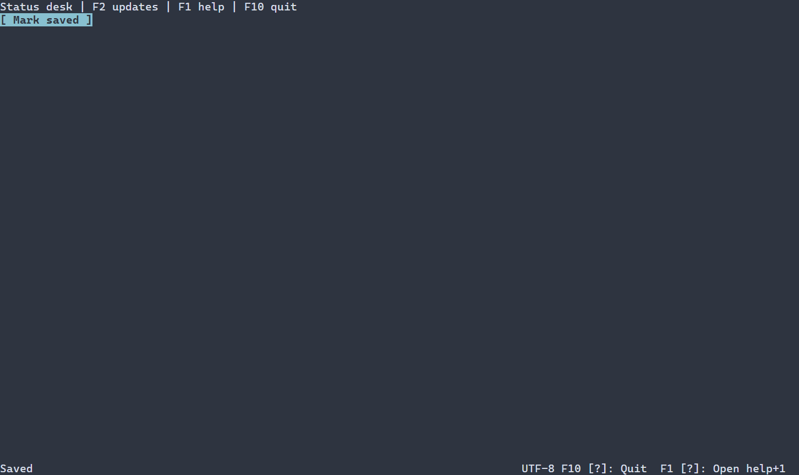

# Строка состояния {#status-bar-guide-ru}

[English version](../status-bar.md) · [Подсказки клавиш](key-help.md) · [Компоновка](layout.md)

`ui::statusBar` размещает обычные секции состояния в горизонтальной строке. Она заполняет выделенную область и объединяет надписи, разделители и интерактивные элементы; таймера уведомлений у неё нет. Для временного сообщения используйте toast.

## Полное приложение

Более общий пример объединяет надпись статуса, подсказки клавиш и панель помощи. F2 меняет Ready на Saved, F1 открывает помощь, Escape закрывает её, F10 завершает программу. Стандартный запуск сообщает об ошибках и восстанавливает терминал.



\include status_bar/main.cpp

Соберите `portals_status_bar_example` с `PORTALS_BUILD_EXAMPLES=ON` и запустите в терминале. См. [сборку](getting-started.md) и [пакет](package.md).

## Компоновка, ссылки и ресурсы

`ui::statusBar({.gap = 1}, children...)` использует `LinearOptions`: gap и padding по умолчанию равны нулю, главное выравнивание — START, поперечное — STRETCH, переполнение — CLIP. `SizePolicy` по умолчанию занимает доступную ширину и запрашивает одну фиксированную строку. Spacer отодвигает следующие секции; при нехватке места более поздние сжимаемые элементы первыми уступают его до своих минимумов, остаток обрезается. Положение задаёт родитель; строка сама не закрепляется у края.

`ui::Ref<StatusBar>` наблюдает контейнер для геометрии, видимости и удаления; свойства текста и таймера у него нет. Для изменения текста передайте дочерней надписи `ui::Ref<Label>`, как в примере. Сцена владеет строкой и дочерними элементами. Строка не получает фокус и не имеет собственного действия клавиатуры или мыши; интерактивные дети сохраняют свои действия. `ui::keyHints(help)` отражает привязанный `HelpView`; см. [подсказки клавиш](key-help.md).

Оба формата ресурсов поддерживают строку с дочерними элементами, базовые размеры/flex и gap, например `StatusBar#footer { gap=1 Label#status { text="Ready" } Spacer{} }`. Дочерний элемент доступен через `scene.get<Label>("status")`, строка — через `scene.get<StatusBar>("footer")`. Для min/max, padding и выравнивания используйте формат конфигурации. Старый формат с defaults или definitions в `ControlContext` может отклонить литералы min/max с `DUPLICATE_PROPERTY`; используйте формат конфигурации. См. [подробности ресурсов](controls.md#status-bar-control-ru).

## Настройка оформления {#status-bar-styling-reference-ru}

Естественный селектор — `StatusBar`. Вся выделенная область рисуется стилем normal или disabled; disabled используется при недоступности. Focused, selected, header и caret не рисуются. Дочерние надписи и кнопки определяют собственные стили; цвет строки автоматически не задаёт цвет их текста. Ручной `ControlStyle` задаёт начальные normal и disabled; отдельных свойств символов строки нет.

| Свойство | Значения и действие |
|---|---|
| `foreground`, `background` | `#RRGGBB`; цвет текста и заливки |
| `bold`, `italic`, `underline` | `true` или `false`; явное false переопределяет нижний слой |
| `width`, `height` | Неотрицательное число ячеек, `auto`, `fit-content`, `flex(положительный вес)` в runtime PSS |
| `min-width`, `max-width`, `min-height`, `max-height` | Неотрицательные границы в ячейках; в compile-time PSS поддерживается только `min-width` |

Правила размера не зависят от состояния или `:read-only`; конфликт ограничений отклоняет обновление, сохраняя последние корректные стиль и геометрию. См. [компоновку](layout.md). Ручной `ControlStyle` использует цвета терминала, обычный текст, жирный шрифт при фокусе и курсив для недоступного элемента. Тема и PSS переопределяют отдельные поля; остальные сохраняют значения нижнего слоя. См. [каскад](styling-guide.md).

```pss
StatusBar { background: #182028; height: 1; }
StatusBar:disabled { background: #303030; }
Label.status { foreground: #dce1e8; }
```

Для последнего правила назначьте нужной надписи `.classes("status")`. См. `portals::StatusBar`, `LinearOptions`, `ui::statusBar` и [общие стили](controls.md#basic-controls-styling-reference-ru).
