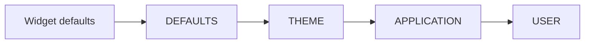

# Слои стилей {#style_layers-ru}

[English original](../style-layers.md)

Слои сохраняют установленные прикладные и пользовательские декларации при замене
темы или изменении её живых параметров. Они включают режим существующего retained
[движка стилей (EN)](../styles.md), а не вводят другой механизм разрешения или runtime.

## Установите независимые переопределения

Создайте владеющие значениями `StyleSheet` с типизированными правилами, через
`parsePss` или [константные описания](compile-time-styles.md). Затем используйте фасад:

```cpp
scene.styleLayers()
     .styleLayer(StyleTier::APPLICATION, "application", applicationStyles)
     .styleLayer(StyleTier::USER, "contrast", userStyles);
```

Эквивалентные стадии:

```cpp
auto styled = std::move(scene)
  | ui::styleLayers()
  | ui::styleLayer(StyleTier::APPLICATION, "application", applicationStyles)
  | ui::styleLayer(StyleTier::USER, "contrast", userStyles);
```

Фрагменты предполагают существующую бездействующую сцену и владеющие таблицы.
Существующие стадии настройки потребляют фасад; переместите его до того, как
callback заимствует его адрес. Для владельца, который уже остаётся на месте,
используйте методы. До подготовки стадии сохраняют настройку в порядке регистрации.
После подготовки они используют существующую границу управляемых изменений.
Отказы поступают в сборщик сцены и наблюдаются через `checked`, типизированный
`run` или политику отчётности `runApp`. Сцена владеет установленными слоями;
клиенту не нужны токены только для сохранения их установки. Конструирование
аргументов и стадий может бросить исключение до проверяемого входа.

Настройка слоёв явная: вызовите `styleLayers` перед `styleLayer`. Повторение
тех же параметров ничего не меняет; смена бюджетов повторным включением режима
отклоняется. Этот API принимает владеющие таблицы, а не новую строковую грамматику.
Runtime PSS доступен через `parsePss`; compile-time PSS-литералы уже
[доступны](compile-time-pss.md). Для этого API материализуйте таблицу стилей
либо используйте отдельный frontend источников `ui::style`.

## Разрешение каждого свойства



Для каждого объявленного свойства более высокий уровень побеждает до сравнения
специфичности селектора. В пределах уровня учитываются специфичность, стабильный
порядок установки слоёв, затем порядок правил в источнике. Замена слоя сохраняет
позицию; удаление с последующим добавлением создаёт новую идентичность и позицию.
Отсутствующее свойство сохраняет значение с нижнего уровня; явное `false`
переопределяет `true`. Поэтому менее специфичное правило USER может победить
более специфичное THEME. Простое объединение таблиц не обеспечило бы этот
приоритет для всех сочетаний селекторов.

`DEFAULTS` и `THEME` — постоянные базовые слоты, входящие в число слоёв.
Умолчания виджетов остаются ниже них. `ManagedScene::styleDefaults` заменяет
слот defaults; `theme` заменяет только слот темы. Удаление прикладного или
пользовательского слоя не удаляет контролы. Одинаковые имена в пределах уровня
отклоняются при добавлении слоя через этот API. Это отличается от именованной
установки источника `ui::style(..., {.name = ...})`, которая явно добавляет
или заменяет слой по паре «уровень/имя»; см. [гайд по стилям](styling-guide.md).

## Явная замена и удаление слоёв

Если потребуется последующая замена или удаление, получите `StyleLayerHandle`
через `ManagedScene::addLayer`. `replaceLayer`, `removeLayer` и `updateLayers`
возвращают типизированные ошибки и фактическую инвалидацию. Пакет атомарно
заменяет/удаляет существующие handles; добавление нескольких новых слоёв в том
же пакете не поддерживается. Дублирующиеся handles отклоняют весь пакет.
Заимствованные входные данные копируются при успехе.

Handles наблюдают время жизни и идентичность движка; они не удерживают контролы
или сцену живыми. Уничтожение handle не удаляет слой. Операции разрешены только
в UI-потоке. Чужой, удалённый или устаревший handle даёт `StyleError` с
`INVALID_ARGUMENT`; закрытая сцена — `CLOSED`, чужой поток — `WRONG_THREAD`.

## Владение темой и совместимость

`style::ct::live` получает полномочия управления слотом темы. Прикладные и
пользовательские переопределения остаются независимыми от живого дескриптора
и его скалярных параметров. Успешная замена `theme` или подключение другой
живой темы отзывает прежний контроллер. Его `get`, `set` и `apply`, включая
обновления равными значениями, возвращают типизированную ошибку устаревшего
контроллера вместо молчаливого восстановления старой темы. Неудачная смена
владельца оставляет прежний контроллер пригодным к использованию.

Включение слоёв отзывает контроллеры, подключённые в прежнем режиме.
Подключите новый контроллер после включения. До включения сохраняется
существующее поведение с одной таблицей. Низкоуровневые `StyleEngine::replace`
и `replacePss` по-прежнему заменяют таблицу целиком: успех выключает режим
слоёв и делает их идентичности недействительными; отказ не меняет ни режим,
ни идентичности.

## Транзакции и ограничения

Ожидающие регистрации стилей и слоистое обновление используют одну подготовленную
транзакцию. Defaults hooks выполняются под существующим заимствованием дерева;
цели проверяются повторно до одной инвалидации и публикации. Ошибка сохраняет
зафиксированные правила, метаданные, вычисленные значения, ревизии и полномочия
управления темой. Равные обновления слоёв без ожидающих метаданных или передачи
владения ничего не выделяют и не запрашивают перерисовку. Ожидающие метаданные
могут изменить фактические стили; явный вызов `theme` также передаёт владение,
в том числе при равных правилах.
Неравное обновление, результат которого перекрыт, может пересчитать стили,
но не даёт фактической инвалидации. Видимые изменения оформления запрашивают
PAINT; изменение минимальной ширины — LAYOUT. Таймер или постоянная перерисовка
не устанавливаются.

Владеющая подготовка стилей отклоняет вложенные изменения стилей с `WOULD_BLOCK`,
включая повторный вход из аллокатора во время копирования. Управляемые операции
метаданных/жизненного цикла также защищены при сборе ожидающих регистраций.
Заимствованные входы, принадлежащие вызывающему, должны оставаться стабильными
до конца операции. Необёрнутый `StyleEngine` должен пережить свои активные
операции; уничтожать его из собственного defaults hook нельзя.
Последовательная замена темы в прежнем режиме не меняется.

Совокупные бюджеты по умолчанию: 16 слоёв, 1024 правила, 6144 декларации
и 1 MiB логически учитываемых владеющих данных. Базовые слоты входят в эти лимиты.
Учёт данных включает записи слоёв/правил, строковые слоты классов селектора,
имена и байты строк с завершающими символами. Проверяемая предварительная оценка
бюджета предшествует глубокому копированию; отклонённое обновление ничего не меняет.
Нулевые бюджеты или меньше двух слотов слоёв недопустимы.

Байтовый бюджет — переносимый логический учёт, а не предел общей памяти аллокатора.
Накладные расходы аллокатора, ёмкости vector/string, привязки и вычисленные стили
учитываются дополнительно. Атомарная подготовка может одновременно держать
резидентные и кандидатные данные — до удвоенного логического бюджета, плюс
скопированные привязки и вычисленные значения. Первая реализация разрешает
один объединённый диапазон правил за O(bindings × total rules), а не каждый
слой отдельно. Эта запись считает сопоставление селектора ограниченным:
сопоставление классов также просматривает список классов цели и сравнивает
строки, поэтому неограниченные размеры классов/строк дают дополнительные затраты.
Состояния оформления и рисуемые свойства — фиксированные множества.

## Полные программы для установленного пакета

Обе программы переключают тему, подключают живые параметры, меняют ширину,
сохраняют прикладные/пользовательские переопределения, меняют размер и очищают
ту же replay-сцену. Через `--failure` они также проверяют недопустимую ширину
с одинаковым поведением типизированной ошибки. В этом сценарии настройка
завершается отказом до получения терминала во владение.

- До: `tests/package_consumer/style_layers_before.cpp`.
- После: `tests/package_consumer/style_layers.cpp`.
- Общая сцена, ошибки и очистка: `tests/package_consumer/style_layers_support.hpp`.
- Общая диагностика: `tests/package_consumer/static_styles_support.hpp`.
- Общий replay-терминал: `examples/replay/terminal.hpp`.

### До

\include{lineno} style_layers_before.cpp

### После

\include{lineno} style_layers.cpp

### Общая настройка и очистка

\include{lineno} style_layers_support.hpp

Специализированный benchmark (`tools/benchmarks/style_layers.cpp`) различает
равные, перекрытые и видимые обновления, а также материализованные видимые,
скрытые и находящиеся за экраном контролы. Его вывод содержит фактические
числа defaults/paint и байты разницы терминала в памяти. Он не измеряет
использование аллокатора или пропускную способность аппаратного терминала;
контролы за экраном в этой нагрузке не виртуализованы.

## Темы и плановый источник PSS

Принятое направление — загружать темы средствами стилей в существующий `THEME`,
сохраняя слои `APPLICATION`/`USER`. Канонический PSS-источник и генерация встроенных
ресурсов — **TBD — M5/U65**, расширенные параметры/выражения — **TBD — M5/U65/U128**.
Это не новый resolver и не накопление необратимых патчей computed style.
Действующий `ui::style(ui::file(...))` по умолчанию устанавливает `APPLICATION`,
а не реализует будущую операцию загрузки темы. [Подробности](themes-guide.md).
