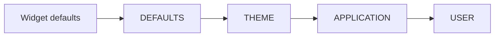

# Слои стилей {#style_layers-ru}

[Английская версия](../style-layers.md)

[Слой стилей](glossary.md) хранит отдельную таблицу правил. Слои сохраняют установленные прикладные и пользовательские декларации при замене
темы или изменении её живых параметров. Приоритеты слоёв разрешает существующий
[движок стилей](styles.md).

## Независимые переопределения

Таблицы `StyleSheet` с собственным хранением данных можно создать из
типизированных правил, через `parsePss` или [константные описания](compile-time-styles.md).
Фасад устанавливает их следующим образом:

```cpp
scene.styleLayers()
     .styleLayer(StyleTier::APPLICATION, "application", applicationStyles)
     .styleLayer(StyleTier::USER, "contrast", userStyles);
```

Эквивалентные стадии:

```cpp
auto styled = std::move(scene)
  | ui::styleLayers()
  | ui::styleLayer(StyleTier::APPLICATION, "application", applicationStyles)
  | ui::styleLayer(StyleTier::USER, "contrast", userStyles);
```

Фрагменты предполагают существующую сцену вне выполнения и подготовленные таблицы стилей.
При применении к именованной сцене стадии возвращают `ui::Scene&` и оставляют объект на месте.
В показанном примере `std::move(scene)` передаёт фасад в `styled`; эту передачу
необходимо завершить до регистрации обработчика, который захватывает адрес сцены. Методы и оператор `|`
доступны для настройки именованной сцены. До подготовки стадии сохраняют настройку в порядке регистрации.
После подготовки они используют существующую границу управляемых изменений.
Отказы поступают в сборщик сцены и наблюдаются через `checked`, типизированный
`run` или политику отчётности `runApp`. Сцена владеет установленными слоями;
клиенту не нужны токены только для сохранения их установки. Конструирование
аргументов и стадий может бросить исключение до проверяемого входа.

Настройка слоёв явная: `styleLayers` должен предшествовать `styleLayer`. Повторение
тех же параметров ничего не меняет; смена бюджетов повторным включением режима
отклоняется. Этот API принимает таблицы стилей, которые хранят свои данные.
PSS времени выполнения доступен через `parsePss`; PSS-литералы времени компиляции уже
[доступны](compile-time-pss.md). Для этого API требуется материализованная
таблица стилей. Источники стилей также доступны через `ui::style`.

## Как разрешается каждое свойство



Для каждого объявленного свойства более высокий уровень побеждает до сравнения
специфичности селектора. В пределах уровня учитываются специфичность, стабильный
порядок установки слоёв, затем порядок правил в источнике. Замена слоя сохраняет
позицию; удаление с последующим добавлением создаёт новую идентичность и позицию.
Отсутствующее свойство сохраняет значение с нижнего уровня; явное `false`
переопределяет `true`. Поэтому менее специфичное правило USER может победить
более специфичное THEME. Простое объединение таблиц не обеспечило бы этот
приоритет для всех сочетаний селекторов.

`DEFAULTS` и `THEME` — постоянные базовые слоты, входящие в число слоёв.
Умолчания виджетов остаются ниже них. `ManagedScene::styleDefaults` заменяет
слот defaults; `theme` заменяет только слот темы. Удаление прикладного или
пользовательского слоя не удаляет контролы. Одинаковые имена в пределах уровня
отклоняются при добавлении слоя через этот API. Это отличается от именованной
установки источника `ui::style(..., {.name = ...})`, которая явно добавляет
или заменяет слой по паре «уровень/имя»; подробности — в
[руководстве по стилям](styling-guide.md).

## Замена и удаление слоёв

Для последующей замены или удаления `ManagedScene::addLayer` возвращает
`StyleLayerHandle`. `replaceLayer`, `removeLayer` и `updateLayers`
возвращают типизированные ошибки и фактическую инвалидацию. Пакет атомарно
заменяет/удаляет существующие дескрипторы; добавление нескольких новых слоёв в том
же пакете не поддерживается. Дублирующиеся дескрипторы отклоняют весь пакет.
Заимствованные входные данные копируются при успехе.

Дескрипторы `StyleLayerHandle` наблюдают за временем жизни и идентичностью движка; они не удерживают контролы
или сцену живыми. Уничтожение дескриптора не удаляет слой. Операции разрешены только
в UI-потоке. Чужой, удалённый или устаревший дескриптор даёт `StyleError` с
`INVALID_ARGUMENT`; закрытая сцена — `CLOSED`, чужой поток — `WRONG_THREAD`.

## Владение темой и совместимость

`style::ct::live` получает полномочия управления слотом темы. Прикладные и
пользовательские переопределения остаются независимыми от живого дескриптора
и его скалярных параметров. Успешная замена `theme` или подключение другой
живой темы отзывает прежний контроллер. Его `get`, `set` и `apply`, включая
обновления равными значениями, возвращают типизированную ошибку устаревшего
контроллера вместо молчаливого восстановления старой темы. Неудачная смена
владельца оставляет прежний контроллер пригодным к использованию.

Включение слоёв отзывает контроллеры, подключённые в прежнем режиме.
Новый контроллер требуется подключить после включения. До включения сохраняется
существующее поведение с одной таблицей. Низкоуровневые `StyleEngine::replace`
и `replacePss` по-прежнему заменяют таблицу целиком: успех выключает режим
слоёв и делает их идентичности недействительными; отказ не меняет ни режим,
ни идентичности.

## Транзакции и ограничения

Ожидающие регистрации стилей и слоистое обновление используют одну подготовленную
транзакцию. Обработчики значений по умолчанию выполняются под существующим заимствованием дерева;
цели проверяются повторно до одной инвалидации и публикации. Ошибка сохраняет
зафиксированные правила, метаданные, вычисленные значения, ревизии и полномочия
управления темой. Равные обновления слоёв без ожидающих метаданных или передачи
владения ничего не выделяют и не запрашивают перерисовку. Ожидающие метаданные
могут изменить фактические стили; явный вызов `theme` также передаёт владение,
в том числе при равных правилах.
Неравное обновление, результат которого перекрыт, может пересчитать стили,
но не даёт фактической инвалидации. Видимые изменения оформления запрашивают
PAINT; изменение минимальной ширины — LAYOUT. Таймер или постоянная перерисовка
не устанавливаются.

Владеющая подготовка стилей отклоняет вложенные изменения стилей с `WOULD_BLOCK`,
включая повторный вход из аллокатора во время копирования. Управляемые операции
метаданных/жизненного цикла также защищены при сборе ожидающих регистраций.
Заимствованные входы, принадлежащие вызывающему, должны оставаться стабильными
до конца операции. Необёрнутый `StyleEngine` должен пережить свои активные
операции; уничтожать его из собственного обработчика значений по умолчанию нельзя.
Последовательная замена темы в прежнем режиме не меняется.

Совокупные бюджеты по умолчанию: 16 слоёв, 1024 правила, 6144 декларации
и 1 MiB логически учитываемых владеющих данных. Базовые слоты входят в эти лимиты.
Учёт данных включает записи слоёв/правил, строковые слоты классов селектора,
имена и байты строк с завершающими символами. Проверяемая предварительная оценка
бюджета предшествует глубокому копированию; отклонённое обновление ничего не меняет.
Нулевые бюджеты или меньше двух слотов слоёв недопустимы.

Байтовый бюджет учитывает логический объём данных. Общий расход памяти аллокатора
может превышать этот бюджет.
Накладные расходы аллокатора, ёмкости vector/string, привязки и вычисленные стили
учитываются дополнительно. Атомарная подготовка может одновременно держать
резидентные и кандидатные данные — до удвоенного логического бюджета, плюс
скопированные привязки и вычисленные значения. Первая реализация разрешает
один объединённый диапазон правил за O(число привязок × общее число правил). Эта запись считает сопоставление селектора ограниченным:
сопоставление классов также просматривает список классов цели и сравнивает
строки, поэтому неограниченные размеры классов/строк дают дополнительные затраты.
Состояния оформления и рисуемые свойства — фиксированные множества.

## Примеры

[Гайд по стилям](styling-guide.md) показывает независимые именованные слои
и замену одной группы правил. [Гайд по темам](themes-guide.md) показывает
сохранение прикладных и пользовательских переопределений.

## Темы и плановый источник PSS

Принятое направление — загружать темы средствами стилей в существующий `THEME`,
сохраняя слои `APPLICATION`/`USER`. Канонический PSS-источник и генерация встроенных
ресурсов — **TBD — M5**, расширенные параметры/выражения — **TBD — M5**.
Тема заменяет таблицу правил в `THEME`; правила приложения и пользователя сохраняются.
Действующий `ui::style(ui::file(...))` по умолчанию устанавливает `APPLICATION`.
Загрузка файла непосредственно как темы пока запланирована. [Подробности](themes-guide.md).

<details>
<summary>Лимиты слоёв стилей</summary>

`StyleLayerOptions` передаётся при первом включении слоёв. По умолчанию
доступны 16 слоёв, 1024 правила, 6144 декларации и 1 MiB логически учитываемых
данных. Два постоянных базовых слоя входят в лимит слоёв.
Требуется не меньше двух слотов слоёв; остальные лимиты должны быть больше нуля.

Пример удваивает значения по умолчанию. `maxOwnedBytes` учитывает логический
объём данных установленных слоёв, а не всю память приложения.
Изменение лимитов повторным вызовом `styleLayers` отклоняется.

```cpp
#include <portals/ui_style.hpp>

int main() {
  using namespace portals;

  StyleLayerOptions layers;
  layers.maxLayers = 32;
  layers.maxRules = 2048;
  layers.maxDeclarations = 12288;
  layers.maxOwnedBytes = 2 * 1024 * 1024;

  auto scene = ui::scene(ui::label("F10: quit"));

  return scene
    | ui::styleLayers(layers)
    | ui::onKey("F10", ui::quit)
    | ui::runApp();
}
```

</details>
