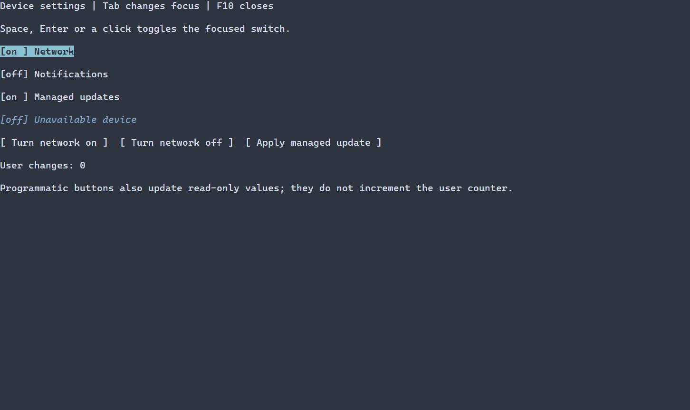

# Булевы переключатели {#switch-guide-ru}

[English version](../switch.md) · [Контролы](controls.md) · [Ресурсы сцены](scene-loading-guide.md)

Переключатель подходит для немедленного изменения булевой настройки; неопределённого состояния у него нет. См. [настройки и фабрики Switch](../../include/portals/ui_switch.hpp) и [API контрола](../../include/portals/switch.hpp). На изображении показана полная форма настроек устройства.

`ui::toggle` показывает и изменяет булево значение. Публичный класс называется
`Switch`; имя фабрики не пересекается с ключевым словом C++ `switch`.



[Статичный кадр](../images/switch.png). Клавиатурное демо показывает read-only переключатель и программные изменения без увеличения счётчика пользовательских действий.

## Полная программа

[Собираемый пример](../examples/guide_switch.cpp) связывает scene-owned bool,
наблюдает пользовательские изменения и включает переключатель обычной кнопкой:

\include guide_switch.cpp

Соберите `portals_docs_switch` с `PORTALS_BUILD_TESTS=ON`, либо
`portals_switch_example` с `PORTALS_BUILD_EXAMPLES=ON` для полного
[приложения настроек устройства](../../examples/switch/main.cpp). Запускайте EXE
в терминале. Tab меняет фокус, Space/Enter или нажатие левой кнопки переключает
значение, F10 закрывает пример. `ui::runApp()` восстанавливает терминал при выходе.

`ui::toggle("Network")` начинает с false; второй аргумент true задаёт начальное
включённое состояние. `ui::toggle(ref, "Network", owner.state(true))` принимает
проверяемый результат создания модели без ручной цепочки извлечений. Переданный
`ManagedState<bool>` остаётся авторитетным; mount не перезаписывает его.
Switch не принимает трёхсостоянийную модель и значение MIXED.

## Наблюдение и запись

`ref.checked()` создаёт наблюдающий `CheckedProperty`. Он удерживает исходный
слот ссылки: сохранённый до mount proxy увидит последующую публикацию. Proxy
не владеет сценой или виджетом. `.get()` возвращает `expected<bool, ManagedError>`;
неявного преобразования property в bool нет.

В обычном обработчике используйте `ref.checked() = true`. Присваивание возвращает
наблюдающий proxy с точной квитанцией `PropertyUpdate<bool>` через `.result()` и автоматически собирает ошибки как
`switch.checked`, даже если void-обработчик игнорирует результат. Диагностика
сохраняет место вызова `checked()`. Для явного места вызова и checked-квитанции
есть `.set(value, origin)`. Чтение само не сообщает ошибок. Присваивание другого checked property копирует
его bool один раз и сохраняет обе наблюдающие идентичности. Ошибка источника
не меняет получателя и сообщается один раз; self-assignment равного bool — no-op. Низкоуровневые
`ManagedScene::setChecked` и `CheckBoxBinding::set` только возвращают checked
результат; обработка отказа остаётся вызывающему коду.

Программная запись и равное значение не вызывают `ui::onChange`. Равная запись
не создаёт новой публикации или перерисовки. Изменённая модель синхронизируется
в presentation обычной подготовкой сцены перед следующим кадром.
`ui::onChange(ref, [](bool value) { ... })` получает только успешные изменившие
значение пользовательские операции. Receipt-обработчик видит исходный snapshot
commit, включая rejected/cancelled notifications; реентерабельная новая запись
не подменяет эту квитанцию. Удаление узла прекращает остальные обработчики.
Callback не может отменить уже выполненный commit.

[Полный пример](../../examples/switch/main.cpp) отдельно считает пользовательские
переключения. Кнопки присваивают property и не увеличивают этот счётчик.

## Ввод, readOnly и оформление

Переключатель занимает одну Tab-остановку. Только немодифицированные activation,
Space и left press меняют значение. Drag-анимации и radio-навигации нет.
Disabled/hidden узлы и их потомки используют общую eligibility маршрутизатора.
`.settings({.readOnly=true})` сохраняет фокус, но блокирует пользовательскую
запись; property/model writes доступны. В полном примере кнопка программно
меняет read-only переключатель; отдельно показан недоступный элемент.

Обычный ASCII chrome — `[off] ` и `[on ] `, оба шириной шесть клеток. Естественная
высота — одна строка, ширина — ширина подписи плюс chrome. Используйте обычные
fitWidth, fixed/min/max размеры и layout settings. Цвета normal/focused/disabled
приходят из ControlStyle и текущей темы; состояние читается без цвета.
Естественные selectors: Switch, CheckBox и Control, плюс обычные ID/classes.

Для другого chrome передайте per-switch `ui::SwitchOptions` с владеющими
строками offText/onText. Они должны быть однострочными, валидными и одинаковой
клеточной ширины при WidthPolicy принимающей сцены. Неверная пара отклоняется
до публикации. Настройки Switch не хранятся в посторонних контролах. Native
custom constructor принимает проверенный `SwitchChrome::from`; несовпадение
политики подписи/chrome возвращает INVALID_GEOMETRY при измерении.

Обычные строки и TextValue — владеющий cold ingress. Для i18n есть resolver
в SwitchOptions; ключ разрешается при mount с действительной WidthPolicy сцены.
Paint использует только синхронизированные владеющие text/decorations/style,
не вызывает модель, formatter или resolver. Borrowed paint text нужно
растрировать внутри того же tree.frame. Действуют прежние text/grapheme/layout
лимиты, дополнительных произвольных ограничений нет.

## Загружаемая сцена

[Полная resource-программа](../examples/guide_switch_resource.cpp) загружает
`Switch#network { checked=true text="Network" }`, получает
`scene.get<Switch>("network")` и подключает те же property/button/onChange пути.
Цель сборки: portals_docs_switch_resource.

\include guide_switch_resource.cpp

checked — существующий булев alias к state=CHECKED/UNCHECKED. readOnly, подпись,
размеры, visibility/enabled, ID/classes идут через общий resource pipeline.
MIXED и THREE_STATE отклоняются. Named registry factory с внешней bool моделью
не принимает явный initial checked/state override, даже равный текущему;
отсутствующее свойство сохраняет авторитетную модель. В configuration defaults используются канонические state=CHECKED/UNCHECKED;
checked — сокращение атрибута узла Switch. То же правило применяется
к initial из ControlContext defaults: конфигурация не заменяет code model молча.

Ошибки потока, закрытого owner, stale/unpublished Ref, несовместимой модели,
active-frame mutation и allocation/callback сохраняют typed причины и provenance.
Низкоуровневый enum CheckState binding целиком отвергает Switch: его модель bool.


## Настройка оформления {#switch-styling-reference-ru}

Естественный селектор — `Switch`. Подпись и обозначение on/off используют общий стиль normal, focused или disabled; disabled имеет приоритет. Checked — значение, а не отдельное рисуемое состояние PSS; selected, header и caret не рисуются. `ui::SwitchOptions::offText` и `onText` имеют тип владеющего `std::string`, по умолчанию `[off] ` и `[on ] `. Они задаются в C++, а не в PSS: обе строки должны быть однострочными и иметь одинаковую ширину в ячейках согласно политике получателя. Недопустимый текст или разная ширина приводят к ошибке создания.

Общие свойства отрисовки действуют на соответствующий рисуемый элемент:

| Свойство | Значение |
| --- | --- |
| `foreground` | цвет текста или символа `#RRGGBB` |
| `background` | цвет заливки `#RRGGBB` |
| `bold` | `true` или `false` |
| `italic` | `true` или `false` |
| `underline` | `true` или `false` |

Ручной `ControlStyle` по умолчанию использует цвета терминала, обычный текст, жирный шрифт при фокусе и курсив для недоступного элемента. Тема и PSS переопределяют отдельные поля; неуказанные поля сохраняют значения нижнего слоя, включая явное `false`. Селектор без состояния задаёт все варианты. См. [каскад и селекторы](styling-guide.md) и [стили](styles.md).

Свойства размеров `width` и `height` принимают неотрицательное число ячеек, `auto`, `fit-content` или `flex(положительный вес)`; `min-width`, `max-width`, `min-height`, `max-height` — неотрицательное число ячеек. Селектор не должен содержать состояние или `:read-only`. Эти свойства, кроме `min-width`, доступны только в runtime PSS. При противоречии ограничениям виджета обновление отклоняется с сохранением прежних стиля и геометрии. Ограничения и приоритеты описаны в [компоновке](layout.md). Размер влияет на выделенную область, а не на сами символы.

```pss
Switch { foreground: #dce1e8; }
Switch:focused { background: #245070; bold: true; }
```
