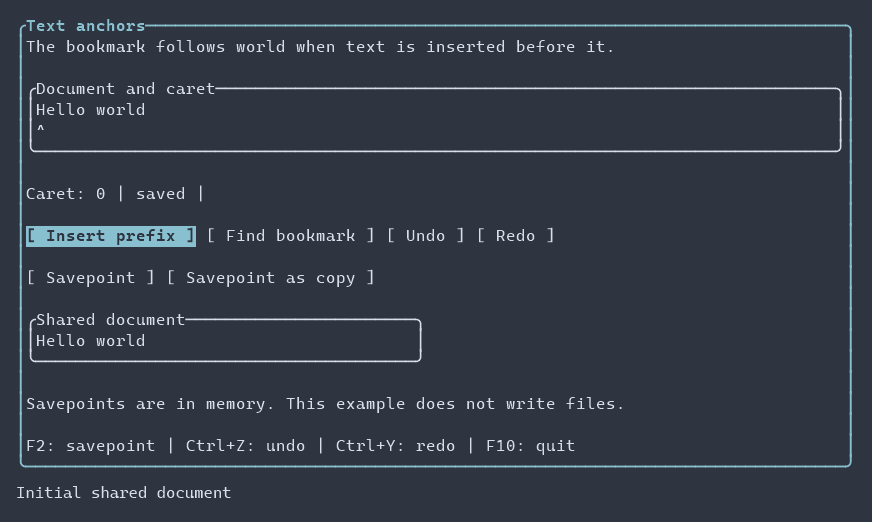

# Позиции текста при правках {#text-anchors-ru}

[English version](../text-anchors.md) · [Закладки модели](model-positions.md) · [Undo и Redo](editor-history.md)

Текстовая закладка хранит позицию в логическом документе. При вставке перед
этой позицией закладка следует за исходным текстом. Выделение и история Undo/Redo
принадлежат документу, поэтому замена представления их не сбрасывает.

## Пример конечного документа

Подключите `<portals/ui_text_document.hpp>`, чтобы объявить конечный документ
в памяти и привязать к нему обычные подписи. Этот необязательный заголовок
подключается отдельно от `ui.hpp`. Пример показывает два представления одного
документа и отметку каретки:

[Полный пример](../examples/guide_text_anchors.cpp):

\include docs/examples/guide_text_anchors.cpp

Соберите приложение с C++23 и `portals::core`, как описано в разделе
[Подключение приложения](package.md). Нажмите **Insert prefix**, затем **Find bookmark**.
Оба представления покажут `Hi, Hello world`; закладка восстановит каретку перед
`world`, теперь по байтовому смещению 10. Undo и Redo восстанавливают текст вместе
с выделением. Для отметки каретки пример использует ASCII: здесь байтовое
смещение совпадает с колонкой на экране.

**Savepoint** и **Savepoint as copy** подтверждают базовое состояние в памяти
с именем `memory:note` или `memory:copy`. Программа не записывает файлы.
Смена назначения сохранения сохраняет логический документ, закладки и историю.
F2 создаёт первую точку сохранения, Ctrl+Z и Ctrl+Y перемещаются по истории,
F10 завершает приложение.

## Ограничения и поток выполнения

По умолчанию UI-фабрика допускает 4096 байт UTF-8 и 4096 графем, используя
существующие ограничения конечного текста. Передайте `FiniteTextDocumentOptions`,
чтобы задать другие конечные пределы. Каждая правка сегментирует допущенный буфер
и использует существующую ограниченную историю снимков. Каждое значение для
UI владеет полным конечным текстом. Эти затраты зависят от размера допущенного
текста; адаптер предназначен для небольших документов и демонстрации сессии.

Копии `ui::FiniteTextDocument` разделяют документ и его источник `source()`,
доступный только для чтения. `ui::label(note)` показывает текст;
`ui::label(note.source(), formatter)` позволяет вывести выделение, признак
изменений или назначение сохранения. Команды вызываются в создавшем документ
UI-потоке. Источник привязывается к одной сцене; замена представлений внутри неё
сохраняет сессию. После закрытия или уничтожения сцены команды возвращают `CLOSED`.
Запись через поле источника представления отклоняется. Используйте команды
документа, чтобы согласованно менять текст и выделение.

Ядро принимает правку до публикации значения для UI. Ошибка выделения памяти
или отклонённое уведомление при публикации могут оставить принятый документ
новее видимого текста. Проверяемый результат команды сообщает об ошибке;
после устранения причины вызовите `refresh()` для повторной публикации.
Откат уже принятой ядром правки не обещается. `lastError()` сохраняет типизированную
причину `TextDocumentError`, если ошибка возникла в операции ядра. Проверяемые
результаты можно возвращать прямо из обработчиков кнопок и клавиш для обработки
в `runApp`.

## Байтовые смещения и границы графем

`portals::FiniteTextDocument` из `<portals/text_document.hpp>` — конечный адаптер,
независимый от UI. Координаты `replace`, `setSelection` и `bookmark` задаются
байтовыми смещениями UTF-8 на границах расширенных графем, включая конец текста.
Это не экранные колонки и не порядковые номера графем. Вызывающий код
сериализует доступ. Заимствованное значение `text()` становится недействительным
при успешной правке текста или уничтожении документа.

`PositionAffinity::FORWARD` оставляет отметку после вставки в её позиции,
`BACKWARD` — перед вставкой. Unicode-правка может объединить графемы и убрать
старую границу. Тогда восстановление выбирает конец или начало текущей графемы
по affinity и возвращает `NEAREST`. Undo, восстановившее известное состояние
содержимого, может вернуть исходную точную границу.

Ядро реализует `PositionResolver`: передайте квалифицированный `PositionRequest`
и проверьте `PositionReply` перед применением. Закладка не предоставляет право
записи. Если нужное доказательство изменений уже не сохранено, возвращается
`UNAVAILABLE`; чужой ресурс или несовместимая история не восстанавливаются молча.

## Подтверждение настоящего сохранения

Для записи вызовите `beginSave(target)` и сохраните байты именно той ревизии,
которую указывает билет, используя собственный снимок или механизм сериализации.
Билет владеет метаданными назначения и данными проверки; он не хранит байты
документа и не выполняет ввод-вывод. Выполняйте запись вне UI-потока и вызывайте
`acknowledgeSave(ticket)` в потоке владельца только после успешного завершения записи.

Подтверждение старого состояния не снимает признак более новых изменений.
Билет старше уже подтверждённого сохранения возвращает `STALE`. SaveAs меняет назначение
и подтверждённую точку сохранения, сохраняя выделение, логическую идентичность
и Undo/Redo. `dirty()` сравнивает текущее состояние содержимого с подтверждённым,
поэтому Undo/Redo могут вернуть документ к сохранённому состоянию.

В ядре `portals::FiniteTextDocument` сообщите о внешней замене через
`observeExternalReplacement()`. Документ
переходит в состояние конфликта и не принимает внешние байты автоматически.
Явный `acceptExternalReplacement(text)` проверяет новую базу, меняет поколение
совместимой истории и очищает несовместимые закладки и Undo/Redo, сохраняя
логическую идентичность.

## Якоря для большого текстового источника

`TextChangeMap` — ограниченный помощник для метаданных провайдера с собственным
хранилищем, историей и поиском границ Unicode. `TextSplice` описывает правку
в скалярных единицах провайдера. Помощник не хранит текст, не выполняет ввод-вывод
и не требует глобального индекса графем. По умолчанию он сохраняет 128 изменений.
Провайдер обязан правдиво сообщать обо всех правках и сериализовать операции карты.

`map(bookmark)` возвращает промежуточный `TextMappedPosition`. Перед возвратом
общего ответа для позиции `TEXT` провайдер должен проверить скалярное смещение
или перенести его на текущую границу графемы. Точное скалярное соответствие само
по себе не доказывает границу Unicode. `traverse` принимает токен состояния
содержимого и размер, подтверждённые существующим механизмом Undo/Redo провайдера;
карта не создаёт второе хранилище истории.

Эта основа не добавляет оконное редактирование текста, запись файлов или
автоматическую привязку LineEdit/TextArea. Такой провайдер может использовать
общий контракт закладок, загружая только данные для проверки нужной границы.
Конечный демонстрационный адаптер не обещает редактирование произвольных объёмов.
