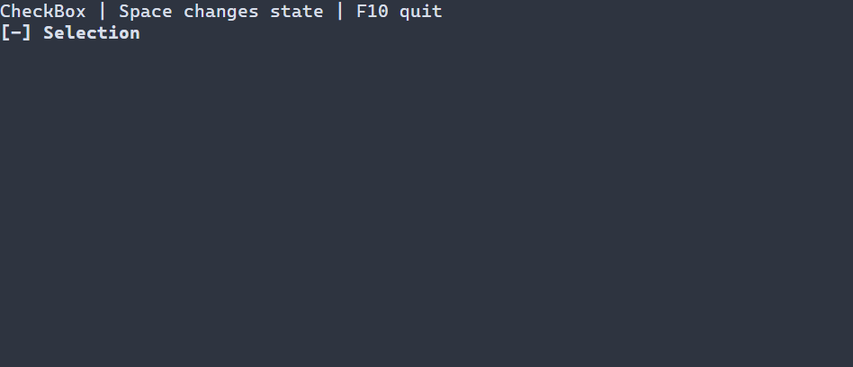

# Выбор с тремя состояниями {#three-state-guide-ru}

[English version](../three-state.md) · [CheckBox](check-box.md) · [RadioGroup](radio-group.md)

`ui::threeState` подходит, когда снятое, установленное и смешанное значения значимы, например для общего выбора. Для булева значения используйте [CheckBox](check-box.md), для взаимоисключающих вариантов — RadioGroup.

## Полное приложение

Пример начинает со смешанного значения. Space или Enter переключает его; F10 завершает программу, стандартный запуск сообщает об ошибках и восстанавливает терминал.



\include check_state/main.cpp

Соберите `portals_check_state_example` с `PORTALS_BUILD_EXAMPLES=ON` и запустите в терминале. См. [сборку](getting-started.md) и [пакет](package.md).

## Значение, ввод и ресурсы

`ui::threeState("Selection", CheckState::MIXED)` создаёт состояние, принадлежащее сцене. Если начальное значение опущено, используется значение контекста, иначе — снятое; перегрузка с `ManagedState<CheckState>` разделяет модель сцены. Фиксированный цикл: `UNCHECKED` → `CHECKED` → `MIXED` → `UNCHECKED`. Активируют немодифицированные Enter, Space и нажатие левой кнопки мыши. Отпускание, движение, вставка и жесты с модификаторами игнорируются; скрытый или недоступный предок блокирует активацию. Отдельного режима read-only нет.

`ui::Ref<ThreeState>` наблюдает смонтированный элемент. Типизированные обработчики изменения и `ui::onChange` получают успешные изменения пользователя; внешняя запись модели не вызывает бизнес-обработчик. Отклонение уведомлений не отменяет сохранённое значение. Сцена владеет виджетом и привязкой, Ref только наблюдает. Альтернатива `ui::checkbox(...).threeState()` сохраняет естественный тип `CheckBox`; пример приведён на странице [CheckBox](check-box.md). Результаты и агрегирование описаны в [привязке трёх состояний](controls.md#check-box-with-three-states-ru).

Ресурсы регистрируют `ThreeState`; именованный элемент доступен через `scene.get<ThreeState>(...)`. Синтаксис и типизированный поиск описаны в [ресурсах сцен](scene-loading-guide.md).

## Настройка оформления {#three-state-styling-reference-ru}

Естественный тип — `ThreeState`, базовый тип — `CheckBox`, поэтому подходят оба селектора. Подпись и фиксированные маркеры `[ ] `, `[x] `, `[-] ` используют общий стиль normal/focused/disabled; disabled имеет приоритет. Checked и mixed — значения, а не состояние отрисовки `:selected`. Header и caret не рисуются; PSS не заменяет строки маркеров и не задаёт им отдельный цвет.

| Свойство | Значения и действие |
|---|---|
| `foreground`, `background` | `#RRGGBB`; цвет текста и заливки |
| `bold`, `italic`, `underline` | `true` или `false`; явное false переопределяет нижний слой |
| `width`, `height` | Неотрицательное число ячеек, `auto`, `fit-content`, `flex(положительный вес)` в runtime PSS |
| `min-width`, `max-width`, `min-height`, `max-height` | Неотрицательные границы в ячейках; в compile-time PSS поддерживается только `min-width` |

Правила размера не зависят от состояния или `:read-only`; конфликт ограничений отклоняет обновление, сохраняя последние корректные стиль и геометрию. См. [компоновку](layout.md). Ручной `ControlStyle` использует цвета терминала, обычный текст, жирный шрифт при фокусе и курсив для недоступного элемента. Тема и PSS переопределяют отдельные поля; остальные сохраняют значения нижнего слоя. См. [каскад](styling-guide.md).

```pss
ThreeState { min-width: 12; }
ThreeState:focused { foreground: #ffffff; background: #245070; }
ThreeState:disabled { italic: true; }
```

См. `portals::ThreeState`, `CheckState`, `ui::threeState` и [общие стили](controls.md#basic-controls-styling-reference-ru).
