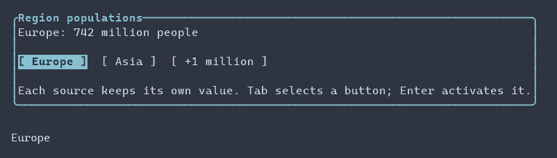
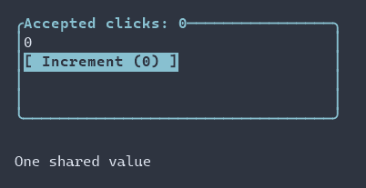

# Привязать значения модели к подписям {#value-models-ru}

[English version](../value-models.md) · [Вьюхи коллекций](view-models.md) · [Привязки и события](bindings-guide.md)

Модель значения подходит, когда несколько контролов должны показывать или изменять
одно принятое значение: число, bool, enum, строку с владением данными или структуру.
Подписи Label и Button, а также заголовки обычных рамок используют одинаковые
описания моделей, проекции полей и форматируемые выражения. Сцена регистрирует
значения и наблюдение при монтировании принимающих рецептов.

## Выбрать источник и изменить его значение

Полная программа хранит отдельное население Европы и Азии. Кнопки выбирают источник
подписи. **+1 million** увеличивает население показанного региона; после возврата к
прежнему источнику остаётся его принятое значение.

@include docs/examples/guide_value_models.cpp



На анимации F4 меняет активное население, затем выбор с клавиатуры переключает
источники. Это захваченные терминальные ячейки приложения с подписями действий
под рамкой, а не запись конкретного терминального эмулятора.

Проекция `describe` принадлежит привязке Label. Вызов `summary.model(candidate)`
проверяет замену и сохраняет эту проекцию. Описание `selected` меняется только после
успешного допуска: отказ сохраняет и показанный источник, и цель следующей записи.
Отдельного изменяемого названия региона или строкового состояния с готовой подписью нет.

Для сборки используйте [настройку приложения-потребителя](index.md) и библиотеку
`portals::core`. [Полный исходник](../examples/guide_value_models.cpp) доступен отдельно.

## Изменить значение или заменить источник

Фрагменты выполняются в UI-обработчике после успешного монтирования моделей и ссылок
из полной программы:

```cpp
europe.value() = Region{"Europe", 743};
europe.field(&Region::population) += 1;
summary.model(asia);
```

`value()` и `field()` обращаются к принятому значению одной модели. Присваивание полю
копирует последнюю принятую структуру, изменяет нужное поле и публикует результат через
то же корневое свойство, сохраняя остальные поля. Сложение использует обычную семантику
оператора C++ для типа поля; насыщение и проверка арифметического переполнения не добавляются.

Копирование или присваивание описаний `ui::Model<T>` разделяет одно описание. Оно не
копирует и не публикует текущее значение. Описание владеет своей декларацией и начальным
значением; смонтированная ссылка наблюдает свойство, принадлежащее сцене, и не удерживает
сцену в живых. Регистрация и доступ к значению выполняются в создавшем UI-потоке.
Для другой сцены создайте новое описание.

Проверяемые чтение и запись не сообщают об ошибках автоматически:

```cpp
auto snapshot = europe.value().snapshot();
auto update = europe.field(&Region::population).set(744);
auto replacement = summary.setModel(asia);
```

Проверьте результаты перед чтением содержимого. Успешный `PropertyUpdate` сохраняет
принятый снимок корня, признак изменения и результат доставки уведомлений. Отказ
доставки после commit не отменяет принятое значение. Короткие присваивание, `+=` и
`.model(...)` используют существующий сбор ошибок сцены. Неуспешный setup-этап даёт
текущему callback закончиться, затем останавливает последующие setup-этапы и запуск.

## Одно значение и три получателя

Полная программа привязывает Label, подпись Button и заголовок рамки к одному счётчику.
Нажатие кнопки обновляет все три. Заголовок обрезается по текущей ширине рамки и снова
показывает больше текста после увеличения терминала.

@include docs/examples/guide_value_captions.cpp



Форматируемое выражение владеет аргументами и наблюдает явные зависимости от моделей:

```cpp
ui::label(text("Population: {}", europe.field(&Region::population)))
```

Стандартная строка формата проверяется по типу значения поля. Статические строковые
представления и символьные массивы копируются. Временный снимок или ссылка на его поле
не сохраняются. Повторные поля одного корня используют одно наблюдение на принимающее
выражение. Равный результат не меняет подпись и не запрашивает дополнительную перерисовку.
У скрытых получателей нет таймера или постоянного опроса.

Проецируемая подпись `ui::label(summary, europe, &Region::name)` сохраняет проекцию
после допуска совместимого корня через `.model(asia)`. Подпись
`ui::label(summary, text("{}", europe.field(&Region::name)))` получает целый вычисляемый
текстовый источник. Заменяйте его другим `text(...)`. Передача отдельной входной модели
отклоняется, чтобы незаметно не переназначить одну из зависимостей выражения.

Обычный рецепт `.framed("rounded", expression)` создаёт заголовок пассивного `Border`.
Перегрузка со ссылкой на внешнюю рамку поддерживает `outer.setModel(...)` и
`outer.model(...)`. Изменение заголовка сохраняет рисунок рамки, оформление концов,
политику размеров и выделенную геометрию. Недопустимый или слишком большой заголовок
сохраняет прежнее валидное представление. Встроенные рамки `ScrollArea`, `LogView` и
`DocumentView` пока используют статический API заголовка: эти перегрузки с живой
привязкой для них недоступны.

## Локализовать живую строку формата

Передайте владеющий `TextValue` и resolver с существующим протоколом результата.
Resolver может принимать только ключ ресурса либо ключ и значения аргументов.
Вторая форма позволяет явно передать модель языка:

```cpp
auto population = ui::model(742);
auto russian = ui::model(false);
auto resolve = [](std::string_view key, int, bool ru)
  -> std::expected<std::string, TextResourceError> {
  if (key != "population") {
    return std::unexpected(TextResourceError::MISSING_RESOURCE);
  }

  return ru ? "Население: {0}" : "Population: {0}";
};
auto caption = ui::label(text(i18n("population"), resolve, population, russian));
```

Население занимает аргумент формата ноль. Язык — аргумент один и явная зависимость,
хотя переведённая строка его не печатает. Изменение любой модели запускает разрешение
ресурса; неизменный кадр этого не делает. Resolver получает сохранённые снимки аргументов
непосредственно, в том числе при первом монтировании. Он не должен читать ещё не
опубликованные модели или менять состояние UI. Чтение ресурсов должно быть коротким,
из памяти, без блокировки UI-потока.
Выражение сохраняет захваты resolver. Заимствованные им сервисы должны оставаться
доступными до завершения времени жизни смонтированной привязки.

Переведённые строки формата проверяются при выполнении. Отсутствующий resolver при
первом монтировании сохраняет `RESOLVER_REQUIRED` в `ManagedError::resource`; ошибка
поиска ресурса также сохраняет исходную категорию. Поздние ошибки разрешения идут
через существующий канал `TreeError` наблюдателя и сохраняют последнюю валидную подпись.
Этот канал не сохраняет отдельную категорию `TextResourceError`. Ошибки форматирования
тоже сохраняют последнее валидное представление и подчиняются обычной политике ошибок
наблюдателей.

## Следовать принятому источнику общей навигации

Если подпись должна показывать источник, принятый общей группой списка и таблицы,
используйте `navigation.current()`. Адаптер `bySource` сопоставляет ресурс с владеющими
метаданными предметной области:

```cpp
ui::label(region, navigation.current(),
  ui::bySource<City>({{europe, "Europe"}, {asia, "Asia"}}))
```

Так работает [полный пример смены модели](view-models.md#view-models-example-ru).
Отказ допуска группы сохраняет прежний источник и подпись. Успешный допуск публикует
принятый ресурс до наблюдения зависимыми получателями. Отказ доставки после допуска
оставляет принятый источник установленным.

Тип метаданных по умолчанию — `std::string`. Вариант `ui::bySource<City, Region>(...)`
возвращает владеющую структуру; поддерживаются и другие копируемые владеющие типы.
Каталог копирует метаданные и описания, не регистрирует невыбранные cold-модели
и не приобретает дополнительные диапазоны строк или снимки. Захваченные описания моделей
сохраняют обычное владение начальным значением и провайдером. Поиск проходит по записям каталога, а не
строкам модели. `CollectionLimits::maxRows` ограничивает число записей; по умолчанию
это 4096. Неизвестный ресурс, неоднозначное соответствие, недопустимое описание,
закрытый источник, чужой поток или разные зарегистрированные сцены дают typed-ошибку.
Адаптер не угадывает метаданные другого источника.

## Возможности данных и стоимость

`ui::model("text")` и `ui::model(std::string(...))` объявляют скалярную строку.
`ui::model(std::array{...})` объявляет существующую ограниченную последовательность
с владением данными. Неизменяемый `ModelSnapshot<T>` остаётся провайдером с собственным
доступом к диапазонам. Произвольные input- и бесконечные ranges не материализуются
неявно. Заимствованный `string_view` явно преобразуйте во владеющую строку перед
сохранением в модели значения.

Запись целого значения и поля использует контракт владеющего `Property<T>`:
копирование, сравнение, проекция и форматирование должны быть ограниченными, чистыми
и не входить повторно в UI. Большие данные передавайте через
[провайдеры и оконные источники](model.md), с работой вне UI-потока. Модель значения
не превращает большой файл в копируемый скаляр и источник неизвестной длины —
в конечную последовательность. Закладки дерева используют общий протокол позиций;
эти привязки не добавляют `TreeView` и не выравнивают иерархию в плоский список.

Привязки дают принятые владеющие значения и проекции только для чтения. У внешней
условной записи, редактируемой формы текущей записи и истории черновиков отдельные
контракты. Существующие `ManagedState<T>` и `ManagedSource<T>` оборачиваются через
`ui::model(state)` и `ui::model(source)`. Read-only обёртка сохраняет исходные проверки
доступности, потока и времени жизни и отклоняет запись: обёртка не даёт права записи.
