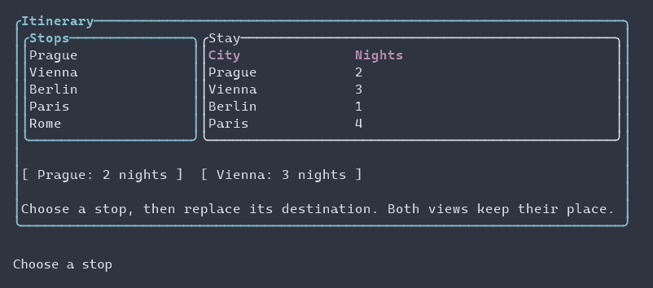
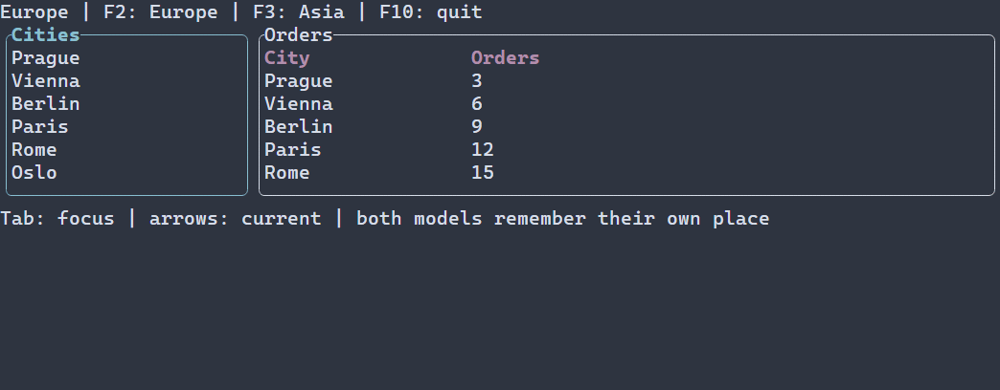

# Сменить модель и вернуться к прежнему месту

[English version](../view-models.md) · [Общая навигация](model-navigation.md)

Это руководство о списках и таблицах managed конечных моделей. [LogView](log-view.md#log-view-switching-models-ru)
использует собственную интеграцию закладок источника, в том числе без общего числа строк.

## Описать модель и представления

`ui::model` описывает небольшую последовательность с владением значениями либо готовый
неизменяемый провайдер. Регистрация происходит при монтировании представления.
С типом `City` из полного примера:

```cpp
auto europe = ui::model(std::array{City{"Prague", 3}, City{"Vienna", 6}});
auto navigation = ui::navigation(europe, {.readingAnchor = true});
auto views = ui::hbox(
  ui::virtualList(navigation, &City::name),
  ui::virtualTable(navigation,
    tableColumn("City", &City::name, 18),
    tableColumn("Orders", &City::orders, 8)));
```

Проекция списка может быть указателем на поле или лямбдой. Для скалярных строк со
стандартным форматированием проекция не нужна: `ui::virtualList(model)`. Колонки
принимают проекции поля/лямбды со стандартным или явно заданным форматтером. Ошибки
схемы сохраняют исходную типизированную причину при монтировании.

Копии `ui::Model<T>` разделяют одну регистрацию в одной сцене. Несколько представлений
этой Model получают независимую навигацию. Явный `ui::Navigation<T>` связывает включённые
каналы; отдельные вызовы `ui::navigation(model)` создают независимые сессии. Описания
используют существующие managed-модели, свойства и цикл подготовки. Второй runtime
или собственная карта истории приложения не требуются.

## Сменить модель

Смонтированный список или таблица запоминает текущую запись, выбранные идентичности и
место чтения отдельно для каждой посещённой модели. Переход A → B → A восстанавливает A
по стабильной идентичности строки; номер строки из B не переносится. У разных вьюх
независимые позиции, пока они явно не подключены к одному контексту навигации.

```cpp
// Independent views keep separate positions for every model.
list.model(europe);
table.model(europe);

// One shared context changes all participants together.
navigation.model(europe);

// Discard the target checkpoint and use its initial policy.
list.model(europe, {.restore = ModelRestorePolicy::RESET});
```

Формы `model(...)` направляют ошибки в существующую диагностику сцены. Если результат
нужно проверить немедленно, используйте `setModel(...)`. Вызовы выполняются в UI-потоке;
подготовка данных провайдера остаётся в существующем механизме. Смена общей группы
сначала допускает всех потребителей и метаданные, затем заменяет привязки. Отказ
сохраняет старую группу. Последовательность независимых вызовов не становится общей
транзакцией. Автоматический адаптер произвольной межмодельной проекции не создаётся:
такой участник отклоняется до замены привязок.

## Что означает «то же место»

Конечный провайдер реализует ограниченный `locateRow(RowId)`, если явной навигации
нужен индекс идентичностей. По умолчанию он сообщает UNSUPPORTED; UI не сканирует
модель, чтобы угадать номер строки. Небольшая последовательность с владением значениями
предоставляет такой индекс; контракт провайдера описан в [закладках модели](model-positions.md).

Сохранившаяся запись остаётся текущей после вставки или перестановки. Подтверждённое
удаление позволяет выбрать выжившего соседа при наличии доказательства порядка.
Отсутствие строки в фильтре не доказывает удаление. Подтверждённо удалённый нетекущий
элемент убирается из выбранного набора, а не заменяется соседом. Текущая запись,
выбранный набор и место чтения остаются разными логическими значениями.

Незавершённый возврат сохраняет закладку и подавляет неверный начальный кадр со строкой 0.
Ожидание продолжается по публикации модели и существующей доставке запросов;
перерисовка и resize не опрашивают провайдера. `restoreStatus()` сообщает результат
восстановления идентичности. Неподдерживаемая, несовместимая или недоступная история —
состояние конкретной вьюхи, а не ошибка здоровой модели или независимого соседа.
Новая публикация может предоставить недостающее доказательство. Явный RESET позволяет
отказаться от сохранённого места.

## Идентичность ресурса и время жизни

Автоматическая идентичность относится к зарегистрированной модели. Повторное открытие
провайдера другой регистрацией требует явного контракта ModelResource и сессии источника,
подтверждающего непрерывность. Совпавших значений, номеров строк или случайно равных ID
недостаточно. Другая линия истории несовместима. Явно квалифицированная закладка может
пережить переключение на другой источник и закрытие прежнего провайдера. Она не удерживает
модель, страницы строк или сам провайдер. Закрытие текущего активного источника по-прежнему
закрывает его контекст. Постоянное хранение на диске в эту интеграцию не входит.

## Подготовка и ошибки

Обычная подготовка принадлежит модели. При смене используется loader назначения;
произвольный callback, захвативший прежний провайдер, молча не переносится. Сохранение,
замена и очистка низкоуровневого override задаются явно. Изменение только callback на
той же модели не открывает нового потребителя, не сбрасывает навигацию и не отменяет
ожидающий запрос разрешения.

По умолчанию метаданные истории ограничены 256 КиБ на сессию вьюхи или общий контекст;
закладка — 4096 байт, выбранный набор — 1024 ID. Лимиты не зависят от числа строк.
Переполнение допуска возвращает typed-ошибку без молчаливого вытеснения позиции другой
модели. Старые и новые метаданные подготовки учитываются в бюджете одновременно.

После успешной установки общей группы её текущие снимки каналов и привязки согласованы
до начала доставки наблюдателям. Уже поставленные в очередь исторические значения
сохраняют свой ресурс и результат разрешения. Отказ доставки сообщается после commit
и не откатывает установленное состояние. Неуспешный допуск может оставить безвредный
запрос обновления layout, но не устанавливает часть новой группы.

## Изменять небольшую последовательность

`ui::model(std::array{...})` владеет копируемыми значениями и назначает стабильные
идентичности строк. Равные значения остаются разными строками. После монтирования
операции UI-потока возвращают проверяемый `std::expected<void, ManagedError>`:

| Операция | Результат |
| --- | --- |
| `model.insert(index, value)` | Вставить копию одного значения с новой идентичностью. |
| `model.erase(first, count)` | Удалить диапазон; `count` по умолчанию равен 1. |
| `model.move(first, count, destination)` | Сохранить идентичности; destination — индекс **после удаления** переносимого диапазона. |
| `model.clear()` | Удалить все строки. |
| `model.update(id, value)` | Заменить значение записи, сохранив её идентичность и порядок. |

Проверьте результат, прежде чем обновлять зависимое состояние приложения. Ошибка
выделения памяти или допуска сохраняет установленный снимок. Пустое удаление, перенос
на прежнее место и очистка пустой последовательности не публикуют ревизию. Удалённые
идентичности не используются повторно; успешные структурные изменения увеличивают
положительную ревизию. Владение значением сохраняет обычную семантику C++: `string_view`
или ссылка внутри него по-прежнему заимствует свой объект.

Вместимость по умолчанию — 4096 строк; она настраивается через `CollectionLimits`.
Адаптер хранит последние 1024 структурных изменения по умолчанию, с настройкой через
`PositionMapOptions`. Последующие изменения остаются рабочими. Существующая идентичность
разрешается как EXACT, даже если её старая ревизия вышла за пределы этого окна. Если
идентичность отсутствует, а нужное доказательство уже утрачено, восстановление сообщает
UNAVAILABLE и сохраняет закладку, не угадывая соседа. В пределах окна подтверждённое
удаление может дать NEAREST. Хранение доказательств отдельно от описанного выше бюджета
закладок вьюхи/контекста. Провайдерная модель не получает изменяемую копию данных:
проверяемые вызовы этих операций для неё возвращают INVALID_ARGUMENT.

## Обновить запись и сохранить место {#view-models-update-row-ru}

`model.update(id, value)` заменяет значение существующей записи владеющей модели и
возвращает проверяемый результат. Полный `RowId` получают от этой модели или её
навигации: это локальный ключ источника, а не номер строки и не глобальный
идентификатор. Неизвестный, удалённый ключ или несовпавшая generation дают
типизированную ошибку. Отсутствие записи не превращается в запись ближайшего соседа.

`navigation.currentRow()` читает существующий канал текущей позиции и возвращает
`expected<optional<RowId>, ManagedError>`. Отсутствие текущей записи — успешный
`nullopt`; холодный, закрытый или вызванный из чужого потока handle сохраняет
проверяемую ошибку. Getter не регистрирует биндинг и не загружает строку. Навигация
и изменяемый источник должны соответствовать друг другу. RowId не содержит свой
источник: совпавшие value/generation могут пройти проверку в другой модели, а
`update` не распознает эту подмену. Используйте ключ с моделью, которая сейчас
связана с навигацией.

Успешная замена сохраняет идентичность и порядковое место записи, текущую строку,
выбор и якорь чтения общей навигации. Ранее полученные снимки сохраняют старое
значение. Для типов с проверкой равенства замена на равное значение ничего не
публикует. Для остальных копируемых значений каждая явная замена может увеличивать
ревизию. Изменение только значения не расходует хранимую историю структурных операций.

Короткий `model.row(id, value)` выполняет ту же операцию и передаёт ошибку в
существующую диагностику сцены; при успехе возвращает `true`. Checked-вариант удобен,
когда обработчик возвращает результат непосредственно или дальнейшее состояние
приложения зависит от допуска:

```cpp
// Inside a UI handler, with an identity obtained from this model:
stops.row(id, Stop{"Prague", 2});

// An expected-returning handler can return the original checked result:
return stops.update(id, Stop{"Vienna", 3});
```

Ошибка выделения памяти, копирования, проверки или допуска до commit сохраняет
установленный снимок. Ошибка доставки после принятия не отменяет принятое значение.
Провайдерная модель сохраняет собственные права записи: эта операция не загружает
её строки и не превращает read-only источник в изменяемый.

API предназначен для небольшой владеющей последовательности. Подготовка нового
неизменяемого снимка копирует строки и перестраивает индекс; это не запись за
постоянное время в произвольно большой источник. Для внешних или неограниченных
моделей используйте провайдерный путь ниже. Условная запись во внешний источник и
сессии редактирования — отдельные возможности.

### Полный пример маршрута

Выберите остановку в любом представлении, затем нажмите F2/F3 или кнопку направления.
Оба представления обновят одну запись и сохранят текущее место. Tab меняет фокус,
F10 или Ctrl+C завершает приложение. Остановка остаётся тем же пунктом маршрута,
даже когда её направление меняется.



[Полный исходник](../examples/guide_owned_rows.cpp):

\include docs/examples/guide_owned_rows.cpp

## Сохранить провайдерный путь для больших данных

Для готового `std::shared_ptr<const ModelSnapshot<T>>` используйте `ui::model<T>(provider)`.
Описание и монтирование не читают и не копируют данные строк; тип строки может быть
некопируемым. Подготовка видимого диапазона и публикация сохраняют существующее владение
провайдера. Снимки, publisher и worker-интеграция описаны в [неизменяемых моделях](model.md).

Готовые массивы колонок и именованные настройки также работают с cold Model:

```cpp
// model, columns, config and tableRef have matching row types.
auto view = ui::virtualTable(tableRef, model, columns, config);
```

`columns` может быть массивом/span `TableColumn<T>`; рецепт владеет копиями определений
и настроек. Пустой `config.prepared` использует обработчик подготовки модели; непустой
заменяет его для этой вьюхи. Эта форма принимает `ui::Model<T>` и сохраняет независимую
навигацию, не объявляя координаты произвольных проекций общими автоматически.
Существующие фабрики `ManagedModel<T>` остаются доступны для сложных интеграций.

После успешного монтирования `model.managed()` возвращает проверяемый runtime handle
для существующего publisher или низкоуровневого API. Допуск публикации, остановка
производителя и время жизни заимствований в callbacks остаются обязанностями приложения.
Описание относится к одной сцене: пустой, неуспешный, чужой или закрытый handle даёт
типизированную ошибку. Для корректного описания `managed()` сообщает CLOSED до публикации и после закрытия сцены.
Ошибки монтирования идут через существующую диагностику сцены/`runApp`; `setModel` и
изменения последовательности позволяют немедленно проверить результат.

Провайдер может переопределить `ModelSnapshot::positionHistory()` для ограниченного
квалифицированного доказательства изменений. Реализация по умолчанию не требует override
или хранения истории в каждом источнике. Дополнение совместимо на уровне исходников,
но меняет виртуальный интерфейс: пересоберите бинарные провайдеры и потребителей SDK
с соответствующими друг другу установленными headers и library. Совместимость со старой
бинарной vtable SDK/провайдера не обещается.

## Конечные модели с нулевой ревизией

Ревизия 0 допустима для обычной конечной модели. Для закладки нужна положительная
ревизия, поэтому возврат к её сохранённой позиции сообщает UNSUPPORTED. Первичное
показывание, локальная клавиатурная навигация, уход к другой модели и явный RESET
остаются рабочими. RESET использует обычное начальное состояние и убирает старое
намерение восстановления. Поздняя положительная публикация не квалифицирует старую
неверсионированную закладку задним числом. Явный shared capture/navigate без нужного
доказательства возвращает WOULD_BLOCK; native-контролы сохраняют локальное поведение,
но общая bookmark-навигация для этой версии не гарантируется.

## Полный пример общей группы {#view-models-example-ru}



[Полный исходник](../examples/guide_view_models.cpp) задаёт две небольшие модели с
владением данными через `ui::model` и связывает список с проекцией и таблицу через
`ui::navigation`. Перемещайтесь
стрелками, меняйте регион через F2/F3 и возвращайтесь к прежнему: обе вьюхи восстановят
его логическое место. Tab меняет фокус, F10 или Ctrl+C завершает приложение. Подпись
наблюдает принятый ресурс навигации через `navigation.current()` и владеющую проекцию
`ui::bySource`. Отказ допуска группы сохраняет прежнюю подпись; отдельного присваиваемого
названия региона нет. Метаданными может быть владеющая структура или enum; см.
[модели значений](value-models.md).

Вьюхи разделяют текущую строку и помнят позиции каждой модели. При показе текущей
строки учитывается собственная высота области данных: заголовок таблицы занимает
строку, поэтому первые видимые записи могут различаться. При `readingAnchor`
явная прокрутка также передаёт общую логическую позицию чтения; автоматический
сдвиг для показа текущей строки не связывает viewport жёстко. Позднее обновление
общей позиции поступает в ранее подготовленные вьюхи на следующем обычном кадре,
без нового ввода. Соберите `portals_docs_view_models`
с включёнными тестами либо используйте установленный SDK.

Полный клиент использует cold-описания и обычную форму смены модели с диагностикой
сцены; регистрация и допуск общей группы остаются внутри SDK. Массивы с владением
данными предназначены для небольших наборов. Большие данные продолжают использовать
провайдерную интеграцию из связанного руководства о неизменяемых моделях.

@include docs/examples/guide_view_models.cpp
