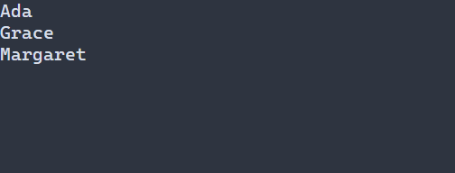

# Показать виртуальный список {#virtual-list-ru}

[Английская версия](../virtual-list.md)

Виртуальный список подходит для большой типизированной модели, когда форматировать нужно только видимые строки. По умолчанию `VirtualListOptions` задаёт высоту строки в одну клетку и по две дополнительные строки по краям. Стрелки и Home/End перемещают выбор, левая кнопка мыши выбирает строку, колесо прокручивает. Типизированная ссылка наблюдает представление, принадлежащее сцене. Для загруженной конфигурации зарегистрируйте типизированную фабрику; модель и форматтер остаются захваченными объектами C++. См. [регистрацию ресурсов](../../include/portals/ui_scene_resource.hpp).



## Настройка оформления {#virtual-list-styling-reference-ru}

Декларативный список использует `VirtualList`; API управляемых виртуальных представлений по умолчанию использует `List`, если цель стиля не задана. Для напрямую привязанного виджета действует зарегистрированная цель. Строки используют обычный стиль или `:selected`, но не варианты фокуса и отключения. `VirtualListOptions::normal` и `selected` задают значения по умолчанию под каскадом.

Доступны `foreground`, `background` (`#RRGGBB`), `bold`, `italic`, `underline` (`true` или `false`). Правило без состояния действует на все варианты. См. [каскад и ограничения размеров](styling-guide.md); `min-width` задаётся без состояния. Подсветка подготовленных совпадений задаётся в `VirtualListOptions::highlight`, а не частью PSS: заданные цвета перекрывают цвета строки, а логические атрибуты объединяются с атрибутами строки через OR (по умолчанию включены bold и underline).

```pss
VirtualList:selected { background: #305070; bold: true; }
```

Используйте [VirtualList<T>](../../include/portals/virtual_list.hpp). Программа ниже показывает три имени со стандартной навигацией клавиатурой и мышью. F10 закрывает приложение.

Программа использует адаптер Names — неизменяемый `ModelSnapshot<std::string>` с тремя записями — и функцию displayText для создания GraphemeText. Адаптер, функция, заголовки и вся программа приведены ниже и в [guide_vlist.cpp](../examples/guide_vlist.cpp).

<details>
<summary>Полная программа</summary>

\include guide_vlist.cpp

</details>

[Отдельный проект примеров](examples.md) собирает цель `guide_vlist`; запустите полученную программу в терминале. Она связывается с `portals::core`.


Сцена владеет привязками ввода, потребителями диапазонов и подготовкой. Форматировщик возвращает собственный текст и только читает переданную строку. Готовые данные в памяти не требуют обработчика поставщика. Для ожидающих данных задайте prepared в ui::VirtualListConfig<T>, чтобы передать возвращённый запрос на исполнение; библиотека не запускает потоки. TBD: запрошенный псевдоним ui::vlist отсутствует; срок не назначен.

Термины: [рецепт](glossary.md#glossary-recipe-ru), [кадр](glossary.md#glossary-frame-ru), [владение](glossary.md#glossary-ownership-ru).

<details>
<summary>Справка API и ограничения</summary>

`VirtualList<T>` — один виджет при любом числе логических строк. Он использует [модель](model.md), [маршрутизатор](focus.md) и обычную отрисовку дерева. Для каждого представления создайте отдельный `ModelConsumer<T>` и передайте его списку перемещением вместе с владеющим копируемым форматировщиком.

Тип `T` может быть некопируемым и без конструктора по умолчанию. Форматировщик заимствует `const ModelRow<T>&` на один вызов и возвращает владеющий `GraphemeText` с политикой `options.width_policy`. Он не сохраняет ссылку, не выполняет ввод-вывод, не запускает работу и не меняет дерево или модель. Захваты уничтожаются на UI. Источник обеспечивает неизменяемость данных и стабильные ненулевые `RowId`.

**Подготовка**

Между кадрами обслужите планировщик и получите один снимок модели для всех представлений. `prepareVirtualList` принимает окончательный локальный размер в целых ячейках до `tree.frame`. После изменения размера подготовка повторяется. Несовпадение с размещённым размером даёт `INVALID_GEOMETRY`; отсутствие подготовки или изменённые прокрутка и параметры дают `WOULD_BLOCK` при рисовании. Ошибка требует отклонить весь набор команд.

Список удерживает снимок кадра и диапазона и владеет форматированным текстом. Новое отображение устанавливается после полной подготовки. Ошибка памяти или форматировщика сохраняет прежнее согласованное отображение. Рисование не читает модель и не форматирует. Заимствованный текст команд потребляется внутри кадра; готовый буфер можно передать `FrameWriter` после него.

Допускается удержание одной готовой предварительно загруженной страницы источника. Новый точный интервал читается из неё при совпадающих ревизии, числе строк и лимите чтения. Форматируются только видимые строки. Промах оставляет запрос ожидающим; ошибка источника сохраняется явно. Новая ревизия и скрытие освобождают подготовленную страницу.

**Диапазоны и запросы**

Для положительной высоты строки H отображаются `ceil(viewport.height/H)` строк, включая частичную последнюю. Нулевой размер и пустая модель дают ноль строк. Начало ограничивается последней логической строкой, для пустой модели равно нулю. `overscan_rows` добавляет запрашиваемые строки по обе стороны; они не форматируются. Полного сканирования ID и вычисления общей высоты модели нет.

Подготовка сначала проверяет результат своего потребителя в кадре, затем ограниченное чтение базового снимка и собственные готовые страницы. Требуется готовность всего запрошенного диапазона; частичные результаты не объединяются. Ожидание показывает `...`, ошибка — `!`, с отсечением целых графем. `rangeState()` сообщает состояние отдельно; подробная ошибка доступна в диапазоне модели.

Новый ожидающий запрос возвращается один раз как `optional<ModelRequest<T>>`. Приложение запускает свою работу. При `WOULD_BLOCK` можно повторить завершение тем же токеном. Если работа не началась, отмените и освободите токен: следующая подготовка сможет выдать новый. Ошибка источника сохраняется до публикации или явного `retryVirtualList` с последующей подготовкой. Проверяйте `Model::lastError()` после доставки; принятие очередью не гарантирует применения.

Прокрутка отменяет предыдущий запрос; модель проверяет поколения и ревизии завершений. Отмена не ожидает поток и сохраняет резерв до освобождения владельцев. Полный лимит незавершённой работы даёт `WOULD_BLOCK`. Лимит диапазона модели включает видимые строки и запас; превышение возвращает `INVALID_ARGUMENT` без уменьшения отображаемой области.

**Выделение и ввод**

Выделение хранит `optional<RowId>`, сохраняется при перестановке, публикации и прокрутке. Удалённый ID остаётся выбранным до явного изменения. `setVirtualListSelection` принимает невидимый ненулевой ID без загрузки и поиска.

Сохраняйте `ActionBinding` от `bindVirtualList`. Up/Down перемещают по модели, Home/End — к краям. Если выбранной строки среди видимых нет, Up/Down начинают с первой видимой. Поиск ограничен видимыми ID. Ожидающее намерение содержит позицию и ревизию данных; новая ревизия или явное выделение отменяет его. Готовые строки подходящей подготовки разрешают позицию в стабильный ID. Ожидание данных не блокирует дальнейшую прокрутку.

Нажатие левой кнопки использует актуальные геометрию поверхности, отсечение и высоту строки. Пока содержимое не подготовлено, нажатия мыши на него не обрабатываются. Колесо сдвигает начало на строку без изменения выделения. [Дробная прокрутка](scroll.md) и привязка к идентичности используют ограниченный `locateRow`; неподдерживающий источник сохраняет позиционное поведение.

Скрытие предка отменяет работу, освобождает строки и снимок кадра, очищает намерение навигации и сохраняет выделение. После изменения видимости вызывайте подготовку даже без рисования. Удаление уничтожает потребителя; отключённый элемент продолжает рисоваться без ввода.

**Ошибки и обновление**

Изменения выполняются на UI вне кадра с проверками дерева. Неверные высота, размеры, ID, политика и переполнение диапазона дают `INVALID_ARGUMENT`; память — `NO_MEMORY`; форматировщик — `CALLBACK_FAILED`; чужой снимок — `STALE_NODE`. При ошибке получателя уже принятые команды могут сохраняться; весь кадр отклоняется.

Изменившаяся подготовка запрашивает рисование. Повтор неизменной не форматирует и не запрашивает кадр. Выделение, прокрутка и повтор запроса требуют рисования; параметры — размещения и рисования. Текст и заглушки используют полную политику ширины; широкие графемы не делятся.

</details>
