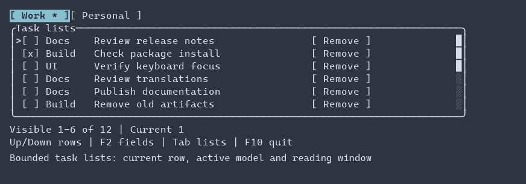
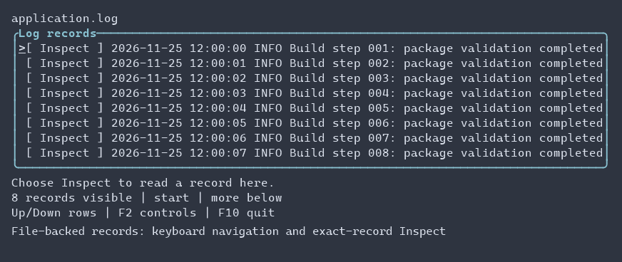

# Разместить контролы в виртуализованных строках {#virtual-rows-ru}

[English version](../virtual-rows.md)

Используйте `ui::virtualRows`, когда каждой записи модели нужны интерактивные
контролы: например, флажок задачи, редактируемое название и кнопка удаления.
Представление создаёт обычные дочерние контролы для видимых записей. Данные
остаются в модели, когда строка уходит за край окна.

Для списка форматированного текста подходит [VirtualList](virtual-list.md),
для колонок с заголовками — [VirtualTable](virtual-table.md).

## Списки задач {#virtual-rows-example-ru}

Полная программа содержит две модели задач. Кнопки Work и Personal переключают
модель того же представления. В каждой строке находятся CheckBox, Label,
LineEdit и Button. Звёздочка обозначает активную модель независимо от
клавиатурного фокуса на кнопке. Панель ограничена по ширине и показывает видимый
диапазон, точное число задач и текущую строку. F10 закрывает приложение.



[Полный исходник](../examples/guide_virtual_rows.cpp).

<details>
<summary>Полная программа</summary>

\include guide_virtual_rows.cpp

</details>

[Отдельный проект примеров](examples.md) собирает `guide_virtual_rows` и
подключает `portals::core`. Для этого API нужен заголовок
`<portals/ui_virtual_rows.hpp>`.

## Перемещаться между списками, строками и полями {#virtual-rows-keyboard-ru}

У представления два клавиатурных режима. При навигации по строкам всё
представление занимает одну позицию в общем порядке Tab. Чтобы вернуться к
выбору списка, не требуется проходить каждый флажок, поле и кнопку модели.

| Клавиша | Навигация по строкам | Внутри контролов текущей строки |
|---|---|---|
| Tab / Shift+Tab | Следующий / предыдущий внешний контрол | Переход между контролами этой строки |
| Вверх / Вниз | Перейти к соседней строке и показать её | Собственное поведение контрола с фокусом |
| Enter / F2 | Войти в контролы текущей строки | Собственное поведение контрола с фокусом |
| Escape | Остаться в навигации по строкам | Вернуться к строкам, если незавершённое редактирование разрешает переход |

На первой и последней строке дополнительное нажатие стрелки не переносит фокус
к выбору списка. Представление запоминает текущую запись по её устойчивому идентификатору.
Перемещение окна чтения и смена текущей записи остаются разными операциями. Мышь позволяет
войти в обычные контролы. Отказ перехода сохраняет черновик и состояние
валидации; Escape не задаёт новую общую политику сохранения или отмены.

Enter или F2 открывает контролы текущей строки, Escape возвращает к навигации
по строкам. Следующая запись показывает фокус полей, редактирование и удаление.


## Наблюдать текущую позицию {#virtual-rows-position-ru}

Сохраните `ui::Ref<VirtualRows<T>>`: его метод `position()` возвращает модель
только для чтения. Размещайте связанные с ней подписи после представления в
описании сцены. В полной программе обычные подписи показывают позицию и режим
клавиатурной навигации. Обновления следуют принятым изменениям представления;
приложению не нужен таймер опроса или вторая изменяемая переменная позиции.

`VirtualRowsPosition` разделяет текущую запись и окно чтения:

| Поле | Значение |
|---|---|
| `resource`, `current` | Текущая запись с идентичностью источника либо отсутствие текущей записи. |
| `currentIndex`, `firstIndex` | Опциональные точные номера с нуля; у курсорного источника с неизвестным размером недоступны. |
| `visible` | Готовые записи, видимые в окне, без удерживаемых за окном редакторов. |
| `count` | Опциональное точное число записей; отсутствие не означает ноль. |
| `hasBefore`, `hasAfter` | Есть ли записи до и после окна; отсутствие значения означает, что это неизвестно. |
| `windowStatus` | Опциональное состояние доставки оконного источника. |
| `editing` | Находится ли фокус внутри контролов текущей строки. |

Пример задач показывает человеку номера с единицы. Пример для файла показывает
видимые записи и известные направления перехода без выдуманного числа записей
или процента. `Navigation::current()` и `ui::bySource` дают подписи принятого
активного источника; сам фокус на кнопке не переключает модель.

## Записи, поля и обработчики {#virtual-rows-data-ru}

Фабрика строки возвращает новое обычное описание контролов.
`row.field(&Task::done)` связывает флажок с конкретной записью независимо от
текущего выбора. Перестановка модели не перенаправляет сохранённое поле или
действие на другую запись. После освобождения строки её сохранённые дескрипторы
возвращают `CLOSED`.

`row.value()` заимствует неизменяемое значение только на время работы фабрики.
Для подписи скопируйте нужное поле. Поздний обработчик может вызвать
`row.snapshot()` и получить проверяемый владеющий снимок данных. Снимок удерживает
исходную страницу и расходует её бюджет, но не удерживает контролы. Запись и
заимствованные поля остаются доступны, пока живёт снимок.

Адаптеры полей используют общий [контракт редактирования](model-workflows.md).
По умолчанию действует режим `IMMEDIATE`. Валидация, конфликты и ошибки записи
остаются проверяемыми результатами. Для изменения данных провайдера только для
чтения нужен явный записывающий `EditEndpoint`.

Для живого принятого значения используйте
`ui::label(row.field(&Task::category))`. Подпись обновляется без замены активного
редактора. Подпись из `row.value().category` — снимок на момент работы фабрики;
она обновляется при повторном построении строки. Пока строка сохраняется из-за
фокуса или локальной истории редактора, такая подпись сохраняет прежний текст. Для независимо меняющихся
подписей выбирайте привязку поля.

В режиме `EXPLICIT` одна незавершённая строка может оставаться удержанной за
пределами окна. Вместе сохраняются черновик, история Undo, курсор, выделение и
состояние валидации. Начало редактирования второй незавершённой строки
отклоняется до изменения её данных. В режиме `ON_COMPLETION` прокрутка
незавершённой строки за пределы окна отклоняется: сначала явно завершите или
отмените редактирование. Прокрутка не выполняет скрытый commit или cancel.

История принятых изменений принадлежит установленному редактору. Commit не
стирает её, пока этот редактор остаётся на месте. После удаления и повторного
создания завершённой строки её редактор начинает новую историю. Представление
не хранит истории завершённых редакторов для всех когда-либо посещённых записей.
Эти правила не меняют поведение отдельно принадлежащего приложению `EditSession`.

Модели, состояния и вычисляемые значения, объявленные внутри фабрики строки,
принадлежат этому экземпляру строки и освобождаются вместе с ним. Общая модель,
объявленная снаружи фабрики, сохраняет владельца-сцену, даже если первой её
использовала строка. Новую холодную модель нельзя читать до подключения:
проверяемый доступ возвращает `CLOSED` до публикации.

## Размеры и композиция {#virtual-rows-size-ru}

Пример ограничивает всю панель с помощью `maxWidth(76)` и позволяет полю
названия сжиматься в более узком терминале. Это не измеряет все записи модели.
Ограничения ширины выбираются для композиции: представление не сканирует
потенциально неограниченный источник в поиске самой длинной строки.

`height(8)` задаёт высоту окна в терминальных ячейках, включая рамку.
`VirtualRowsOptions::rowHeight` задаёт общую высоту дочерней композиции одной
записи; по умолчанию это одна ячейка. Для `ui::vbox` с несколькими полями
увеличьте её. Если дочерний контрол требует больше места, возвращается
`INVALID_GEOMETRY`.

`maxRows` ограничивает число видимых строк; по умолчанию это 256. Ограничение
относится к ресурсам представления и не задаёт предел размера модели.
Слишком большое окно отклоняется, а не скрывает обязательные строки.
Автоматический расчёт разной высоты записей запланирован отдельным этапом.

### Параметры представления

Передайте `VirtualRowsOptions` третьим аргументом `ui::virtualRows`.

| Поле | По умолчанию | Назначение |
|---|---|---|
| `rowHeight` | `1` | Положительная высота композиции одной записи в ячейках терминала. |
| `maxRows` | `256` | Положительный предел числа экземпляров строк, необходимых видимой области. |
| `overscanRows` | `2` | Дополнительные записи оконного источника для ограниченного перекрытия при построчной прокрутке. |
| `maxPendingRows` | `4096` | Положительный предел принятого относительного перемещения по записям до доставки данных. |
| `editing` | `EditOptions{}` | Общий режим редактирования и пределы удержания полей и байтов. |
| `checkpoints` | `ModelCheckpointOptions{}` | Существующие настройки ограниченной истории позиций источников. |
| `scrollbar` | `true` | Существующая стилизуемая вертикальная полоса для точного конечного размера. |
| `currentIndicator` | `true` | Левая ячейка для маркера текущей строки. |

Во время замены подготовленные и удаляемые деревья контролов могут существовать
одновременно. `maxRows` не ограничивает общее число контролов этим значением:
строка может содержать несколько контролов, а незавершённое редактирование —
удерживать ещё одну строку. Источник отдельно учитывает подготовленные страницы
и явно сохранённые снимки данных. Перемещение сверх предела отклоняется
с проверяемой ошибкой.

## Оформление контролов и рамки {#virtual-rows-styling-reference-ru}

Тип стиля представления — `VirtualRows`. Дочерние контролы сохраняют свои
обычные типы: [CheckBox](check-box.md), [Label](label.md),
[LineEdit](line-edit.md) и [Button](button.md). Поддерживаемые свойства
и состояния описаны в этих руководствах. К композиции строки можно добавить
классы и ID обычным API описаний. Тема применяется к сцене обычным способом.

`.framed("rounded", "Task lists")` добавляет рамку с заголовком. Глифы рамки,
оформление заголовка и цвета настраиваются через общий
[механизм стилей](styling-guide.md). Маркер текущей строки отделён от фокуса
конкретного дочернего контрола. Вертикальная полоса использует существующие
[стили скроллбаров](scroll-controls.md) в компактной правой полосе внутри рамки.
Это не размещение `ON_FRAME` у ScrollArea. Источник с неизвестным размером не
получает выдуманную шкалу. После входа каждый дочерний контрол сохраняет своё
поведение ввода и отображения.

## Источники с неизвестным числом записей {#virtual-rows-window-source-ru}

`ui::model<T>(provider)` принимает `shared_ptr<WindowProvider<T>>` и возвращает
отдельное описание оконного источника. Передайте его в `ui::virtualRows` с той
же фабрикой строк. Источнику не требуется сообщать общее число записей или
поддерживать произвольный доступ.

Возможности источника определяют доступность движения назад, перехода к записи
и перехода к хвосту. `rowCount()` для такого источника пуст. Провайдер загружает
данные на существующем рабочем потоке приложения. Фабрики и обновления контролов
выполняются в UI-потоке над уже подготовленными неизменяемыми страницами.

Вариант для файла использует существующий `FileLogModel` как
`WindowProvider<LogLine>`. У каждой видимой записи есть кнопка Inspect. Она
получает проверяемый владеющий снимок и копирует его текст в отдельную подпись.



[Полный исходник варианта для файла](../examples/guide_virtual_log_rows.cpp).

<details>
<summary>Полная программа для файла</summary>

\include guide_virtual_log_rows.cpp

</details>

Соберите `guide_virtual_log_rows` с `portals::lyra` и передайте UTF-8 лог:

```text
guide_virtual_log_rows application.log
guide_virtual_log_rows --help
```

Путь по умолчанию — `application.log`. В этом примере записи ограничены
настройками существующего `FileLogOptions`: по умолчанию 32 КиБ на запись,
без полного индекса строк. Для просмотра документа с режимами текста/hex и
обработкой длинных строк используйте [DocumentView](document-view.md).

| Операция | Конечная модель | Оконный источник |
|---|---|---|
| Число записей | Точный размер модели | `rowCount()` пуст |
| Подготовка данных | Существующий протокол диапазонов модели | Существующий рабочий поток и ограниченные страницы |
| Движение по строкам и страницам | В пределах возможностей модели | Сохранённые соседние записи, затем возможности провайдера |
| Изменение поля | Записывающий backend модели или явный endpoint | Явный записывающий endpoint |
| Возврат к сохранённому месту | Существующий resolver позиции модели | Переход к устойчивому RowId через `seekRow` |

## Переключить существующее представление {#virtual-rows-model-switch-ru}

Сохраните `ui::Ref<VirtualRows<T>> rows` и добавьте `.reference(rows)` к
описанию. Вызывайте `rows.model(other)` из UI-обработчика. Проверяемая форма —
`rows.setModel(other)`; короткая форма сообщает об ошибке через сцену. Одинаковая форма вызова поддерживает замену внутри семейства источника:
конечная модель заменяется конечной моделью, а оконный провайдер — оконным.
Существующее представление не переключается между конечным и оконным описанием;
такой запрос возвращает проверяемый отказ и сохраняет установленный источник.
Сохраняйте и повторно используйте описания при возвращении к тому же логическому
источнику.

По умолчанию `REMEMBER` восстанавливает сохранённое место чтения. Если
однонаправленный провайдер не умеет разрешить сохранённую запись, возвращается
проверяемая ошибка неподдерживаемой или недоступной операции; установленный
источник сохраняется. Это не запрещает первый переход к источнику, для которого
ещё нет сохранённого места. Чтобы явно начать с начальной позиции, используйте
`.model(other, {.restore = ModelRestorePolicy::RESET})`. Для восстановления нужен
поддерживаемый переход к записи этого логического источника; курсор нельзя использовать
повторно после завершения сеанса доставки.

## Ошибки и ограничения {#virtual-rows-limits-ru}

При ошибке подготовки новых строк сохраняется последний установленный набор.
Проверяемые интерфейсы сообщают об ошибках памяти, фабрики, геометрии, потока,
времени жизни и источника. `lastError()` и `sourceError()` относятся к разным
областям ошибок; `windowStatus()` показывает состояние доставки данных.

Виртуализация ограничивает число контролов и подготовленных страниц, удерживаемых
представлением. Она не меняет способ хранения записей в пользовательской модели
и сложность её операций. Тяжёлый разбор, ввод-вывод и дорогие изменения источника
выносите из UI-потока. Отдельно сохранённые снимки расходуют бюджет страниц и могут
привести к временному отказу при нехватке ресурсов.
