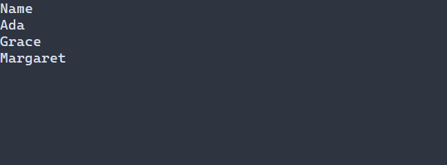

# Показать виртуальную таблицу {#virtual-table-ru}

[Английская версия](../virtual-table.md)

Виртуальная таблица показывает строки типизированной модели в столбцах фиксированной ширины с заголовками. По умолчанию строка имеет высоту одну клетку и по две дополнительные строки по краям; пределы — 64 столбца, 16384 подготовленные ячейки и 1 МиБ подготовленного текста. Навигация доступна стрелками, Home/End, левой кнопкой мыши и колесом. Типизированная ссылка позволяет получить видимую модель, как показано ниже. Для загруженной конфигурации нужна типизированная фабрика с моделью и форматтерами из C++; см. [регистрацию ресурсов](../../include/portals/ui_scene_resource.hpp).



## Настройка оформления {#virtual-table-styling-reference-ru}

Декларативная таблица использует `VirtualTable`; API управляемых виртуальных представлений по умолчанию использует `Table`, если цель стиля не задана. Для напрямую привязанного виджета действует зарегистрированная цель. Строки используют обычный стиль или `:selected`, заголовки — `:header` независимо от выделения. `VirtualTableOptions::normal`, `selected` и `header` задают значения по умолчанию под каскадом. Настройка подсветки совпадений списка не оформляет ячейки таблицы.

Доступны `foreground`, `background` (`#RRGGBB`), `bold`, `italic`, `underline` (`true` или `false`). Правило без состояния действует на все варианты. См. [каскад и ограничения размеров](styling-guide.md); `min-width` задаётся селектором без состояния.

```pss
VirtualTable:header { bold: true; background: #304050; }
```

Используйте [VirtualTable<T>](../../include/portals/virtual_table.hpp). Программа ниже показывает заголовок Name и три строки со стандартной навигацией клавиатурой и мышью. F10 закрывает приложение.

Программа использует адаптер Names — неизменяемый `ModelSnapshot<std::string>` с тремя записями — и функцию displayText для создания GraphemeText. Адаптер, функция, заголовки и вся программа приведены ниже и в [guide_vtable.cpp](../examples/guide_vtable.cpp).

<details>
<summary>Полная программа</summary>

\include guide_vtable.cpp

</details>

[Отдельный проект примеров](examples.md) собирает цель `guide_vtable`; запустите полученную программу в терминале. Она связывается с `portals::core`.


Каждый TableColumn хранит стабильный ColumnId, заголовок, ширину в ячейках и форматировщик. Рецепт копирует массив столбцов: его можно создать внутри фабрики. Сцена выполняет подготовку и подключает ввод. Для ожидающих данных нужен prepared в ui::VirtualTableConfig<T>. TBD: запрошенный псевдоним ui::vtable отсутствует; срок не назначен.

## Прочитать видимые строки

Сохраните типизированную ссылку на таблицу и получите отложенный источник её видимых строк:

```cpp
ui::Ref<VirtualTable<std::string>> table;
auto visible = table.visibleModel();
```

Передайте `table` в перегрузку `ui::virtualTable` со ссылкой на контрол. Создание
`visible` не читает данные; таблицу можно смонтировать позднее. В UI-обработчике
события после подготовки таблицы получите один стабильный снимок:

```cpp
auto rows = visible.snapshot();

if (!rows) {
  summary.text() = "Видимые строки пока недоступны";
  return;
}

std::size_t bytes = 0;

for (const auto &name : *rows) {
  bytes += name.size();
}

summary.text() = std::format("Строк: {}, байтов UTF-8: {}",
  rows->size(), bytes);
```

Фрагмент предполагает, что `summary` — смонтированная `ui::Ref<Label>`, а тип
записи модели — `std::string`. Для `std::format` подключите `<format>`.

[`VisibleModelSnapshot<T>`](../../include/portals/visible_model.hpp) — диапазон
только для чтения с прямым многопроходным обходом элементов `const T&`. Снимок
удерживает данные: прокрутка и удаление таблицы не меняют его строки. Метод
`rows()` дополнительно предоставляет `RowId` каждого значения. Копия снимка
разделяет неизменяемое хранилище, не копируя все значения. Сохраняйте снимок,
пока используете его итераторы или ссылки на элементы.

Диапазон содержит строки тела, пересекающие окончательную видимую область с
учётом отсечения родительскими контейнерами. Частично видимая строка включается
один раз. Заголовок и запас строк для виртуализации в него не входят. Пустая
готовая таблица даёт успешный пустой диапазон. Ожидание или ошибка провайдера
и неподготовленное представление сообщаются отдельно, а не как пустые данные.

<details>
<summary>Доступность снимка и время жизни</summary>

Вызывайте `snapshot()` на UI-потоке владельца, вне кадра дерева и обработчиков
управляемой подготовки. До монтирования и после закрытия сцены доступ закрыт;
после удаления сохраняется исходная устаревшая идентичность. После изменения
прокрутки или конфигурации представление может возвращать `NOT_PREPARED` до
следующей завершённой подготовки и раскладки. `PENDING` и `FAILED` описывают
готовность данных провайдера; текст ошибки принадлежит результату.
`VisibleModelError` отличает эти состояния от ошибок доступа `ManagedError`.
Проверяемое чтение возвращает ошибку напрямую, без автоматического сообщения.

Снимок удерживает хранилище провайдера, которое может быть больше видимого
диапазона. Не накапливайте снимки без ограничения их хранения. Полученные снимки
остаются читаемыми после уничтожения сцены; уничтожение данных подчиняется
действующему контракту потоков модели. Этот API не копирует историю и не
создаёт потоковый буфер.

</details>

Автоматические вычисления и привязки поверх видимого источника остаются
**TBD — M4**.

Термины: [рецепт](glossary.md#glossary-recipe-ru), [кадр](glossary.md#glossary-frame-ru), [владение](glossary.md#glossary-ownership-ru).

<details>
<summary>Справка API и ограничения</summary>

`VirtualTable<T>` показывает неизменяемые записи в столбцах фиксированной ширины и строках фиксированной высоты. Первая строка ячеек — заголовок. Пустая модель сохраняет заголовки; пустой набор столбцов показывает пустую область. Отдельных виджетов строк и ячеек и скрытых рабочих потоков нет.

**Столбцы и подготовка**

Создайте таблицу на UI с отдельным `ModelConsumer<T>`, массивом `TableColumn<T>` и параметрами. Конструктор копирует определения, заголовки и захваты форматировщиков; входной массив после возврата не нужен. Тип `T` может быть некопируемым. Форматировщик заимствует `const T&` и возвращает владеющий `GraphemeText`.

Каждый столбец имеет уникальный ненулевой полный `ColumnId`, положительную ширину, заголовок и копируемый форматировщик. Повтор номера требует нового поколения. Текст использует настроенную политику ширины. Форматировщик не выполняет ввод-вывод, не меняет дерево и модель, не сохраняет ссылки и не выделяет неограниченную память. Исключения переводятся при подготовке; принудительное завершение из пользовательского кода восстановить нельзя.

Между кадрами получите один [фиксированный снимок](glossary.md#glossary-model-pin-ru) `ModelFrame<T>` после обслуживания планировщика для всех представлений. Локальный размер включает заголовок и должен совпасть с окончательным размещением. Подготовка внутри `tree.frame` запрещена. Для всех столбцов читается один диапазон видимых строк с запасом; форматируются только готовые видимые строки и пересекающие ширину столбцы.

Текст, заголовки, ID и снимок устанавливаются согласованно после полной подготовки. Ошибка сохраняет прежнее отображение. Неизменная подготовка не запрашивает кадр. Удержанная страница завершения может обслуживать новый точный интервал при совпадающих ревизии и числе строк в пределах лимита чтения. Промах остаётся ожидающим; ошибка источника сообщается явно. Новая ревизия и скрытие освобождают страницу.

**Рисование и ввод**

Измерение, размещение и рисование не читают источник, не форматируют и не выполняют ввод-вывод. Команды локальны; владелец кадра переводит их на поверхность, применяет отсечение и потребляет текст до выхода из `tree.frame`. Каждая ячейка и заголовок имеют собственную область отсечения. Широкая графема не переходит в соседний столбец. Последняя строка может быть частичной; фон покрывает свободные ячейки.

Ожидание показывает `...`, ошибка — `!`. Новый `ModelRequest<T>` возвращается один раз для запуска приложением. Сохраните его до завершения или отмените при отказе запуска. `retryVirtualTable` выдаёт новый запрос при следующей подготовке. Отменённые токены учитываются до освобождения. Скрытие и уничтожение отменяют без ожидания рабочих потоков; скрытая подготовка освобождает данные и сохраняет выбранный ID.

`bindVirtualTable` обслуживает стрелки, Home/End, левое нажатие и целую прокрутку колеса. Привязка живёт меньше дерева и маршрутизатора. Нажатие заголовка не выбирает строку. Нажатие тела учитывает начало поверхности, отсечение и высоту заголовка и строки. Выделение сохраняется при перестановке и уходе за экран; удалённый ID очищается явно. Навигационный поиск ограничен подготовленными видимыми ID и текущей ревизией данных.

**Изменения и лимиты**

- `setVirtualTableFirst` задаёт целое начало, отменяет прежние работу и намерение и запрашивает рисование. Подготовка ограничивает позицию моделью.
- `setVirtualTableSelection` меняет стабильный ID и запрашивает рисование.
- `setVirtualTableColumns` проверяет и копирует массив. Ошибка проверки, памяти или захватов сохраняет прежнюю конфигурацию; успех требует нового размещения и подготовки.
- `setVirtualTableOptions` проверяет параметры и заголовки. Для смены ширины очистите столбцы, установите новую политику и добавьте пересозданные заголовки между кадрами.

По умолчанию доступны 64 столбца, 16384 видимые ячейки тела и 1 МиБ всех заголовков вместе с видимым текстом. Положительные лимиты настраиваются, превышение отклоняется целиком. Модель отдельно ограничивает строки с запасом. Произведение проверяется до умножения. Временная память пользовательского форматировщика в эти лимиты не входит.

Неверные размеры, ID, ширины, политика и превышение лимитов дают `INVALID_ARGUMENT`; память — `NO_MEMORY`; форматировщик и копирование захватов — `CALLBACK_FAILED`. Сохраняются проверки потока, дерева и сессии модели. Рисование возвращает `WOULD_BLOCK` без актуальной подготовки и `INVALID_GEOMETRY` при несовпадении размера. Ошибка требует отбросить частичные команды. Неудачная подготовка после изменения параметров не делает прежнее отображение пригодным.

См. [модель](model.md), [список](virtual-list.md), [прокрутку](scroll.md).

</details>
