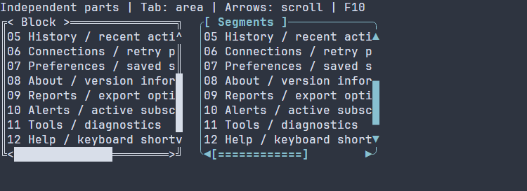

# Scroll ordinary content {#scroll-controls}

[Русская версия](ru/scroll-controls.md)

Wrap one ordinary content root in `ui::scrollArea`; use `ui::vbox`, `ui::hbox`
or `ui::grid` to group several controls. The scene creates its controller,
clips and positions the content, prepares layout, and reveals newly focused
controls. This complete application has eight buttons inside a rounded frame titled Sections. The frame is 28 columns
wide and six rows high, leaving at most four content rows; the scrollbar uses
the frame edge.
Use the wheel, keyboard arrows, the enabled scrollbar buttons, Page Up/Down, Home/End, or drag a thumb. Exit and F10 close
through the standard runner and restore the terminal.

[Complete source](examples/guide_scroll_controls.cpp):

\include guide_scroll_controls.cpp

Link your application to `portals::core`; see [package setup](package.md).
The [guide examples](examples.md) describe the standalone CMake build. Its
`guide_scroll_controls` executable opens a native terminal.


## Fractional thumb edges {#fractional-scrollbar-thumb}

Use `.scrollbar("fractional-block")` for a thumb whose position and proportional
length are calculated in eighths of a terminal cell. In a managed scene, the
wheel, directional arrow keys and thumb dragging move through intermediate
controller positions over 120 ms. All views sharing that controller observe the
same position. Ordinary text continues to move on the cell grid.

The transition uses the scene's existing scheduler and stops scheduling when the
target is reached. A new wheel event accumulates the requested destination;
releasing a dragged thumb lets the last transition finish. Page/Home/End commands
and functional arrow buttons retain immediate movement. Programmatic position
commands cancel an older transition, including a successful same-value command.
Hidden, disabled, disconnected and read-only controls do not continue animating.

The wheel distance remains three logical rows per ordinary detent by default.
Windows native input preserves fractional and multiple-detent magnitudes; cell
mouse reporting still has cell-sized drag coordinates. Smooth transitions fill
in the positions between those coarse input events.

Set `ScrollAreaOptions::smoothDurationMs` or `ScrollBarOptions::smoothDurationMs`
to another duration; zero disables transitions. For example, pass
`{.smoothDurationMs = 0}` as the existing options argument to `ui::scrollArea`.
Integral/ASCII profiles and low-level bindings without clock services retain
immediate movement. The low-level services are described by
`ScrollRepeatServices`, shared by held-arrow repeats and fractional motion.

The complete example has overflowing content on both axes. Run the
`portals_docs_fractional_scroll` target from the main build, or build
`guide_fractional_scroll` with the [installed examples project](examples.md).
Use the arrows or wheel; F10 and Exit close the application.

\include guide_fractional_scroll.cpp


The recording uses native Windows wheel events, including fractional detents,
and thumb dragging on both axes. It retains captured terminal frames at 50 fps;
no intermediate images are synthesized.

The profile uses a blank track and prepared Unicode block glyphs. It fills only
missing local foreground/background colors; theme colors and explicit part and
segment colors keep their normal priority. No stylesheet is needed for this
example. The thumb length is proportional to the viewport, quantized directly
to eighths and clamped to the existing minimum of one cell. A partial edge can
occupy an additional cell. Partially covered cells participate in dragging.

For PSS, use `scrollbar-track-pattern: minimal` together with
`scrollbar-thumb-pattern: fractional-block`. Typed styles use
`ScrollbarThumbPattern::FRACTIONAL_BLOCK`; loaded scenes can select
`scrollbar { pattern=FRACTIONAL_BLOCK }`.

A nonblank custom track, custom thumb caps, or a width policy that cannot render
the required one-cell blocks is rejected before the new configuration is
published. Select the ordinary `block` or `ascii` profile for those cases.
Rounded caps remain a separate glyph-profile option. A fractional-offset change
requests PAINT, while a changed cell offset or metrics also requests layout.
Painting reuses the prepared glyphs and reads the current owning controller
presentation, including when several controls share a controller. This profile
adds no continuous redraw or inertia. Font rasterization still depends on the
terminal and font.

### Choose a font for fractional blocks

The portable profile uses the standard Block Elements U+2581–U+258F. Lower and
left blocks, combined with foreground/background colors, also represent upper
and right fractions. A Nerd Font is not required. The terminal's selected font
must contain these glyphs and render them at one cell each; Unicode width checks
alone cannot detect a missing font glyph.

The native recording uses Cascadia Mono. The inspected local Cascadia Mono and
DejaVu Sans Mono fonts contain all fifteen block elements; the inspected Consolas
font lacks twelve of them and needs font fallback. Coverage depends on the font
version and does not guarantee how a particular terminal chooses its fallback.

The reference [tui-scrollbar](https://docs.rs/tui-scrollbar/0.2.7/tui_scrollbar/)
uses additional upper/right blocks U+1FB82–U+1FB8B from
[Symbols for Legacy Computing](https://www.unicode.org/charts/PDF/U1FB00.pdf)
in its default glyph set. Those shapes require separate font coverage. The
inspected 3270 Nerd Font Mono contains them; the Nerd Font label alone is not a
coverage guarantee. Portals' portable fractional profile does not require them.

## Precise pointer scrolling {#precise-pointer-scrolling}

Ordinary `ui::scrollArea(...)` and `ui::scrollBar(...)` code needs no new option.
`ApplicationOptions::nativePointer` defaults to AUTO with unconfirmed input ordering,
which keeps ordinary cell mouse reporting. Windows native console records also keep
the cell backend. Wheel input and keyboard scrolling retain their existing behavior.

On a supported POSIX host, the advanced configuration can declare
`settings.nativePointer.ordering = NativeInputOrder::FIFO`. This is a host contract:
complete input packets must precede replies to subsequently processed queries and
must not interleave with replies. Portals does not infer it from the terminal name,
environment, or a successful DECRPM. `NativePointerPolicy::OFF` disables the optional
negotiation. No physical pixel host has yet been qualified; the ordering declaration
is the caller's responsibility, and simulated PTY tests do not qualify a host.

The [complete advanced example](examples/guide_precise_scroll.cpp) uses the standard
Lyra adapter and runner. It shows content wider and taller than the viewport, so both
thumbs can be dragged. Build `guide_precise_scroll` with the
[standalone examples project](examples.md), linking `portals::lyra`. `--help` returns
before scene creation or terminal access. The default run uses ordinary fallback;
`--fifo-host` declares the contract above and lets AUTO attempt precision. F10 or Exit
closes normally. Exit codes are 0 for help/orderly completion, 1 for runtime failure,
and 2 for invalid arguments; native modes are restored by the runner.

AUTO requires supported 1016 reporting, 2048 resize notifications, positive character
dimensions and nonzero text-area pixel dimensions. The optional probe cap is 100 ms,
further limited to one quarter of the remaining setup budget; ordinary setup keeps
its reserved time. Missing/unsupported replies and zero pixels keep cell reporting.
Fresh process-local, non-reused private-mode queries correlate two FIFO boundaries.
Tracking and encoding states are queried after the first fresh boundary and must
arrive before the second. All tracking modes must be inactive; the selected tracker
must be mutable/reset, and the encodings must remain mutable and match the old units.
A permanent mode, missing fresh state, or a control batch exceeding the output limit
declines startup precision. An unknown nonce mode that does not reply also declines it. A completed
write alone does not establish the boundary. Explicitly reduced decoder limits that
cannot admit native size/barrier reports decline the enhancement without increasing
those limits. A font change without any report is unobservable; the host must deliver
the promised resize/size notifications.


All POSIX startup overloads with mouse reporting enabled require an initial cell
context. If the mandatory mode queries find 1016 already active, startup returns `INPUT_PROTOCOL` with
`TerminalProtocolIssue::INITIAL_PIXEL_CONTEXT_UNKNOWN` ("initial pixel context unknown")
before changing encoding/tracking: retained pixels have no trustworthy original
metrics. This check also applies when precise input is `OFF` or FIFO ordering is
unconfirmed. Disabling mouse reporting skips mouse setup and its mode queries;
it does not classify pre-existing foreign mouse input. Other validation rules for
unsupported or incomplete mode replies remain unchanged.

Each precise mouse event still has cell `column`/`row`. Its optional owning
`precision` stores zero-based pixel coordinates, the character and text-pixel
sizes used for that sample, and a generation. Dragging keeps its grab point and
initial logical offset; both axes use checked rational units before the exact
logical inverse. Integral offsets above 2^53 and both endpoints remain exact.
Text still renders on whole cell rows and columns; this changes pointer precision,
not terminal text rasterization or the configured frame rate.

A native resize or incompatible/font-only metrics change cancels capture and held
arrow repeat in input order. A font-only update does not require LAYOUT; capture
retirement can request its ordinary paint. Identical reports do not cancel or request
another frame. Wire metrics never change the native viewport: a future-size candidate
is retained for a later matching resize, while historical reports cannot roll layout
back. Missing usable metrics during pixel input request a bounded, serialized return
to cell reporting. Keys remain available; ambiguous pointer samples are suppressed
only during that transition. A rejected oversized/malformed CSI 48 also invalidates the old pixel context.
A failed transport/barrier deadline is a typed
`TerminalErrorKind::INPUT_PROTOCOL` failure followed by cleanup.

Mode output and at most one deferred frame share the existing native writer.
Protocol bytes do not count toward frame-byte completion statistics. No new worker,
scheduler, or blocking I/O in an input callback is used. Active drag ownership is
allocated before capture; failed allocation reports `NO_MEMORY` without publishing
an anchor, and MOVE does not allocate another drag payload.

Specifications: [SGR pixel reporting 1016 and DECRPM](https://invisible-island.net/xterm/ctlseqs/ctlseqs.html),
[in-band resize 2048 / CSI 48](https://gist.github.com/rockorager/e695fb2924d36b2bcf1fff4a3704bd83).

## Compare on-frame scrollbar skins

This keyboard-only gallery places the same eight-label content root, 40 cells
wide, in four 30-by-6 outer areas arranged 2 by 2. Each area uses `ON_FRAME`,
with tracks on its right and bottom frame edges, and one of four skins: legacy,
frame, minimal or ASCII. The frame inset leaves a 28-by-4 content viewport
before any other layout gutters. The ordinary eight-row content is not
virtualized. Tab focuses an area, arrow keys scroll it, and F10 quits.

The default themes highlight focused scrollbar parts with accent foreground
on the surface background. Focus does not invert the background or change the
scrolling range. Application styles can override each part independently.


[Static PNG frame](images/scrollbar-gallery.png)

Build `guide_scrollbar_gallery` with the [standalone guide project](examples.md).
The [complete source](examples/guide_scrollbar_gallery.cpp) is included below.

\include guide_scrollbar_gallery.cpp

## Choose content and bar placement

Ordinary content remains retained in memory, including off-viewport controls;
it is measured and laid out as an ordinary subtree. For large datasets use
[virtual views](virtual-preparation.md), which own their own scrolling state.
Embedded bars add no Tab stops. `ScrollAreaOptions::focusable` controls the area's
own stop; keyboard focus on a descendant remains on that descendant.

`ScrollAreaOptions` controls bar presence, steps, placement and an optional frame.
Each axis supports `AUTO` (show on overflow), `ALWAYS`, and `NEVER`.
`NEVER` hides the bar while wheel, key and checked programmatic scrolling remain
available. The defaults move three logical cells per wheel event, one per arrow,
and a page with one overlapping cell for Page Up/Down. Home/End select endpoints.

| Placement | Viewport and content |
| --- | --- |
| `RESERVED` (default) | A visible bar reserves a one-cell gutter. |
| `OVERLAY` | The nominal viewport and range stay unchanged; the bar obscures edge cells. Reveal guarantees nominal visibility. |
| `ON_FRAME` | The area's own `frame` supplies the right/bottom track lines, excluding corners, without a second content inset. |

For `ON_FRAME`, use `.framed("rounded", "Sections").scrollOnFrame()`; the pipe
form is `| ui::framed("rounded", "Sections") | ui::scrollOnFrame()`. Advanced
options remain available: `options.frame = BorderOptions{}` and
`options.placement = ScrollPlacement::ON_FRAME`. A separate `ui::border` does
not supply the area’s own frame. Missing frame/invalid options return
`TreeError::INVALID_ARGUMENT`. `readOnly` disables user scrolling while keeping
focus reveal and checked programmatic commands available. Nested ordinary areas
use the same tree clipping and managed preparation; each owns its own content root.

## Add functional arrow buttons

Call `.arrows()` or append `| ui::arrows()` to a native `ScrollArea` or `ScrollBar`.
The default is `false`; `.arrows(false)` overrides an enabled context default.
Each arrow press moves by `keyStep`. Managed scenes supply hold timing and cleanup
automatically: the first repeat follows after 350 milliseconds, then one step every
60 milliseconds. A late dispatch takes one step rather than catching up missed ticks.
Read-only controls reject arrow input while checked programmatic commands remain available.


[Static PNG frame](images/scroll-arrows.png)

This native MSVC Debug recording sends scripted SGR mouse press/release events:
a held DOWN button scrolls forward and held UP returns. Captions identify the
injected events. It does not qualify delivery from a physical host mouse.

Each channel of at least three cells reserves its first and last cells for arrows.
The thumb and its drag travel use the remaining cells. Frame corners and the shared
bar intersection stay outside the channel. A shorter channel collapses the buttons
without increasing the control's minimum size or changing its viewport and range.
Release, pointer motion away from the pressed button, capture loss, hiding, disabling,
removal, or geometry/metrics changes end the hold. Reaching the range boundary
stops the timer and creates no further offset publications or redraws.

`ScrollAreaOptions` and `ScrollBarOptions` expose constructor-only `arrows`,
`arrowDelay` and `arrowRepeat`. Both times are positive integral milliseconds;
zero and deadline overflow return `TreeError::INVALID_ARGUMENT`. The sparse
settings and loaded scene properties use the same names, for example
`ScrollBar{arrows=true arrowDelay=400 arrowRepeat=80}`. PSS controls appearance;
it does not change these behavior options after mounting.

Functional glyphs are separate from decorative `ScrollbarSkin::ends`: use
`horizontal.backward`, `horizontal.forward`, `vertical.backward` and
`vertical.forward` in the skin, or prefix those paths with `scrollbar.` in a
loaded scene. Nonempty custom glyphs must be one printable one-cell grapheme
under the receiving width policy; an empty arrow glyph is invalid. Defaults use
Unicode triangles with the existing ASCII fallback. `scrollbar-arrows-foreground`,
`scrollbar-arrows-background`, `scrollbar-arrows-bold`, `scrollbar-arrows-italic`
and `scrollbar-arrows-underline` style the buttons independently of the track,
thumb, decorative ends, corner and frame.

The original low-level `bindScrollArea(router, tree, node)` and
`bindScrollBar(router, tree, node)` overloads support a single arrow step.
Their overloads accepting `ScrollRepeatServices{now, onError}` add hold through
`WidgetTree::at` and the node's existing scheduler scope. Supply the same clock
used by the tree's scheduler and a typed `TreeError` sink for asynchronous
admission failures. The tree and any references captured by those callbacks must
outlive the node, binding and admitted calls. The callbacks are copied; they may
throw, and an exception is reported through the existing callback-failure boundary.
The initial press returns timer admission errors without changing the offset.
A later admission failure stops the hold before calling `onError`.
Without host capture capabilities, both overloads keep single-click behavior.

## Compose nested forms {#nested-scroll-areas}

This complete form uses editable connection fields and internal-state checkboxes.
Each area owns an `ON_FRAME` frame; the inner form is six rows high and the outer
form is nine. Tab moves between controls, Space toggles a checkbox, and Exit or
F10 closes the standard runner. Values live in this scene and are not persisted.

\include guide_nested_scroll.cpp

Build `guide_nested_scroll`
with the [standalone guide project](examples.md), or `portals_docs_nested_scroll`
with `PORTALS_BUILD_TESTS=ON`. The installed-package consumer compiles this same
source; it does not run the interactive program as an automated test.

Wheel input starts at the hit descendant and follows ordinary ancestor routing.
If the inner area changes its offset, it handles the whole event, including a
partial move to its boundary; it does not forward an unused delta. A later event
at that boundary leaves its offset unchanged and can scroll the outer area.
A descendant handler that handles the event stops this propagation.

Manual wheel or checked `setOffset` scrolling keeps focus on the same control
and does not repeatedly reveal that unchanged focus. A newly focused control
re-arms reveal through the enclosing areas. `reference.ensureVisible()` requests
a checked one-shot reveal for the next prepared frame without changing focus;
check its `std::expected<void, ManagedError>` result. See [focus](focus.md).
`readOnly` disables an area's user scrolling, not its child controls or checked
commands and focus reveal; an ignored wheel event may still reach an ancestor.

Paint and hit testing use the same inherited content clips. The inner frame
moves with the outer content, while a `ui::border` outside an area stays fixed.
Tracks on the area's own frame exclude corners and add no second gutter; content
cannot receive input through clipped frame cells. Hiding an ancestor or disabling
an area cancels its drag capture; hiding preserves the canonical offset. Removing
an area retires its bindings and capture, so late motion/release cannot reuse the
removed target. Resize or content removal clamps offsets during visible preparation.

Both forms are ordinary retained subtrees: even off-viewport children participate
in ordinary layout, whose work grows with their count. For large logical datasets,
[virtual views](virtual-preparation.md) prepare bounded visible/overscan ranges and
own their own scroll state. Nesting ordinary areas does not add virtualization.

## Share a controller and issue checked commands

The default area needs no application-held controller. Create an explicit
`ScrollController::create()` only when another control must share its values.
Pass the owning handle to `ui::scrollArea(child, options, controller)` and
`ui::scrollBar(controller, axis)`. One mounted area writes the metrics; the bar
projects that axis and can change its offset. A second area writing the same
controller is rejected. All mounted projections must belong to the same tree
session; a foreign session returns `TreeError::WRONG_SESSION`.

A standalone `ui::scrollBar(reference, axis)` creates its own controller and owns
the metrics. Set them with `reference.setMetrics({extent, viewport})`.
An area-sharing bar cannot change metrics: that command returns
`TreeError::INVALID_ARGUMENT`. Change a mounted area or bar with
`reference.setOffset(axis, {integral, fraction})`; check its
`std::expected<void, ManagedError>` result. The lower-level
`setScrollOffset(tree, node, axis, offset)` and `setScrollMetrics` retain their
checked `TreeError` results. Commands must run on the owning UI thread between
frames. Removed/closed targets fail through the existing typed lifecycle checks.

The controller owns values and no tree, router or widget references.
`snapshot()` returns an owning observation on its creating UI thread, including
a revision and both axes. The handle and copied snapshots may outlive the scene;
they do not wake a retired tree. Removing a bar retires its binding/capture and
leaves other projections alive. Removing an area releases its metrics-writer
lease; it does not grant that role to another projection automatically.

Offsets preserve an exact `uint64_t` integral part plus a finite fraction in
`[0,1)`. The maximum is `max(extent - viewport, 0)`, or zero when viewport is zero;
the fraction is zero at the maximum. `scrollRange`, `scrollThumb` and
`scrollOffsetForThumb` preserve integer endpoints above 2^53 without a round trip
through `double`. Ordinary layout still uses signed 32-bit cell geometry;
unrepresentable layout/translation returns `TreeError::INVALID_GEOMETRY`.
Exact controller metrics do not virtualize an ordinary subtree.

## Native sessions and custom hosts

A mounted scroll registration requests held-button motion immediately before
native terminal open. The ordinary scene query remains false and preserves the
original profile: POSIX queries only coordinate modes 1005/1006/1015/1016 and
uses 1000+1006. Scroll opt-in additionally queries mode 1002 with DECRQM.
Statuses 1 (set), 2 (reset), and 3 (permanently set) admit button motion;
0 (unknown) and 4 (permanently reset) return `TerminalErrorKind::UNSUPPORTED`.
Missing or malformed replies consume the existing setup deadline and retain
the original typed failure. Successful output of 1002h alone does not prove
support. Cleanup restores saved tracking with XTRESTORE and queried encoding
modes through the existing restoration path. Windows uses native mouse records
with held-button identity. See [application lifecycle](application.md).

`nativeMouseReporting=false` takes precedence: no mouse query/mutation occurs,
and dragging is unavailable. Late-mounted controls use the profile already
opened; mounting does not switch terminal modes during a session.

Custom `ApplicationTerminal` and `ApplicationReadyTerminal` hosts must explicitly
return sufficient `pointerCaptureCapabilities()`: held-button motion, matching
LEFT release (or explicit cancellation), and reliable held-button identity.
Their default declaration has no drag capability; wheel, keys and track clicks
remain available. Hosts must call `EventRouter::cancelPointerCapture()` on lost
sequences or external focus/capability loss. The input model cannot detect an
unsignalled OS focus loss. Resize, Escape, session stop and cleanup retire capture.
A drag continues outside the owner's rectangle while capture remains valid.

`ui::runApp()` collects checked mount/preparation/input errors and attempts cleanup
before returning its exit code. Native setup failures remain explicit errors;
capability becomes observable only after successful setup. The xterm
[DECRQM and button-event tracking specification](https://invisible-island.net/xterm/ctlseqs/ctlseqs.html)
describes modes 1002 and 1006; a syntactically valid reply cannot authenticate a host.

## Style scrollbar parts {#scrollbar-skins}

Use `.scrollbar("frame")` after `.scrollOnFrame()` to match the scrollbar track
to the prepared frame, including custom frame lines. An unframed control uses
single lines for this preset. The equivalent pipe is `| ui::scrollbar("frame")`.

[Complete C++ source](examples/guide_scrollbar_skin.cpp) and
[complete loaded-scene source](examples/guide_scrollbar_resource.cpp) show the
same form. Build `portals_docs_scrollbar_skin` or `portals_docs_scrollbar_resource`
with tests enabled; both run interactively through `runApp`.

\include guide_scrollbar_skin.cpp

| Preset | Track | Thumb |
| --- | --- | --- |
| `legacy` (default) | Existing shaded track | Existing block |
| `frame` | Prepared oriented frame line | Block |
| `minimal` | Blank | Block |
| `ascii` | Dot | Hash |

`ScrollbarSkin` supplies owning sparse horizontal and vertical glyph overrides,
optional decorative ends and a corner glyph. Each supplied glyph is validated
under the receiving width policy: one printable one-cell grapheme, at most
`maxGlyphBytes` UTF-8 bytes (default 64). Track and thumb cannot be empty; empty
ends suppress their decoration, and an omitted or empty corner retains the fill.
Invalid settings return typed errors before changing the prepared skin.

Ends are disabled by default. Enabling them paints in existing track cells;
the thumb has priority. This does not reserve cells, create arrow buttons or
change clicking, range, dragging, focus or offsets. `ON_FRAME` keeps the frame's
existing corners; the independent corner glyph applies only where the existing
geometry exposes a scrollbar intersection.

PSS prefixes `scrollbar-track-`, `scrollbar-thumb-`, `scrollbar-ends-` and
`scrollbar-corner-` accept `foreground`, `background`, `bold`, `italic` and
`underline`. They use the ordinary state, selector and layer rules and retain
explicit `false` overrides. Colors and text attributes are shared by both axes;
glyph overrides are axis-specific. Runtime, typed and compile-time sheets use
the same declarations. Existing common styles remain the fallback.

Loaded configuration uses `scrollbar { pattern=FRAME ends=true }`, with optional
`maxGlyphBytes`, `horizontal { track="-" thumb="#" start="<" end=">" }`,
`vertical { track="|" thumb="#" start="^" end="v" }` and `corner="+"`.
Dotted leaves such as `scrollbar.vertical.thumb` are equivalent. A skin never
enables a frame or chooses its placement implicitly. Low-level callers can use
`setScrollbarSkin(tree, node, skin)` for a checked atomic replacement.

### Independent sources and segmented thumbs

The complete [ordinary scroll client](examples/guide_scroll_controls.cpp) keeps
frame and title decoration independent of `.scrollTrack("minimal")`,
`.scrollThumb("block")` and `.scrollArrows("ascii")`. Each method has an equivalent
pipe stage, for example `| ui::scrollThumb("ascii")`, and a typed overload.
Track sources use `ScrollbarPattern` (`legacy`, `frame`, `minimal`, `ascii`);
thumb sources use `ScrollbarThumbPattern` (`legacy`, `block`, `ascii`);
arrow sources use `ScrollbarArrowPattern` (`legacy`, `triangle`, `ascii`).
`block` and `triangle` retain the control's ASCII/width fallback. Appearance
selection does not enable functional arrows; use `.arrows()` separately.

The umbrella `.scrollbar(...)` supplies defaults. Explicit part sources override
it regardless of method/pipe order, and per-axis custom glyphs override their
part source. Omitted leaves retain context values. `setScrollbarSkin` remains
an atomic replacement of the whole low-level skin.

Append `thumbStart`, `thumbBody`, `thumbEnd` and `thumbSingle` to either axis:

```cpp
ScrollbarSkin skin;
skin.horizontal = {.thumb = "#", .thumbStart = "[", .thumbBody = "=", .thumbEnd = "]", .thumbSingle = "o"};
skin.vertical = {.thumb = "#", .thumbStart = "A", .thumbBody = "I", .thumbEnd = "V", .thumbSingle = "O"};
```

A zero-length thumb paints nothing; one cell uses `thumbSingle`; two cells use
start/end; longer thumbs use start/body/end. Any omitted segment uses the old
repeated `thumb` glyph (or its effective preset). Segment strings cannot be empty
and obey the existing printable one-cell grapheme and `maxGlyphBytes` checks.
They are owned and prepared before publication; painting selects prepared text.
Decorative `start`/`end`, functional buttons, track clicking and geometry retain
their existing behavior.

Loaded scenes accept `scrollbar { trackPattern=MINIMAL thumbPattern=BLOCK
arrowPattern=ASCII horizontal { thumbStart="[" thumbBody="=" thumbEnd="]"
thumbSingle="o" } }`; equivalent dotted leaves use the same names.
PSS accepts `scrollbar-thumb-start-`, `scrollbar-thumb-body-`,
`scrollbar-thumb-end-` and `scrollbar-thumb-single-` with each of `foreground`,
`background`, `bold`, `italic` and `underline`. Each omitted segment attribute
inherits the resolved common `scrollbar-thumb-*` attribute. Segment declarations
use the existing selector, state and layer cascade, including explicit `false`;
the same segment style applies on both axes and with either custom or preset glyphs.
One cell selects only `single`, two select `start`/`end`, and longer thumbs select
`start`/`body`/`end`. Decorative `scrollbar-ends-*` and functional
`scrollbar-arrows-*` remain independent. Runtime, typed, literal and compact PSS
share these declarations, including styles applied to loaded scenes.

```css
#segments {
  scrollbar-thumb-foreground: #62b4d7;
  scrollbar-thumb-bold: true;
  scrollbar-thumb-start-foreground: #f2c879;
  scrollbar-thumb-end-foreground: #f2c879;
  scrollbar-thumb-body-bold: false;
  scrollbar-thumb-single-underline: true;
}
```

Typed `StyleDeclarations` provides `scrollbarThumbStart`, `scrollbarThumbBody`,
`scrollbarThumbEnd` and `scrollbarThumbSingle` paint groups. Compile-time
declarations use the corresponding functions, for example
`scrollbarThumbStartForeground(rgb(242, 200, 121))` and
`scrollbarThumbBodyBold(false)`.
Frame/title decoration uses its independent existing settings and styles.
The low-level `ComputedStyle` retains owning inline segment values for source
compatibility; `resolveStyle` remains allocation-free and `noexcept`. Managed
controls use a compact `StyleSnapshot` and shared optional extensions instead.
A matching extension is prepared before publication and can report an allocation
error without replacing the previous valid style. Controls without these
extensions do not reserve their inline storage. Painting uses the prepared values.


One-cell terminal glyphs do not promise a GUI radius or font coverage. Preview
custom caps and the [named glyph profiles](#named-glyph-profiles) on the target
host. ASCII and the legacy block remain explicit alternatives.

PSS also selects the same named sources directly:

```pss
ScrollArea {
  scrollbar-track-pattern: minimal;
  scrollbar-thumb-pattern: block;
  scrollbar-arrow-pattern: ascii;
}
ScrollArea:focused { scrollbar-track-pattern: frame; }
```

Each declaration follows the ordinary tier/selector/state cascade, overrides
its C++ preset default and leaves other parts unchanged. Custom per-axis glyphs
and segments retain priority over named sources. Typed sheets expose
`scrollbarTrackPattern`, `scrollbarThumbPattern` and `scrollbarArrowPattern`
with the corresponding enum values. Runtime, literal and compact PSS share the
same enum admission; invalid names/ordinals reject the stylesheet atomically.
PSS shape declarations accept named presets; custom segment text is currently
configured through C++ or loaded scenes.

### Two-pane scrollbar gallery

The [complete gallery source](examples/guide_scrollbar_parts.cpp) shows two
independent 26×10 outer areas. With `.scrollOnFrame()`, each has a 24×8
viewport; both scroll ordinary content of 12 rows and 36 columns. The left pane
uses frame track lines and ASCII arrow buttons. The right pane supplies custom
thumb segments and uses PSS named presets for its track, thumb and arrows.
`settings(...)` replaces the instance patch, so set custom segments before
`id`, frame and scroll modifiers. Each part's fluent or pipe stage changes only
that part.

Use Tab to focus the areas, arrow keys to scroll, and mouse arrow-button holds
to repeat scrolling; F10 exits. Gallery capture:



\image html scrollbar-parts.gif "Two-pane scrollbar parts gallery"

\include guide_scrollbar_parts.cpp

## Named glyph profiles {#named-glyph-profiles}


[PNG](images/glyph-profiles.png)

Choose a map independently of the theme. The default retains existing output.
For a native scroll area, the short form is:

```cpp
ui::scrollArea(content())
  .glyphProfile("nf-rounded")
  .glyphFallback("unicode")
  .framed("rounded", "Orders")
  .titleDecoration("profile")
  .scrollOnFrame();
```

Here `content()` is an ordinary sized content recipe. The complete
[profile gallery](examples/guide_glyph_profiles.cpp) owns the scene and uses the
standard runner for input and terminal cleanup. Build it as `guide_glyph_profiles`
with the [standalone example project](examples.md).
Its gold title text is an explicit `frame-title-foreground` rule; selecting an NF
profile does not change any color.

`.glyphProfile(GlyphProfile::NF_ROUNDED)` and `| ui::glyphProfile("nf-rounded")`
select the same map. `.glyphFallback(GlyphFallback::ASCII)` and
`| ui::glyphFallback("ascii")` select the portable fallback. Sized recipes apply
the map to their optional frame; ScrollArea and ScrollBar also use it for their
scrollbars. Low-level manual construction uses `BorderOptions::glyphSelection`
or `ScrollbarSkin::glyphSelection`. These settings own only logical values.

| PSS / compact name | C++ `GlyphProfile` | Horizontal thumb start / end | Single |
| --- | --- | --- | --- |
| `default` | `DEFAULT` | Current manual map, or existing legacy sources | Existing source |
| `unicode` | `UNICODE_GLYPHS` | U+25D6 / U+25D7 | U+25CF |
| `ascii` | `ASCII` | `[` / `]` | `#` |
| `nf-rounded` | `NF_ROUNDED` | U+E0B6 / U+E0B4 | U+25CF |
| `nf-chevron` | `NF_CHEVRON` | U+E0B2 / U+E0B0 | U+25C6 |
| `nf-slash` | `NF_SLASH` | U+E0BA / U+E0BC | U+2588 |
| `nf-backslash` | `NF_BACKSLASH` | U+E0BE / U+E0B8 | U+2588 |

The NF mapping uses the Powerline entries in the
[Nerd Fonts 3.4 glyph map](https://github.com/ryanoasis/nerd-fonts/blob/v3.4.0/glyphnames.json).
Use an active Nerd Font Mono in the receiving terminal. Portals does not install,
distribute or detect fonts. A missing font can display a replacement box even
when WidthPolicy admits a one-cell glyph; that is not an admission failure.
Choose Unicode or ASCII explicitly on hosts where NF support is unknown.

NF caps are horizontal. Their vertical thumb uses Unicode inset caps U+2584 and
U+2580, with U+2588 body/single. Explicit ASCII fallback selects `+` vertical caps
and `#` body/single. No glyph rotation occurs. Unicode and NF horizontal bodies
use U+2588; the ASCII horizontal body is `=`. Lengths one, two and longer select
single, start/end and start/body/end within the same existing thumb geometry.

PSS uses the ordinary state and layer cascade:

```css
ScrollArea { glyph-profile: nf-rounded; glyph-fallback: unicode; }
ScrollArea:disabled { glyph-profile: ascii; }
```

Runtime `StyleDeclarations::glyphProfile` / `glyphFallback`, typed
`style::ct::glyphProfile(...)` / `glyphFallback(...)`, compile-time PSS and loaded
scene styles share these logical declarations. Loaded construction settings use
`glyphProfile=NF_ROUNDED` and `glyphFallback=UNICODE_GLYPHS`; a PSS style
above them takes priority. `UNICODE_GLYPHS` is safe with the Windows `UNICODE` macro.

Glyph precedence is manual profile, then PSS profile, then explicit independent
track/thumb/arrow patterns, then literal custom glyphs and thumb segments. Removing
an override returns to the current manual map. Replacing the manual skin preserves
active PSS overrides. Colors, including thumb segment attributes, resolve independently.

Existing frame patterns and literal frame lines remain in place. The ASCII map
supplies ASCII frame lines beneath literal custom sources. Profile title caps require
`.titleDecoration("profile")` or `TitleDecoration::PROFILE`. Existing NONE, square,
round and custom title ends are preserved. Custom ends still take priority.

Each glyph is prepared under the receiving WidthPolicy. A failed one-cell admission
uses the selected Unicode or ASCII replacement; Unicode replacement can fall back
to ASCII. Invalid literal sources reject the update. Allocation failure reports
`NO_MEMORY` and preserves the preceding styles and resources. Style updates prepare
all affected owning resources before publication; paint borrows them synchronously
without allocation, parsing or callbacks. Default construction does not prepare NF maps.

\include guide_glyph_profiles.cpp
