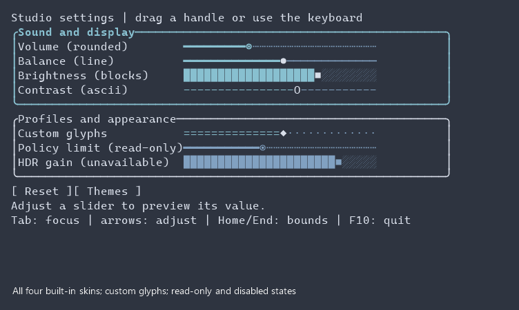
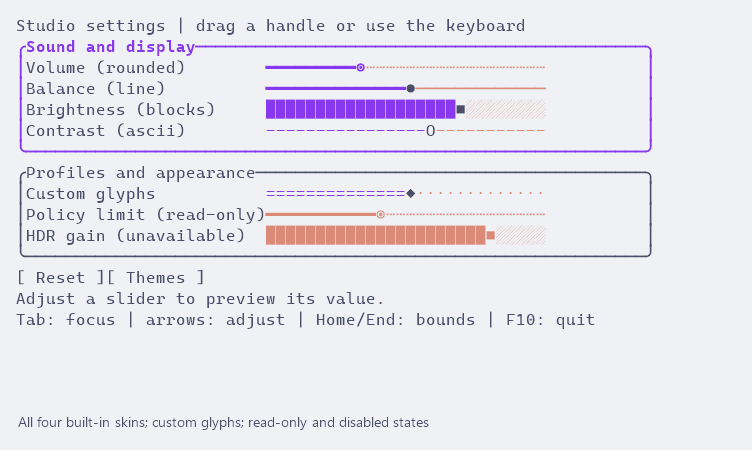

# Numeric sliders {#sliders}

[Русская версия](ru/sliders.md) · [Controls](controls.md) · [Bindings](bindings-guide.md)

A slider lets the user adjust a bounded value such as volume; a [Gauge](gauge.md) displays a value or progress without accepting that input. Use a slider where a relative position is useful; use a [SpinBox](spin-boxes.md) when direct numeric text entry matters. The [Slider API](../include/portals/slider.hpp) describes its options and checked operations. The recordings below use the complete guide application, including every built-in skin.

Use `ui::slider()` to edit a finite numeric value with the keyboard or mouse.
The default horizontal slider starts at zero in the inclusive range 0..100,
with a user increment of one and an intrinsic width of 20 cells.

## A complete application

The application edits sound and display settings with all four built-in skins, a custom glyph set, read-only and disabled examples, live value previews and Reset. The Themes button switches between Nord and Latte. F10 or Ctrl+C closes it.

\include guide_slider.cpp

Build the checkout example with `cmake --build <build> --target portals_docs_slider`.
For an installed SDK, compile the same source using the consumer setup in
[Package setup](package.md). `ui::runApp()` owns the native session and returns
after terminal restoration and scene cleanup.

For volume and balance, live previews, Reset and gesture completion, build
`portals_slider_example` with `PORTALS_BUILD_EXAMPLES=ON` and run the
[complete settings application](../examples/slider/main.cpp).

## Built-in skins and custom glyphs

Choose the appearance directly on the recipe:

```cpp
ui::slider(35).skin("rounded").width(28);
ui::slider(50).glyphs({"·", "=", "◆"});
```

| Name | Typed value | Unfilled / filled / thumb |
| --- | --- | --- |
| `ascii` (default) | `SliderSkin::ASCII` | `-` / `-` / `O` |
| `line` | `SliderSkin::LINE` | `─` / `━` / `●` |
| `rounded` | `SliderSkin::ROUNDED` | `┄` / `━` / `◉` |
| `blocks` | `SliderSkin::BLOCKS` | `░` / `█` / `■` |

`.skin(SliderSkin::ROUNDED)` is the equivalent typed form. Custom `SliderGlyphs`
owns its three strings and overrides the skin. Supply all three glyphs; each
must be one printable grapheme, occupy one cell under the scene's width policy,
and use at most 64 UTF-8 bytes. Invalid custom glyphs produce checked setup errors.
When the width policy cannot admit a built-in Unicode set, the entire set falls
back to ASCII. Font availability is not detected automatically.

The track occupies one terminal row. A pointer selects a numeric tick; the
filled prefix and thumb share that same position. Themes color these parts
independently. The glyph set does not change the range or input operations.





The recordings rasterize actual application VT output using Cascadia Code.
Input captions mark the actions being demonstrated. They are not measurements
of physical Windows Terminal presentation latency.

## Configure the source

An independent recipe can stage its final range and increment:

```cpp
auto gain = ui::slider(0.5).range(0, 1).step(0.1);
```

`ManagedScene::numericState(initial, NumericRange)` creates a scene-owned numeric
source. Its `NumericState` handle observes that source weakly. A `NumericValue`
snapshot owns the value, bounds and increment and cannot expose invalid mutable
fields. The source uses the existing Property publication and recovery rules.
It does not create a second scheduler or an undo history.

The initial value and bounds must be finite. Bounds must be strictly ordered,
their positive span must be representable, and the increment must be positive.
A step smaller than the span must advance a double at both endpoints.
A step at least as large as the span is valid. Explicit values outside the range
are rejected. Only the omitted constructor value can use zero clamped into the
final range.

Programmatic values may lie between user ticks. Neither initialization nor
`NumericState::set(double)` nor `slider.value() = value` rounds them.
`NumericState::configure(initial, range)` replaces the complete source atomically;
it requires an explicit valid new value and never clamps the existing one.
When you supply a numeric source, additional value/range/step settings are an
`INITIAL_CONFLICT`, including equal settings. The external source remains unchanged.

## Input and callbacks

| Input | Result |
|---|---|
| Left/Down, Right/Up | Decrease/increase the current value by one increment, saturating at the bounds |
| PageDown/PageUp | Apply `.pageSteps(count)` increments; the default count is 10 |
| Home/End | Select the exact minimum/maximum |
| Left click or drag | Snap to a minimum-anchored tick or the maximum; ties choose the larger point |
| Escape or capture loss | End the drag and retain values already applied live |

For range 0..10 and increment 3, the pointer can select 0, 3, 6, 9 and 10.
Pointer snapping compares exact distances for the supplied binary64 numbers and
rounds the selected tick once to the nearest double, with midpoint rounding to even.
Keyboard increments preserve the offset of an externally assigned value between
ticks. All computations use double precision; decimal fractions need not be exact.

`ui::onChange(reference, callback)` observes each changed user commit during a
drag. It accepts a double or the exact `PropertyUpdate<NumericValue>` receipt.
Equal/no-op commits, initialization, external writes and presentation recovery
do not invoke it. `readOnly`, hidden and disabled controls cannot mutate through
user input; programmatic writes retain their checked source semantics.

One drag is one local operation. It can create several source revisions and
several live `onChange` calls. `ui::onEditingFinished` observes that operation's
completion or interruption through `SliderOperationEvent`; it owns the initial
snapshot and optional last changed user receipt. Removing the node or closing
the scene suppresses subsequent delivery. Callbacks never run from paint or layout.

An external changed revision interrupts an active drag as `CONFLICT`. The newer
source wins: a later release never restores the saved starting value. An equal
external assignment creates no revision and does not conflict.

## Read values and handle errors

`reference.value().get()` returns a checked double. Assignment returns an owning
`NumericProperty` observation; `.result()` retains that operation's exact receipt
or `ManagedError`. A fresh observation has no assignment and returns
`INVALID_ARGUMENT`. A mutation returns a new observation; the proxy used to
perform it keeps its previous saved result. Inspect the returned observation
for that operation's reported error or exact receipt.
Assigning one numeric property to another reads once and
copies the value; it does not create a binding or copy the receiver's bounds.
Captions use a separate Label. Caption access through a base or erased slider
reference returns `INVALID_ARGUMENT`, including visible-text source reads.

The Ref assignment also uses the existing error collector. Direct NumericState
operations return checked results without automatic reporting. Failed operations
preserve the value and revision. A successful receipt can report rejected
observer notifications; the commit still happened, and repeating the equal set
does not retry those notifications. See [Properties](property.md).

`ManagedError::numeric` preserves `NumericError`: `NOT_FINITE`, `INVALID_RANGE`,
`INVALID_STEP`, `UNREPRESENTABLE_STEP`, `OUT_OF_RANGE` or `INITIAL_CONFLICT`.
Thread, lifetime, frame, allocation and publication failures retain the existing
typed causes. Keep arbitrary reference captures alive through callback invocation;
the Ref itself does not own a scene or widget.

## Load presentation from a resource {#slider-resource}

The configuration resource uses the same settings and native numeric binding:

```text
scene {
  Slider#volume {
    value=35 minimum=0 maximum=100 step=5 pageSteps=10
    preferredWidth=30 readOnly=false skin="rounded"
  }
  Slider#custom {
    value=50 preferredWidth=28
    glyphs.track="." glyphs.fill="=" glyphs.thumb="@"
  }
}
```

Select `SceneResourceFormat::CONFIGURATION` as described in
[Scene loading](scene-loading-guide.md). A registered factory may bind a code-owned
NumericState. If the resource supplies value, minimum, maximum or step for that
factory, mounting fails with `INITIAL_CONFLICT`; absent settings preserve the
factory source. A present `readOnly=false` can override a factory's `true` setting.
Styles and ordinary sizing retain the common resource pipeline.


The resource accepts `skin` and `glyphs.track`, `glyphs.fill`, `glyphs.thumb`.
Custom glyphs require all three leaves and override a valid built-in skin.
Unknown skin names and invalid glyphs produce checked setup errors. The fluent API uses the same restrictions.

## Styling reference {#sliders-styling-reference}

The natural selector is `Slider`. Each part uses the same selected state:
disabled takes precedence over focused, then normal. The `:read-only` predicate
matches a slider whose user editing is prohibited; programmatic checked writes
remain available. Built-in themes use a muted appearance for this state.

Common `foreground`, `background`, `bold`, `italic` and `underline` set the
receiving surface. The following properties override individual parts:

| Property | Type and meaning |
| --- | --- |
| `slider-track-foreground` | `#RRGGBB`, unfilled-track ink |
| `slider-track-background` | `#RRGGBB`, unfilled-track cell background |
| `slider-track-bold` | `true` / `false` |
| `slider-track-italic` | `true` / `false` |
| `slider-track-underline` | `true` / `false` |
| `slider-fill-foreground` | `#RRGGBB`, filled-prefix ink |
| `slider-fill-background` | `#RRGGBB`, filled-prefix cell background |
| `slider-fill-bold` | `true` / `false` |
| `slider-fill-italic` | `true` / `false` |
| `slider-fill-underline` | `true` / `false` |
| `slider-thumb-foreground` | `#RRGGBB`, thumb ink |
| `slider-thumb-background` | `#RRGGBB`, thumb cell background |
| `slider-thumb-bold` | `true` / `false` |
| `slider-thumb-italic` | `true` / `false` |
| `slider-thumb-underline` | `true` / `false` |

Absent part leaves inherit the resolved common state, then the ordinary cascade
selects explicit part overrides. Explicit `false` is retained. Changing only a
part invalidates its paint; theme and part values publish together. These paint
properties are available in runtime and compile-time PSS and typed declarations.

```pss
Slider { slider-track-foreground: #73808f; }
Slider:focused { slider-thumb-foreground: #c28e2c; slider-thumb-bold: true; }
Slider:read-only { slider-fill-bold: false; slider-thumb-bold: false; }
```

Colors in a user rule are explicit overrides; select values appropriate for the
active palette. Glyphs and skins are configured by the recipe or scene resource,
while the part paint properties above are PSS styling.

`SliderOptions::preferredWidth` defaults to 20 cells. Intrinsic height is one;
extra allocated rows receive the common background. Ordinary frames, classes and
layout constraints apply. `.width(28)` fixes the allocation; `.flex(1)` shares
available row width. Size declarations and their checked conflict behavior are
specified in [layout](layout.md).

The native `setSliderReadOnly` operation changes the input gate and invalidates
paint. A standalone `StyleEngine` user must refresh styles after changing that
predicate to re-evaluate `:read-only` declarations.
