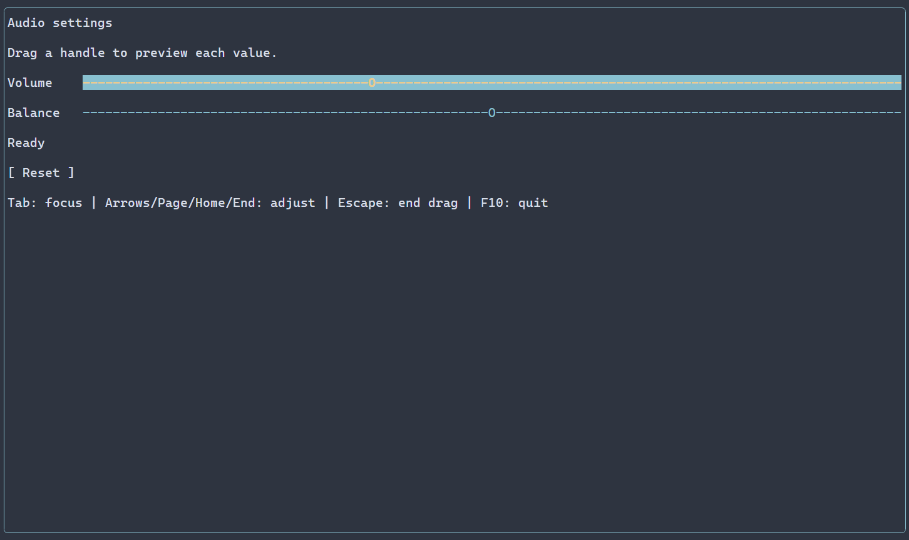
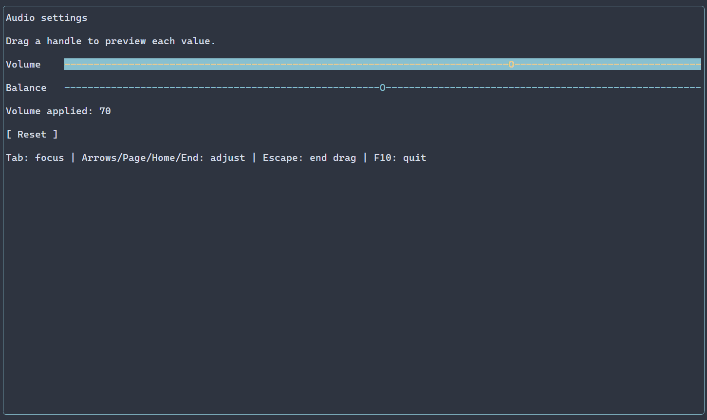

# Numeric sliders {#sliders}

[Русская версия](ru/sliders.md) · [Controls](controls.md) · [Bindings](bindings-guide.md)

Use a slider for a bounded value where a relative position is useful; use a [SpinBox](spin-boxes.md) when direct numeric text entry matters. The [Slider API](../include/portals/slider.hpp) describes its options and checked operations. The recording below shows the larger settings composition, not just the short guide program.

Use `ui::slider()` to edit a finite numeric value with the keyboard or mouse.
The default horizontal slider starts at zero in the inclusive range 0..100,
with a user increment of one and an intrinsic width of 20 cells.

## A complete application

The application below edits one scene-owned numeric value and updates a label
after each changed user commit. F10 closes the application.

\include guide_slider.cpp

Build the checkout example with `cmake --build <build> --target portals_docs_slider`.
For an installed SDK, compile the same source using the consumer setup in
[Package setup](package.md). `ui::runApp()` owns the native session and returns
after terminal restoration and scene cleanup.

For volume and balance, live previews, Reset and gesture completion, build
`portals_slider_example` with `PORTALS_BUILD_EXAMPLES=ON` and run the
[complete settings application](../examples/slider/main.cpp).

The track uses ASCII `-` and `O`. Ordinary themes, `Slider` selectors, classes,
focus/disabled appearances, frames and size constraints apply to it. Its preferred
width is a content measurement; `.flex(1)` lets the surrounding row allocate more
space. The text-width policy validates both one-cell glyphs together.





The recording runs the native Windows console backend. During a drag,
`onPreview` reports the changing value; release finishes one gesture.
## Configure the source

An independent recipe can stage its final range and increment:

```cpp
auto gain = ui::slider(0.5).range(0, 1).step(0.1);
```

`ManagedScene::numericState(initial, NumericRange)` creates a scene-owned numeric
source. Its `NumericState` handle observes that source weakly. A `NumericValue`
snapshot owns the value, bounds and increment and cannot expose invalid mutable
fields. The source uses the existing Property publication and recovery rules.
It does not create a second scheduler or an undo history.

The initial value and bounds must be finite. Bounds must be strictly ordered,
their positive span must be representable, and the increment must be positive.
A step smaller than the span must advance a double at both endpoints.
A step at least as large as the span is valid. Explicit values outside the range
are rejected. Only the omitted constructor value can use zero clamped into the
final range.

Programmatic values may lie between user ticks. Neither initialization nor
`NumericState::set(double)` nor `slider.value() = value` rounds them.
`NumericState::configure(initial, range)` replaces the complete source atomically;
it requires an explicit valid new value and never clamps the existing one.
When you supply a numeric source, additional value/range/step settings are an
`INITIAL_CONFLICT`, including equal settings. The external source remains unchanged.

## Input and callbacks

| Input | Result |
|---|---|
| Left/Down, Right/Up | Decrease/increase the current value by one increment, saturating at the bounds |
| PageDown/PageUp | Apply `.pageSteps(count)` increments; the default count is 10 |
| Home/End | Select the exact minimum/maximum |
| Left click or drag | Snap to a minimum-anchored tick or the maximum; ties choose the larger point |
| Escape or capture loss | End the drag and retain values already applied live |

For range 0..10 and increment 3, the pointer can select 0, 3, 6, 9 and 10.
Pointer snapping compares exact distances for the supplied binary64 numbers and
rounds the selected tick once to the nearest double, with midpoint rounding to even.
Keyboard increments preserve the offset of an externally assigned value between
ticks. All computations use double precision; decimal fractions need not be exact.

`ui::onChange(reference, callback)` observes each changed user commit during a
drag. It accepts a double or the exact `PropertyUpdate<NumericValue>` receipt.
Equal/no-op commits, initialization, external writes and presentation recovery
do not invoke it. `readOnly`, hidden and disabled controls cannot mutate through
user input; programmatic writes retain their checked source semantics.

One drag is one local operation. It can create several source revisions and
several live `onChange` calls. `ui::onEditingFinished` observes that operation's
completion or interruption through `SliderOperationEvent`; it owns the initial
snapshot and optional last changed user receipt. Removing the node or closing
the scene suppresses subsequent delivery. Callbacks never run from paint or layout.

An external changed revision interrupts an active drag as `CONFLICT`. The newer
source wins: a later release never restores the saved starting value. An equal
external assignment creates no revision and does not conflict.

## Read values and handle errors

`reference.value().get()` returns a checked double. Assignment returns an owning
`NumericProperty` observation; `.result()` retains that operation's exact receipt
or `ManagedError`. A fresh observation has no assignment and returns
`INVALID_ARGUMENT`. A mutation returns a new observation; the proxy used to
perform it keeps its previous saved result. Inspect the returned observation
for that operation's reported error or exact receipt.
Assigning one numeric property to another reads once and
copies the value; it does not create a binding or copy the receiver's bounds.
Captions use a separate Label. Caption access through a base or erased slider
reference returns `INVALID_ARGUMENT`, including visible-text source reads.

The Ref assignment also uses the existing error collector. Direct NumericState
operations return checked results without automatic reporting. Failed operations
preserve the value and revision. A successful receipt can report rejected
observer notifications; the commit still happened, and repeating the equal set
does not retry those notifications. See [Properties](property.md).

`ManagedError::numeric` preserves `NumericError`: `NOT_FINITE`, `INVALID_RANGE`,
`INVALID_STEP`, `UNREPRESENTABLE_STEP`, `OUT_OF_RANGE` or `INITIAL_CONFLICT`.
Thread, lifetime, frame, allocation and publication failures retain the existing
typed causes. Keep arbitrary reference captures alive through callback invocation;
the Ref itself does not own a scene or widget.

## Load presentation from a resource {#slider-resource}

The configuration resource uses the same settings and native numeric binding:

```text
scene {
  Slider#volume {
    value=35 minimum=0 maximum=100 step=5 pageSteps=10
    preferredWidth=30 readOnly=false
  }
}
```

Select `SceneResourceFormat::CONFIGURATION` as described in
[Scene loading](scene-loading-guide.md). A registered factory may bind a code-owned
NumericState. If the resource supplies value, minimum, maximum or step for that
factory, mounting fails with `INITIAL_CONFLICT`; absent settings preserve the
factory source. A present `readOnly=false` can override a factory's `true` setting.
Styles and ordinary sizing retain the common resource pipeline.


## Styling reference {#sliders-styling-reference}

The natural selector is `Slider`. Track and thumb share one style: disabled takes precedence over focused, then normal. It does not paint selected, header or caret variants. The ASCII track `-` and thumb `O` are fixed; PSS has no separate part or glyph properties. `SliderOptions::preferredWidth` is `std::int32_t`, default 20 cells; intrinsic height is one. Extra allocated rows receive the background, while glyphs occupy the first row.

The common paint properties apply to each painted target:

| Property | Value |
| --- | --- |
| `foreground` | `#RRGGBB` text/ink color |
| `background` | `#RRGGBB` fill color |
| `bold` | `true` or `false` |
| `italic` | `true` or `false` |
| `underline` | `true` or `false` |

Manual `ControlStyle` defaults use terminal colors, normal text, bold focus and italic disabled text. Theme and PSS declarations override individual manual fields; unspecified fields retain lower-layer values, including explicit `false`. A selector without a state supplies all variants. See [cascade and selectors](styling-guide.md) and [styles](styles.md).

Layout properties `width` and `height` accept nonnegative cell counts, `auto`, `fit-content`, or `flex(positive weight)`; `min-width`, `max-width`, `min-height`, and `max-height` accept nonnegative cell counts. They require selectors without state or `:read-only`; Except for `min-width`, these size declarations are runtime PSS only. Conflicting widget bounds reject the update and retain the previous style and geometry; constraints and recipe precedence are explained in [layout](layout.md). These affect allocation, not the glyphs themselves.

```pss
Slider { width: 20; foreground: #62b4d7; }
Slider:focused { bold: true; }
```
