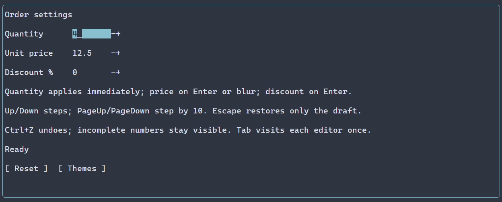

# Numeric editors {#spin-boxes}

[Русская версия](ru/spin-boxes.md) · [LineEdit](line-edit.md) · [Sliders](sliders.md)

Choose SpinBox for a bounded finite number that users can type or adjust by steps; a [Slider](sliders.md) instead emphasizes position in a range. The [SpinBox API](../include/portals/spin_box.hpp) and [numeric source](../include/portals/numeric.hpp) document checked values and range constraints. The preview below shows the larger numeric-form composition.

Use `ui::spinBox()` to edit a finite number as text or with step buttons.
The default value is zero, the inclusive range is 0..100, the increment is one,
and the publication mode is `EditMode::IMMEDIATE`.

## A complete application

\include guide_spin_box.cpp

Build this program with `cmake --build <build> --target portals_docs_spin_box`.
For an installed SDK, use the same source with [Package setup](package.md).
The [numeric form example](../examples/numeric_form/main.cpp) shows three fields,
deferred publication, reset and a theme selector for Nord and Latte. The step
buttons use the selected theme's default styling. Build it with target
`portals_numeric_form`. Both programs use `ui::runApp()` for terminal restoration
and scene cleanup.



Static frames: [Nord dark theme](images/spin-boxes-dark.png) · [Latte light theme](images/spin-boxes-light.png).

## Draft and numeric source

A SpinBox contains one ordinary LineEdit and two plain `-`/`+` buttons. Tab visits
only the editor. The editor keeps its existing selection, Unicode text limits,
clipboard policy and [Undo/Redo history](editor-history.md). Its preferred width
is eight cells; the two buttons each occupy one cell. Ordinary sizing and frames
apply to the containing row.

`ManagedScene::remove` rejects removal of a bound SpinBox's editor or either step
button with `INVALID_ARGUMENT`; remove the whole SpinBox instead. Removing an
individual structural child directly through `WidgetTree` while its binding is
active bypasses this managed ownership contract.

Numbers use locale-independent decimal syntax, a dot and an optional exponent.
The complete draft must represent a finite number within the configured bounds.
An empty draft, a sign, an unfinished exponent, invalid text or an out-of-range
number remains visible without publishing to the numeric source. Successful
confirmation preserves accepted spelling such as `01` or `1e0` until a real
external change. A custom locale or precision formatter is not supported.

| Mode | Publication |
|---|---|
| `IMMEDIATE` | Each valid accepted change |
| `ON_COMPLETION` | Enter or focus loss |
| `EXPLICIT` | Enter; focus loss keeps the draft |

Escape adopts the latest source and resets the baseline. Own confirmation keeps
history. An external change updates a clean field; a dirty field keeps its draft
and reports a revision conflict at confirmation. Changing bounds or increment is
also an external revision, even when the numeric value is unchanged.

`amount.text()` and `amount.lineEdit().text()` access the same visible draft.
`amount.value() = 3.5` follows the selected edit mode. `amount.value().get()` reads
the valid visible numeric draft; incomplete syntax returns `NumericError::INVALID_TEXT`,
nonfinite input returns `NOT_FINITE`, and out-of-range input returns `OUT_OF_RANGE`.
The getters do not discard text or automatically report errors.

An assignment returns an independent observation:

```cpp
// amount is a mounted ui::Ref<SpinBox> in EXPLICIT mode.
auto assignment = amount.value() = 3.5;
auto observed = assignment.result();
// On success, observed->editing describes draft acceptance.
// observed->commit is present only when a numeric publication actually occurred.
```

## Share a model and observe changes

Create `ManagedScene::numericState(initial, NumericRange)` in a scene factory and
pass it to `ui::spinBox(reference, model)`. The same `NumericState` works with a
[Slider](sliders.md). Its `snapshot()` reads the committed numeric value even
while the editor shows a different draft. `set(double)` writes directly to the
source; `configure(initial, range)` replaces the value and complete range atomically.
Explicit value/range/step overrides on a recipe using an external model are an
`INITIAL_CONFLICT`, including equal overrides. Invalid numeric configuration
retains its original `NumericError` and leaves the source unchanged.

`ui::onChange(amount, callback)` receives a `double` or the exact
`PropertyUpdate<NumericValue>` for a changed user publication. External and fluent
writes and equal publications do not invoke it. Text editing and completion
observations remain available through the LineEdit reference. Receipts own their
original snapshots even when a callback writes again or removes the control.

## Input, resources and styling

Up/Down and the two buttons step by `.step(value)`. PageUp/PageDown apply
`.pageSteps(count)` increments, ten by default. A valid dirty draft is the starting
point; an invalid draft is preserved. A clean field steps from the complete source
value, including an off-grid fraction. Steps saturate at the bounds and follow the
current edit mode. Each step is a separate ordinary history operation.

`.readOnly()` blocks user input, history mutation and steps. Programmatic text,
numeric draft and external model writes remain available. Disabled ancestry also
blocks user mutation.

The registered `SpinBox` resource accepts numeric `value`, `minimum`, `maximum`,
`step`, `pageSteps`, `readOnly`, `editMode`, ordinary text/history/limits and
sizing/frame properties. Sparse settings preserve absent factory leaves; explicit
false settings remain overrides. Numeric failures preserve the causal property
origin. `SpinBox` is the natural root style type. Its real children use `LineEdit`
and `Button` with classes `spin-box-editor`, `spin-box-decrease` and
`spin-box-increase`; ordinary theme, class and ID rules apply.


## Styling reference {#spin-boxes-styling-reference}

`SpinBox` is a layout root, not the painted editor. Its children are a `LineEdit` and two `Button` widgets. Target the confirmed classes `.spin-box-editor`, `.spin-box-decrease`, and `.spin-box-increase`; the latter buttons display fixed `-` and `+` captions with no PSS glyph property. The editor paints normal/focused/disabled, selected and caret as described in [LineEdit](line-edit.md#line-edit-styling-reference); buttons paint normal/focused/disabled. Editor manual defaults come from `LineEditOptions`, buttons use `ControlStyle{}`. Style the children independently; a root declaration does not propagate to them.

The common paint properties apply to each painted target:

| Property | Value |
| --- | --- |
| `foreground` | `#RRGGBB` text/ink color |
| `background` | `#RRGGBB` fill color |
| `bold` | `true` or `false` |
| `italic` | `true` or `false` |
| `underline` | `true` or `false` |

Manual `ControlStyle` defaults use terminal colors, normal text, bold focus and italic disabled text. Theme and PSS declarations override individual manual fields; unspecified fields retain lower-layer values, including explicit `false`. A selector without a state supplies all variants. See [cascade and selectors](styling-guide.md) and [styles](styles.md).

Layout properties `width` and `height` accept nonnegative cell counts, `auto`, `fit-content`, or `flex(positive weight)`; `min-width`, `max-width`, `min-height`, and `max-height` accept nonnegative cell counts. They require selectors without state or `:read-only`; Except for `min-width`, these size declarations are runtime PSS only. Conflicting widget bounds reject the update and retain the previous style and geometry; constraints and recipe precedence are explained in [layout](layout.md). These affect allocation, not the glyphs themselves.

```pss
.spin-box-editor { min-width: 8; }
.spin-box-editor:focused { background: #245070; }
.spin-box-decrease { foreground: #62b4d7; }
.spin-box-increase { foreground: #62b4d7; }
```
