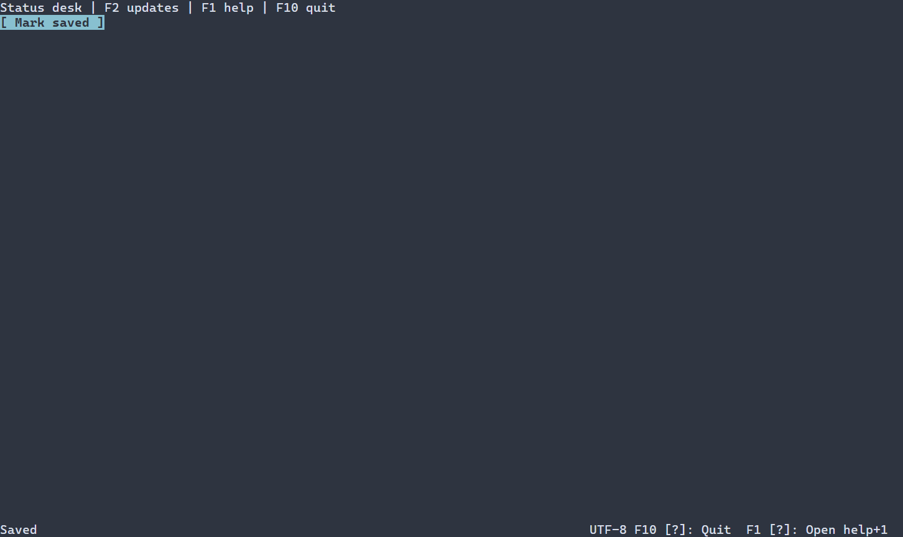

# Status bars {#status-bar-guide}

[Русская версия](ru/status-bar.md) · [Key help](key-help.md) · [Layout](layout.md)

Use `ui::statusBar` to arrange ordinary status sections in a horizontal bar. It fills its allocation and composes labels, spacers and interactive children; it is not a timed notification. Use a toast when a message should be temporary.

## A complete application

This larger example combines a status label and key hints with a real help view. F2 changes Ready to Saved, F1 opens help, Escape closes it and F10 exits. The standard runner reports errors and restores the terminal.



\include status_bar/main.cpp

Build `portals_status_bar_example` with `PORTALS_BUILD_EXAMPLES=ON` and run it in a terminal. See [build setup](getting-started.md) and [package setup](package.md).

## Layout, references and resources

`ui::statusBar({.gap = 1}, children...)` uses `LinearOptions`: gap and padding default to zero, main alignment to START, cross alignment to STRETCH and overflow to CLIP. The default `SizePolicy` fills available width and requests one fixed row. A spacer pushes later sections away; under shortage later shrinkable children yield first down to their minima and remaining overflow is clipped. The parent determines placement; the bar does not dock itself.

A `ui::Ref<StatusBar>` observes the container for geometry, visibility and removal; it has no text property or timer. Give a child `ui::Ref<Label>` to update text, as in the example. The scene owns the bar and children. The bar is not a focus stop and has no own keyboard or mouse action; interactive children keep theirs. `ui::keyHints(help)` reflects the bound `HelpView`; see [key help](key-help.md).

Both resource formats support a bar with children, basic size/flex and gap, for example `StatusBar#footer { gap=1 Label#status { text="Ready" } Spacer{} }`. Get the children with `scene.get<Label>("status")` and the bar with `scene.get<StatusBar>("footer")`. Use the configuration format for min/max, padding and linear alignment. Legacy resources with `ControlContext` defaults or definitions can reject min/max literals with `DUPLICATE_PROPERTY`; use the configuration format. See [resource details](controls.md#status-bar-control).

## Styling reference {#status-bar-styling-reference}

The natural selector is `StatusBar`. It paints its whole allocation with normal or disabled style, disabled when ineligible. It does not paint focused, selected, header or caret states. Child labels and buttons resolve their own styles; a bar foreground does not automatically style their text. The manual `ControlStyle` supplies normal and disabled defaults; there are no bar-specific glyph properties.

| Property | Values and effect |
|---|---|
| `foreground`, `background` | `#RRGGBB`; foreground and fill |
| `bold`, `italic`, `underline` | `true` or `false`; explicit false overrides a lower layer |
| `width`, `height` | Nonnegative cells, `auto`, `fit-content`, `flex(positive weight)` in runtime PSS |
| `min-width`, `max-width`, `min-height`, `max-height` | Nonnegative cell bounds; only `min-width` also works in compile-time PSS |

Size declarations cannot depend on a state or `:read-only`; conflicting bounds reject the update and retain the last valid style and geometry. See [layout](layout.md). Manual `ControlStyle` uses terminal-default colors, normal text, bold focus and italic disabled text. Theme and PSS rules override individual fields; unspecified fields retain lower-layer values. See [the cascade](styling-guide.md).

```pss
StatusBar { background: #182028; height: 1; }
StatusBar:disabled { background: #303030; }
Label.status { foreground: #dce1e8; }
```

Assign `.classes("status")` to the intended label for the last rule. See `portals::StatusBar`, `LinearOptions`, `ui::statusBar`, and [basic styling](controls.md#basic-controls-styling-reference).
