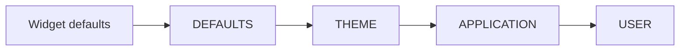

# Style layers {#style_layers}

[Русская версия](ru/style-layers.md)

A [style layer](glossary.md) is an independently installed stylesheet.
Layers keep application and user declarations installed while a theme is
replaced or its live parameters change. They opt into the existing retained
[style engine](styles.md); they do not introduce another resolver or runtime.

## Independent overrides

Owning `StyleSheet` values can be constructed from typed rules, `parsePss`, or
[constant descriptions](compile-time-styles.md). The facade installs them like this:

```cpp
scene.styleLayers()
     .styleLayer(StyleTier::APPLICATION, "application", applicationStyles)
     .styleLayer(StyleTier::USER, "contrast", userStyles);
```

The equivalent stages are:

```cpp
auto styled = std::move(scene)
  | ui::styleLayers()
  | ui::styleLayer(StyleTier::APPLICATION, "application", applicationStyles)
  | ui::styleLayer(StyleTier::USER, "contrast", userStyles);
```

These fragments assume an existing idle scene and owning sheets. Applying these configuration stages to a named scene preserves that scene
and returns `Scene&`. The shown `std::move(scene)` chain transfers ownership
to `styled`; that transfer must finish before callbacks capture the facade by
address. Before preparation,
the stages retain their configuration in registration order. Afterwards they use
the existing managed mutation boundary. Failures enter the scene collector and
are observed through `checked`, typed `run`, or the `runApp` reporting policy.
The scene owns the installed layers; the client needs no tokens just to keep
them installed. Argument and stage construction can throw before checked entry.

Layer configuration is explicit: `styleLayers` must precede `styleLayer`.
Repeating the same options is a no-op; changing budgets by a repeated opt-in is
rejected. This API accepts owning sheets. Runtime PSS is available through
`parsePss`; compile-time PSS literals are covered in
[compile-time PSS](compile-time-pss.md). A materialized sheet is required here;
source-based styling is also available through `ui::style`.

## How each property is resolved



A higher tier wins for each declared property before selector specificity.
Within one tier the order is specificity, stable layer installation order, then
rule source order. Replacing a layer keeps its position; removing and adding it
creates a new identity and position. Absent properties retain lower values;
explicit `false` overrides `true`. A less-specific USER rule can therefore beat
a more-specific THEME rule. Merely concatenating sheets would not provide this
precedence for every selector combination.

`DEFAULTS` and `THEME` are permanent base slots, included in the layer count.
Widget defaults remain below them. `ManagedScene::styleDefaults` replaces the
defaults slot; `theme` replaces only the theme slot. Application/user layer
removal does not remove controls. Adding through `addLayer` or `styleLayer` rejects duplicate names within one tier.
The source-based `ui::style(..., {.name = ...})` frontend instead explicitly
upserts by tier/name; see the [styling guide](styling-guide.md).

## Replacing and removing layers

`ManagedScene::addLayer` returns a `StyleLayerHandle` for later replacement
or removal. `replaceLayer`, `removeLayer`, and `updateLayers` return
typed errors and the effective invalidation. A batch replaces/removes existing
handles atomically; adding multiple new layers in that same batch is not supported.
Duplicate handles reject the entire batch. Borrowed inputs are copied on success.

Handles observe engine lifetime and identity; they do not retain controls or
keep the scene alive. Destruction of a handle does not remove its layer. Operations
are UI-only. A foreign, removed or stale handle has a `StyleError` with
`INVALID_ARGUMENT`; scene close is `CLOSED`, a foreign thread is `WRONG_THREAD`.

## Theme ownership and compatibility

`style::ct::live` claims the theme slot. Application/user overrides remain
independent of the live descriptor and its scalar parameters. A successful
`theme` replacement or another live attachment revokes the previous controller.
Its `get`, `set`, and `apply`, including equal updates, report a typed stale
error instead of silently restoring its old theme. Failed ownership changes
leave the previous controller usable.

Enabling layers revokes controllers attached in legacy mode. A new controller
must be attached after the opt-in. Until layers are enabled, the existing single-sheet behavior
is preserved. Low-level `StyleEngine::replace` and `replacePss` remain whole-sheet
replacement: successful replacement exits layered mode and invalidates layer
identities; failed replacement changes neither mode nor identities.

## Transactions and limits

Pending style registrations and a layered update share one staged transaction.
Defaults hooks run under the existing tree borrow; targets are revalidated before
one invalidation and publication. An error preserves committed rules, metadata,
computed values, revisions and theme authority. Equal layer updates with no
pending metadata or ownership handoff allocate nothing and request no redraw.
Pending metadata can change effective styles; an explicit `theme` call also
hands off ownership, including when its rules are equal.
An unequal update whose result is masked may recompute styles but produces no
effective invalidation. Effective paint changes request PAINT; minimum-width
changes request LAYOUT. No timer or permanent redraw is installed.

Owning style staging rejects nested style mutations with `WOULD_BLOCK`, including
allocator-driven reentry during copying. Managed metadata/lifecycle operations
are likewise protected while pending registrations are collected. Caller-owned
borrowed inputs must remain stable for the duration of an operation. A raw
`StyleEngine` must outlive its active operations; it cannot be destroyed from
its own defaults hook. Sequential legacy theme replacement remains unchanged.

The default aggregate budgets are 16 layers, 1024 rules, 6144 declarations and
1 MiB of logical owning payload. They include the base slots. Payload accounting
charges layer/rule records, selector class string slots, names and string bytes
including terminators. Checked budget preflight precedes deep copying; a rejected
update changes nothing. Zero budgets or fewer than two layer slots are invalid.

The byte budget is portable logical accounting, not a total allocator limit.
Allocator overhead, vector/string capacity, bindings and computed styles are
additional. Atomic staging may retain both resident and candidate payloads,
up to twice the logical payload budget, plus copied bindings and computed values.
The first implementation resolves one combined rule range in
O(bindings × total rules), rather than resolving every layer separately.
This notation treats selector matching as bounded: class matching also scans
the target's class list and compares strings, so unrestricted class/string sizes
are an additional cost. Presentation states and paint properties are fixed sets.

## Examples

The [styling guide](styling-guide.md) shows independent named layers and
replacement of one rule group. The [themes guide](themes-guide.md) shows
how application and user overrides survive a theme change.

## Themes and the planned PSS source

The accepted direction loads themes through the style path into existing
`THEME`, preserving `APPLICATION`/`USER` layers. Canonical PSS and generated
embedded resources are **TBD — M5/U65**; expanded parameters/expressions are
**TBD — M5/U65/U128**. This does not add a resolver or accumulate irreversible
computed-style patches. Existing `ui::style(ui::file(...))` defaults to
`APPLICATION`, not the future theme-loading operation. The [themes guide](themes-guide.md)
describes the current behavior.

<details>
<summary>Style-layer limits</summary>

`StyleLayerOptions` is passed when layers are enabled for the first time. Defaults
are 16 layers, 1024 rules, 6144 declarations and 1 MiB of logically counted
payload. The two permanent base layers count toward the layer limit.
At least two layer slots are required; the other limits must be greater than zero.

The example doubles these defaults. `maxOwnedBytes` counts the logical payload
of installed layers; it is not a limit on the application's total memory.
Changing budgets through a repeated `styleLayers` call is rejected.

```cpp
#include <portals/ui_style.hpp>

int main() {
  using namespace portals;

  StyleLayerOptions layers;
  layers.maxLayers = 32;
  layers.maxRules = 2048;
  layers.maxDeclarations = 12288;
  layers.maxOwnedBytes = 2 * 1024 * 1024;

  auto scene = ui::scene(ui::label("F10: quit"));

  return scene
    | ui::styleLayers(layers)
    | ui::onKey("F10", ui::quit)
    | ui::runApp();
}
```

</details>
