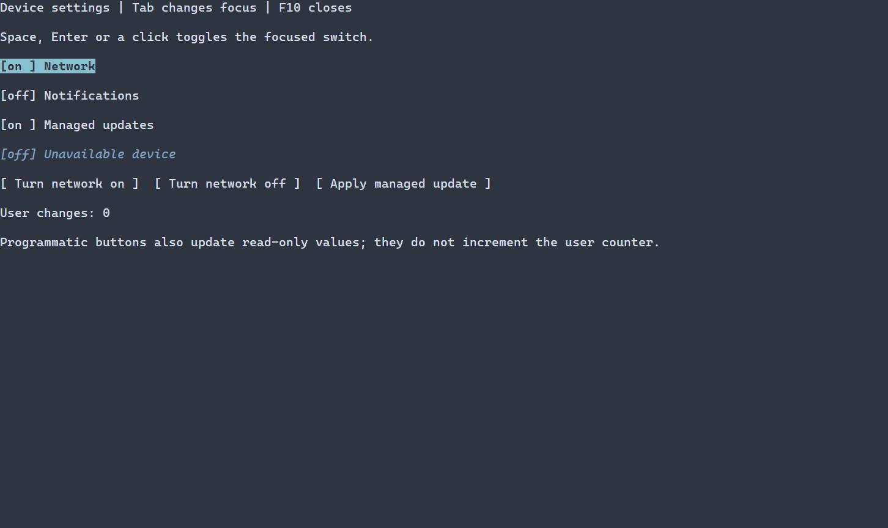

# Boolean switches {#switch-guide}

[Русская версия](ru/switch.md) · [Controls](controls.md) · [Scene resources](scene-loading-guide.md)

Use a switch for a Boolean setting such as network on/off; a [CheckBox](check-box.md) suits an independent selection such as opting into notifications. Both can bind a Boolean value; an accepted user change updates that bound value, while the application controls side effects and persistence. A switch does not represent an indeterminate value. See [Switch options and factories](../include/portals/ui_switch.hpp) and the [control API](../include/portals/switch.hpp). The preview is the larger device-settings composition.

Use `ui::toggle` to display and edit a boolean value. The public widget type is
`Switch`; the factory name avoids the C++ keyword `switch`.



[Still image](images/switch.png). The keyboard demonstration includes a read-only switch and programmatic updates that preserve the user-change count.

## Complete program

This [complete guide program](examples/guide_switch.cpp) binds a scene-owned bool,
observes user changes and enables the switch from an ordinary button:

\include guide_switch.cpp

Build `portals_docs_switch` with `PORTALS_BUILD_TESTS=ON`, or build
`portals_switch_example` with `PORTALS_BUILD_EXAMPLES=ON` for the complete
[device-settings application](../examples/switch/main.cpp). Run the executable in
a terminal. Tab changes focus, Space/Enter or a left press toggles the switch,
and F10 closes the guide. Native `ui::runApp()` restores the terminal on exit.

`ui::toggle("Network")` starts false. Supply `true` as the second argument for
an initially enabled switch. `ui::toggle(ref, "Network", owner.state(true))`
accepts the checked state-creation result directly. An existing
`ManagedState<bool>` remains authoritative; mounting never overwrites it.
Switch does not accept a three-state model or `MIXED` value.

## Observing and changing a value

`ref.checked()` creates an observing `CheckedProperty`. It retains the original
reference slot, so a proxy saved before mount observes later publication. It
never owns the scene or a widget. `.get()` returns `expected<bool, ManagedError>`;
there is no implicit conversion from the property to bool.

Use `ref.checked() = true` in a normal callback. Assignment returns an observing proxy whose `.result()` exposes the exact
`PropertyUpdate<bool>` receipt, and automatically collects failures as
`switch.checked`, even when a void callback ignores the result. Diagnostics use
the `checked()` call site. Advanced callers can use `.set(value, origin)` to
obtain the same checked receipt with an explicit call site. Reads do not report. Assignment from another checked property copies its bool once
and preserves both observing identities. A failed source leaves the destination
unchanged and reports once; self-assignment is an equal-value no-op.
`ManagedScene::setChecked` and `CheckBoxBinding::set` are checked-only low-level
operations; their caller handles failures.

Programmatic writes and equal values do not invoke `ui::onChange`. Equal writes
produce no new notification or redraw. A changed programmatic value is
synchronized into presentation during ordinary scene preparation before the
next frame. `ui::onChange(ref, [](bool value) { ... })` receives changed successful
user commits only. A receipt callback receives the original commit snapshot,
including rejected/cancelled observer notification counts; callback reentry does
not replace it with a newer snapshot. Removing the node stops remaining handlers.
Callbacks cannot undo a commit.

The [full example](../examples/switch/main.cpp) counts user changes separately
from buttons that assign the property. The count does not change when a button
sets the same value or performs a programmatic update.

## Input, readonly policy and appearance

A switch is one focus stop. Only unmodified activation/Space/left press toggles
it. It has no drag animation or radio navigation. Disabled or hidden controls,
including descendants of disabled/hidden ancestors, follow ordinary router
eligibility. `.settings({.readOnly=true})` preserves focus but blocks user writes;
property/model writes still work. The full example includes a read-only switch
updated by a button and an unavailable switch.

Default ASCII decorations are `[off] ` and `[on ] `, both six cells wide.
Natural height is one row, and natural width is caption width plus decoration
width. Use ordinary `fitWidth`, fixed/minimum/maximum sizing and layout settings.
Normal/focused/disabled colors come from `ControlStyle` and the current theme;
state remains legible without color. Natural selectors are `Switch`, `CheckBox`
and `Control`, with ordinary IDs and classes.

For custom chrome, pass per-switch `ui::SwitchOptions` with owning `offText` and
`onText` strings. Both must be single-line, valid text with the same cell width
under the receiving scene's `WidthPolicy`; invalid pairs fail before publication.
No switch configuration is stored on unrelated controls. Low-level custom
construction uses validated `SwitchChrome::from`; mismatched caption/chrome
policies fail measurement with `INVALID_GEOMETRY`.

Caption literals and `TextValue` are owning cold inputs. An i18n caption uses the
`resolver` in `SwitchOptions` and is validated under the receiving policy during
mount. Paint reads only synchronized owning text, decorations and style; it does
not call models, formatters or resolvers. Borrowed paint text must be rendered
inside the same tree frame. Existing text/grapheme and layout limits apply.

## Loaded scenes

The [complete resource program](examples/guide_switch_resource.cpp) loads
`Switch#network { checked=true text="Network" }`, obtains
`scene.get<Switch>("network")`, and attaches the same property/button/user-change
behavior. Build target: `portals_docs_switch_resource`.

\include guide_switch_resource.cpp

`checked` is the ordinary boolean alias for `state=CHECKED/UNCHECKED`.
`readOnly`, caption, sizing, visibility, enabled state, IDs and classes use the
existing resource pipeline. `MIXED` and `THREE_STATE` are rejected. A named
registry factory returning a model-bound Switch may not receive an explicit
initial `checked`/`state` override, even an equal one; absence preserves its
model. Configuration defaults blocks use canonical `state=CHECKED/UNCHECKED`; `checked`
is the Switch node shorthand. Context defaults follow the same admission rule. This prevents loaded
configuration from silently replacing an authoritative code model.

Wrong-thread, closed-owner, stale/unpublished reference, invalid model/type,
active-frame mutation and allocation/callback failures retain the standard
typed errors and diagnostic provenance. The low-level enum CheckState binding
rejects Switch entirely; its binding contract is boolean only.


## Styling reference {#switch-styling-reference}

The natural selector is `Switch`. Its caption and on/off decoration share normal, focused or disabled style, in that priority order with disabled first. Checked is a value, not a separately painted PSS state; selected, header and caret are not painted. `ui::SwitchOptions::offText` and `onText` are owning `std::string` values, default `[off] ` and `[on ] `. Configure them in C++, not PSS: both must be single-line and have equal cell width under the receiving width policy. Invalid text or unequal widths rejects construction.

The common paint properties apply to each painted target:

| Property | Value |
| --- | --- |
| `foreground` | `#RRGGBB` text/ink color |
| `background` | `#RRGGBB` fill color |
| `bold` | `true` or `false` |
| `italic` | `true` or `false` |
| `underline` | `true` or `false` |

Manual `ControlStyle` defaults use terminal colors, normal text, bold focus and italic disabled text. Theme and PSS declarations override individual manual fields; unspecified fields retain lower-layer values, including explicit `false`. A selector without a state supplies all variants. See [cascade and selectors](styling-guide.md) and [styles](styles.md).

Layout properties `width` and `height` accept nonnegative cell counts, `auto`, `fit-content`, or `flex(positive weight)`; `min-width`, `max-width`, `min-height`, and `max-height` accept nonnegative cell counts. They require selectors without state or `:read-only`; Except for `min-width`, these size declarations are runtime PSS only. Conflicting widget bounds reject the update and retain the previous style and geometry; constraints and recipe precedence are explained in [layout](layout.md). These affect allocation, not the glyphs themselves.

```pss
Switch { foreground: #dce1e8; }
Switch:focused { background: #245070; bold: true; }
```
