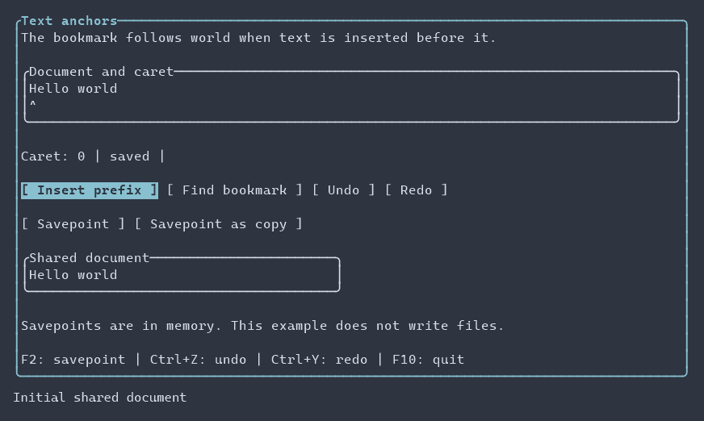

# Keep text positions through edits {#text-anchors}

[Русская версия](ru/text-anchors.md) · [Model bookmarks](model-positions.md) · [Undo and redo](editor-history.md)

A text bookmark records a position in a logical document. Inserting text before
that position moves the bookmark with the original text. The document owns its
selection and Undo/Redo history, so replacing a view does not reset them.

## Try a finite document

Include `<portals/ui_text_document.hpp>` to declare a finite in-memory document
and bind ordinary labels to it. The optional header is separate from `ui.hpp`.
This example displays two views of the same document and a caret marker:

[Complete example](examples/guide_text_anchors.cpp):

\include docs/examples/guide_text_anchors.cpp

Build with C++23 and link `portals::core`, following [Connecting an application](package.md).
Click **Insert prefix**, then **Find bookmark**. Both views show `Hi, Hello world`;
the bookmark restores the caret before `world`, now at byte offset 10. Undo and
Redo restore text and selection together. The caret marker uses ASCII text so
its byte offset also matches its display column.

**Savepoint** and **Savepoint as copy** acknowledge an in-memory baseline named
`memory:note` or `memory:copy`. This program performs no file writes. Saving under
another destination preserves the logical document, bookmarks and history.
F2 creates the first savepoint; Ctrl+Z and Ctrl+Y navigate history; F10 exits.

## Bounds and execution context

The UI factory defaults to 4096 UTF-8 bytes and 4096 graphemes, with the existing
finite text limits. Pass `FiniteTextDocumentOptions` explicitly to select other
finite limits. Each text edit segments the admitted buffer and uses the existing
bounded snapshot history. Each presentation value owns the complete finite text.
These costs depend on the admitted text size; this adapter is suitable for small
documents and demonstrations of session behavior.

Copies of `ui::FiniteTextDocument` share one document and its read-only
`source()`. `ui::label(note)` displays its text; `ui::label(note.source(), formatter)`
projects selection, dirty state or destination metadata. Commands belong on the
creating UI thread. The source binds to one scene; replacing views in that scene
preserves the session. After scene close or destruction, commands report `CLOSED`.
Writing through a field of the presentation source is rejected. Use document
commands to update text and selection consistently.

The core accepts an edit before publishing its UI presentation. A failed
allocation or rejected notification during publication can leave the accepted
document newer than the visible labels. The checked command reports that failure;
after handling its cause, call `refresh()` to retry publication. No rollback of
an already accepted core edit is promised. `lastError()` retains a typed core
`TextDocumentError` when the core operation itself failed. Checked command results
can be returned directly from a button or key handler for `runApp` to report.

## Byte offsets and grapheme boundaries

`portals::FiniteTextDocument` is the UI-independent finite adapter declared in
`<portals/text_document.hpp>`. Its `replace`, `setSelection` and `bookmark`
coordinates are UTF-8 byte offsets at extended grapheme boundaries, including
the end of the text. They are neither display columns nor grapheme ordinals.
Caller code serializes access. A borrowed `text()` view expires on successful
text mutation or document destruction.

`PositionAffinity::FORWARD` keeps a mark after an insertion at that mark;
`BACKWARD` keeps it before the insertion. Unicode edits can merge clusters and
remove an old boundary. Resolution snaps to the end or beginning of the current
cluster according to affinity and returns `NEAREST`. Undo that restores a known
content state can recover the original exact boundary.

The core implements `PositionResolver`: submit a qualified `PositionRequest`
and check the `PositionReply` before applying it. A bookmark carries no write
authority. Missing retained change proof returns `UNAVAILABLE`; a foreign
resource or incompatible lineage cannot be silently restored.

## Acknowledge a real save

For an actual writer, call `beginSave(target)` and retain the bytes observed at
that ticket's revision using the application's own snapshot or serialization
mechanism. The ticket owns destination metadata and qualification; it does not
own the document bytes or perform I/O. Run storage I/O outside the UI thread and
call `acknowledgeSave(ticket)` on the owner thread only after that write succeeds.

An acknowledgement for an older content state does not clear newer dirty edits.
A ticket older than an already acknowledged save reports `STALE`. SaveAs changes destination metadata
and the acknowledged savepoint while preserving selection, logical identity and
Undo/Redo. `dirty()` compares the current content state with the acknowledged
one, so Undo/Redo can return to the saved state.

On the core `portals::FiniteTextDocument`, report an external replacement with
`observeExternalReplacement()`. The document
enters a conflict state; it does not silently adopt external bytes. Explicit
`acceptExternalReplacement(text)` validates the new baseline, advances lineage
and clears incompatible history and marks while retaining logical identity.

## Supply anchors for a large text provider

`TextChangeMap` is a bounded metadata helper for providers with their own storage,
history and Unicode boundary lookup. `TextSplice` records an edit in provider-defined
scalar units. The helper stores no document text, performs no I/O, and does not
require a global grapheme index. Its capacity defaults to 128 retained changes.
The provider must report every edit truthfully and serialize map operations.

`map(bookmark)` returns an intermediate `TextMappedPosition`. Before returning
a general `TEXT` position reply, the provider must validate or snap its scalar
offset to a current grapheme boundary. An exact scalar mapping alone cannot prove
a Unicode boundary. `traverse` receives a content-state token and extent proven
by the provider's existing Undo/Redo engine; the map does not create a second
history store.

This foundation does not add windowed text editing, a file writer, or automatic
LineEdit/TextArea binding. Such a provider can use the same general bookmark
contract while loading only the data needed to qualify the requested boundary.
The finite demonstration does not claim arbitrary-size editing.
