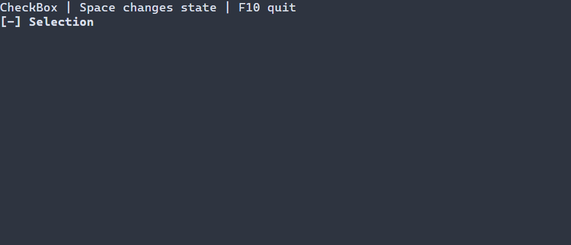

# Three-state choices {#three-state-guide}

[Русская версия](ru/three-state.md) · [CheckBox](check-box.md) · [RadioGroup](radio-group.md)

Use `ui::threeState` when unchecked, checked and mixed are all meaningful, for example an aggregate selection. For a Boolean choice use [CheckBox](check-box.md); for mutually exclusive alternatives use RadioGroup.

## A complete application

The example starts mixed. Space or Enter cycles the value; F10 exits and the standard runner reports errors and restores the terminal.



\include check_state/main.cpp

Build `portals_check_state_example` with `PORTALS_BUILD_EXAMPLES=ON` and run it in a terminal. See [build setup](getting-started.md) and [package setup](package.md).

## Value, input and resources

`ui::threeState("Selection", CheckState::MIXED)` creates scene-owned state. Omitting the initial state uses context defaults, otherwise unchecked; a `ManagedState<CheckState>` overload shares a scene model. The fixed cycle is `UNCHECKED` → `CHECKED` → `MIXED` → `UNCHECKED`. Unmodified Enter, Space and left mouse press activate. Release, movement, paste and modified gestures do not; hidden or disabled ancestry blocks activation. There is no separate read-only checkbox mode.

A `ui::Ref<ThreeState>` observes the mounted control. Typed change callbacks and `ui::onChange` observe successful user changes; external model writes do not invoke the business callback. A committed value is not undone by rejected observer notifications. The scene owns the widget and binding, while Ref is observing. `ui::checkbox(...).threeState()` is an alternative with natural type `CheckBox`, demonstrated in [CheckBox](check-box.md). See [three-state binding](controls.md#check-box-with-three-states) for receipts and aggregate helpers.

Resources register `ThreeState`; retrieve a named instance using `scene.get<ThreeState>(...)`. See [scene resources](scene-loading-guide.md) for syntax and typed lookup.

## Styling reference {#three-state-styling-reference}

The natural type is `ThreeState` with base type `CheckBox`, so either selector matches. Its caption and fixed `[ ] `, `[x] `, `[-] ` markers share normal/focused/disabled style; disabled takes priority. Checked and mixed are values, not `:selected` paint states. Header and caret are not painted; PSS cannot replace marker strings or color them independently.

| Property | Values and effect |
|---|---|
| `foreground`, `background` | `#RRGGBB`; foreground and fill |
| `bold`, `italic`, `underline` | `true` or `false`; explicit false overrides a lower layer |
| `width`, `height` | Nonnegative cells, `auto`, `fit-content`, `flex(positive weight)` in runtime PSS |
| `min-width`, `max-width`, `min-height`, `max-height` | Nonnegative cell bounds; only `min-width` also works in compile-time PSS |

Size declarations cannot depend on a state or `:read-only`; conflicting bounds reject the update and retain the last valid style and geometry. See [layout](layout.md). Manual `ControlStyle` uses terminal-default colors, normal text, bold focus and italic disabled text. Theme and PSS rules override individual fields; unspecified fields retain lower-layer values. See [the cascade](styling-guide.md).

```pss
ThreeState { min-width: 12; }
ThreeState:focused { foreground: #ffffff; background: #245070; }
ThreeState:disabled { italic: true; }
```

See `portals::ThreeState`, `CheckState`, `ui::threeState` and [basic styling](controls.md#basic-controls-styling-reference).
