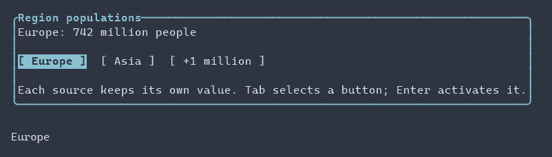
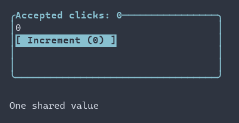

# Bind model values to captions {#value-models}

[Русская версия](ru/value-models.md) · [Collection views](view-models.md) · [Bindings and events](bindings-guide.md)

Use a value model when several controls should display or change one accepted
value. A value may be a number, a boolean, an enum, an owning string or a record.
Labels, button captions and ordinary frame titles use the same model declarations,
field projections and formatted expressions. The scene registers and observes the
values when the receiving recipes mount.

## Choose a source and change its value

This complete program keeps separate populations for Europe and Asia. Choosing a
button changes the source of the summary. **+1 million** changes the population of
the displayed source; switching back shows that source's accepted value.

@include docs/examples/guide_value_models.cpp



The animation shows F4 changing the active population, then keyboard selection
switching between sources. It uses captured application terminal cells with input
steps displayed below the frame; it is not a recording of a particular terminal host.

The `describe` projection belongs to the label binding. `summary.model(candidate)`
checks the replacement and keeps that projection. The `selected` descriptor changes
only after successful admission, so a rejected replacement leaves both the displayed
source and the next write target unchanged. There is no separately updated region
name or formatted-string state.

Build the program with the [consumer application setup](index.md), linking
`portals::core`. The complete source is available as
[guide_value_models.cpp](examples/guide_value_models.cpp).

## Update a value or replace a source

The following UI-handler fragments assume that the models and references from the
complete example have mounted successfully:

```cpp
europe.value() = Region{"Europe", 743};
europe.field(&Region::population) += 1;
summary.model(asia);
```

`value()` and `field()` address the accepted value of one model. Field assignment
copies the latest record, changes the requested member and publishes through the
same root property, preserving the other members. Addition uses that member's
ordinary C++ addition semantics; it does not add saturation or overflow checking.

Copying or assigning `ui::Model<T>` descriptors shares their declaration. It does
not copy or publish the current value. A descriptor owns its declaration and initial
value; a mounted handle observes a scene-owned property and does not keep the scene
alive. Registration and value access belong to the creating UI thread. A declaration
is single-scene; create a new one for another scene.

Checked reads and writes do not report errors automatically:

```cpp
auto snapshot = europe.value().snapshot();
auto update = europe.field(&Region::population).set(744);
auto replacement = summary.setModel(asia);
```

Check these results before reading their payloads. A successful `PropertyUpdate`
retains the accepted root snapshot, change flag and notification receipt. Rejected
delivery after a commit does not undo the accepted value. Short assignment,
`+=` and `.model(...)` use the existing scene error collector; a failed setup stage
stops subsequent setup and application startup after the current callback finishes.

## One value, three receiving controls

This complete program binds a label, a button caption and a frame title to the same
counter. Pressing the button updates all three. The title is clipped to the current
frame width and grows visible again when the terminal becomes wider.

@include docs/examples/guide_value_captions.cpp



Formatted text owns its arguments and observes their explicit model dependencies:

```cpp
ui::label(text("Population: {}", europe.field(&Region::population)))
```

The standard format string is checked against the underlying field value type.
Static string views and character arrays are copied into the expression. No temporary
snapshot or member reference is retained. Repeated fields of one root use one
observation per receiving expression. Equal output does not change the caption or
request another redraw. Hidden recipients have no timer or continuous polling.

A projected caption such as `ui::label(summary, europe, &Region::name)` preserves its
projection when `.model(asia)` accepts a compatible root. A formatted caption such as
`ui::label(summary, text("{}", europe.field(&Region::name)))` has a complete computed
text source. Replace that source with another `text(...)` expression; passing one
of its input models is rejected rather than silently redirecting a hidden dependency.

Ordinary `.framed("rounded", expression)` recipes create a passive `Border` title.
The overload with an observing frame reference supports `outer.setModel(...)` and
`outer.model(...)`. Frame patterns, decorations, size policies and allocated geometry
survive title changes. Invalid or oversized titles preserve the previous valid title.
The native frames inside `ScrollArea`, `LogView` and `DocumentView` retain their static
title API; these live-title overloads are unavailable for those recipes.

## Localize a live format string

Pass an owning `TextValue` and the existing resource resolver protocol. A resolver
may take only the resource key, or the key followed by the underlying argument values.
Use the second form when resolution depends on an explicit language model:

```cpp
auto population = ui::model(742);
auto russian = ui::model(false);
auto resolve = [](std::string_view key, int, bool ru)
  -> std::expected<std::string, TextResourceError> {
  if (key != "population") {
    return std::unexpected(TextResourceError::MISSING_RESOURCE);
  }

  return ru ? "Население: {0}" : "Population: {0}";
};
auto caption = ui::label(text(i18n("population"), resolve, population, russian));
```

The population occupies format argument zero. The language is argument one and an
explicit dependency even though the translated pattern does not print it. Changing
either model triggers resolution; an unchanged frame does not. The resolver receives
the retained input snapshots directly, including during initial mount. It should not
read unpublished models or change UI state. Resource access must be short and
memory-only on the UI thread.
The expression retains the resolver's captures. Any borrowed services captured by
the resolver must remain valid for the lifetime of the mounted binding.

Translated format strings are checked at runtime. A missing initial resolver retains
`RESOLVER_REQUIRED` in `ManagedError::resource`; initial resource lookup errors retain
their resource category. Later resolution failures use the existing observer's
`TreeError` channel and preserve the last valid caption. That channel does not retain
the separate `TextResourceError` category. Invalid formatting also preserves the last
valid caption and reports through the existing observer error policy.

## Follow the accepted source of shared navigation

Use `navigation.current()` when a caption should follow the source accepted by a
shared list/table group. `bySource` maps that resource to owning domain metadata:

```cpp
ui::label(region, navigation.current(),
  ui::bySource<City>({{europe, "Europe"}, {asia, "Asia"}}))
```

The complete [model-switching example](view-models.md#view-models-example) uses this
binding. Rejected group admission keeps the old source and caption. Successful
admission publishes the accepted resource before dependent observation. Delivery
rejection after admission leaves that accepted source installed.

The default metadata type is `std::string`. `ui::bySource<City, Region>(...)` can
instead return an owning record, and other copyable owning types are supported.
The catalog copies metadata and descriptors, without registering unselected cold
models or acquiring additional row ranges or snapshots. Captured model declarations
retain their normal initial-value and provider ownership. Lookup scans catalog entries, not
model rows. `CollectionLimits::maxRows` bounds the number of entries, defaulting to
4096. Unknown resources, duplicate matches, invalid descriptors, retired sources,
foreign threads and mixed registered scenes produce typed failures; the adapter
does not guess a different source's metadata.

## Data capabilities and cost

`ui::model("text")` and `ui::model(std::string(...))` declare scalar strings.
`ui::model(std::array{...})` declares the existing bounded owning sequence; an immutable
`ModelSnapshot<T>` remains a provider with its own range access. Arbitrary input or
infinite ranges are not implicitly materialized. Convert a borrowed string view to
an owning string explicitly before storing it as a model value.

Whole-value and field updates use the existing owning `Property<T>` contract:
copying, equality, projection and formatting must be bounded, pure and non-reentrant.
Large data belongs in the [provider and window-source APIs](model.md), with its work
off the UI thread. A value model does not turn a large file into a copied scalar or
an unknown-length source into a finite sequence. Tree bookmarks use the common
position protocol; these bindings do not add a `TreeView` or flatten a hierarchy.

This API provides accepted owned values and read-only projections. External
conditional writes, editable current-record forms and draft history have separate
contracts. Existing `ManagedState<T>` and `ManagedSource<T>` can be wrapped with
`ui::model(state)` and `ui::model(source)`. A read-only alias keeps its original
readiness, thread and lifetime checks and rejects writes; it does not acquire write
authority by being wrapped.
