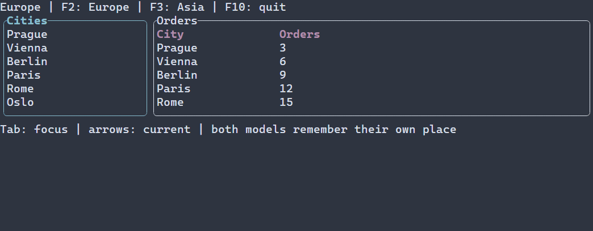

# Switch a model and remember your place

[Русская версия](ru/view-models.md) · [Shared navigation](model-navigation.md)

This guide covers managed finite-model lists and tables. [LogView](log-view.md#log-view-switching-models)
uses its own bookmark-capable source integration, including sources without a total row count.

## Declare a model and its views

Use `ui::model` to describe an owning small sequence or an existing immutable provider.
Registration occurs when a view mounts. With the `City` type from the complete example:

```cpp
auto europe = ui::model(std::array{City{"Prague", 3}, City{"Vienna", 6}});
auto navigation = ui::navigation(europe, {.readingAnchor = true});
auto views = ui::hbox(
  ui::virtualList(navigation, &City::name),
  ui::virtualTable(navigation,
    tableColumn("City", &City::name, 18),
    tableColumn("Orders", &City::orders, 8)));
```

A list projection can be a member pointer or a lambda. Standard-formattable scalar
rows need no projection: `ui::virtualList(model)`. Columns accept member/lambda
projections with default formatting or an explicit formatter. Schema errors retain
their typed cause during mount.

Copies of a `ui::Model<T>` share one registration in one scene. Passing that Model to
several views gives each independent navigation. Passing an explicit `ui::Navigation<T>`
shares its enabled channels; separate `ui::navigation(model)` calls create separate
sessions. These descriptions use the existing managed models, properties and preparation
loop. They do not add another runtime or application-owned history map.

## Switch models

A mounted list or table remembers its current row, selected identities and reading
anchor for each model it has visited. Switching A → B → A restores A by stable row
identity; it does not copy an ordinal from B. Different views remember their own
positions unless they are explicitly bound to the same navigation context.

```cpp
// Independent views: each keeps its own position for each model.
list.model(europe);
table.model(europe);

// Shared navigation: change all participants together.
navigation.model(europe);

// Explicitly discard the target checkpoint and use its initial position.
list.model(europe, {.restore = ModelRestorePolicy::RESET});
```

The collected `model(...)` forms send errors to the scene's existing diagnostics.
Use `setModel(...)` when the caller needs an immediate checked result. These operations
run on the UI thread; provider payload work stays on the existing preparation path.
A shared-context change admits all participant consumers and metadata before replacing
any binding. Admission failure keeps the old group installed. Independent calls do not
form a transaction merely because they appear next to each other. Automatic group
rebinding does not construct an adapter for an arbitrary cross-model projection;
such participants are rejected before any binding is replaced.

### What counts as the same place

A finite provider implements bounded `locateRow(RowId)` when direct navigation needs
an identity index. Its default is UNSUPPORTED; the UI does not scan the model to guess
an ordinal. The small owned sequence supplies this index; custom providers implement
it as described in [model bookmarks](model-positions.md).

An existing row stays current across insertion and reordering. A declared removal may
choose a surviving neighbor when the provider supplies the required ordering proof.
Filtering a row out is not evidence that it was deleted. A selected non-current row
that is proven deleted is removed from the selected set, not replaced with its neighbor.
Current, selected set and reading position remain separate logical values.

An unresolved return retains its checkpoint and suppresses an incorrect initial row-zero
frame. Pending resolution follows model publication and existing request delivery; paint
and resize do not poll the provider. `restoreStatus()` reports the identity outcome.
Unsupported, incompatible or unavailable history is a view-local failure; it does not
mark an otherwise healthy model or an independent sibling as failed. A newer publication
may supply the missing proof. Use explicit RESET to abandon that saved position.

### Resource and lifetime boundaries

Automatic identity belongs to the registered model. Reopening a provider as another
registration requires the explicit ModelResource/source-session contract to attest
continuity. Equal values, equal row numbers or coincidentally equal ids are insufficient.
A different history lineage is incompatible. Explicitly attested checkpoints can survive
switching away and retiring the old provider; no model, row page or provider is retained
by the checkpoint. Retiring the currently active model still closes its navigation
context. This API does not yet change that lifecycle or provide disk persistence.

### Preparation and errors

Ordinary preparation belongs to the model. Switching models uses the destination's
loader; an arbitrary callback capturing the old provider is never silently reused.
Low-level override retention, replacement and clearing are explicit options. Changing
only that callback on the same model does not reopen a consumer, reset navigation or
cancel an outstanding resolution request.

Default history metadata is bounded to 256 KiB per view session or shared context;
bookmarks default to 4096 bytes and selected sets to 1024 ids. Limits do not depend on
row count. Exhausting admission returns a typed error without silently evicting another
model's position. Old and new staged metadata count against the budget together.

After a successful shared-context installation, all current channel snapshots and view
bindings describe the installed group before observer delivery begins. Historical queued
payloads keep their own qualified resource and outcome. Delivery rejection is a reported
postcommit error and does not roll back installed state. An unsuccessful admission may
leave a harmless layout invalidation request; it does not install part of the new group.

### Edit a small owned sequence

`ui::model(std::array{...})` owns copyable values and assigns stable row identities.
Equal values remain distinct rows. After mount, its checked UI-thread operations return
`std::expected<void, ManagedError>`:

| Operation | Effect |
| --- | --- |
| `model.insert(index, value)` | Insert one copied value with a fresh identity. |
| `model.erase(first, count)` | Remove a range; `count` defaults to 1. |
| `model.move(first, count, destination)` | Preserve identities; destination is the index **after removing** the range. |
| `model.clear()` | Remove all rows. |

Handle the result before updating dependent application state. Allocation/admission
failure preserves the installed snapshot. Empty erases, an unchanged move and clearing
an empty sequence do not publish a revision. Erased identities are never reused, and
successful structural changes advance a positive revision. Owning a value preserves
its normal C++ semantics: a `string_view` or reference inside it still borrows its target.

The default capacity is 4096 rows, configurable with `CollectionLimits`. The adapter
retains the latest 1024 scalar changes by default, configurable with `PositionMapOptions`.
Further edits keep working. A still-present identity resolves EXACT even after its old
revision leaves that proof window. For a missing identity older than the retained proof,
restoration reports UNAVAILABLE and keeps the checkpoint; it does not guess a neighbor.
Within the window a proven deletion can resolve NEAREST. This proof retention is separate
from the view/context checkpoint budget above. Provider models do not acquire these
owning mutations; their checked mutation calls return INVALID_ARGUMENT.

### Keep the provider path for large data

For an existing `std::shared_ptr<const ModelSnapshot<T>>`, use `ui::model<T>(provider)`.
Declaring or mounting it neither reads nor copies row payloads; rows may be noncopyable.
Visible-range preparation and publication retain the existing provider ownership.
See [immutable models](model.md) for snapshot, publisher and worker integration.

Existing column arrays and named configs also work with a cold Model:

```cpp
// model, columns, config and tableRef have matching row types.
auto view = ui::virtualTable(tableRef, model, columns, config);
```

`columns` may be a `TableColumn<T>` array/span; the recipe owns its copied definitions
and config. An empty `config.prepared` uses the model's preparation handler; a nonempty
handler overrides it for this view. This form keeps independent navigation and accepts
`ui::Model<T>`, with no automatic shared-coordinate assertion for arbitrary projections.
The existing `ManagedModel<T>` factories remain available for advanced integration.

Use `model.managed()` after successful mount when an existing publisher or low-level
API needs the checked runtime handle. Publisher admission, producer shutdown and borrowed
capture lifetimes remain application obligations. Descriptors are single-scene: empty,
failed, foreign-scene and closed handles produce typed errors. For a valid descriptor, `managed()` is CLOSED
before publication and after scene closure. Mount failures follow the existing scene/
`runApp` diagnostic path; `setModel` and sequence edits expose immediate checked errors.

Providers may optionally override `ModelSnapshot::positionHistory()` to return a bounded,
qualified change proof. Its default requires no override or per-source history storage.
This addition is source-compatible, but changes the virtual interface: rebuild provider
binaries and SDK consumers against matching installed headers and library. Compatibility
with an older binary SDK/provider vtable is not promised.

### Unversioned finite models

Revision zero remains a valid ordinary finite model. It lacks the positive revision
needed by a bookmark, so returning to its saved position reports UNSUPPORTED. Mounting,
local keyboard navigation, switching away and explicit RESET remain usable. RESET uses
the ordinary initial state and clears the incompatible restore intent. A later positive
publication does not retroactively qualify an unversioned checkpoint. Direct shared
capture/navigation requiring unavailable versioned proof returns WOULD_BLOCK; native
controls keep their local behavior without promising shared bookmark continuity.

## Complete shared-group example



[Full source](examples/guide_view_models.cpp) declares two small owned models with
`ui::model` and binds a projected list and table through `ui::navigation`. Move with arrows, switch regions with
F2/F3, and return to the former region. Both views recover that region's logical place.
Tab changes focus; F10 or Ctrl+C exits. The caption changes only after group admission.

The views share the current row and remember their positions for each model. Each
view reveals the current row within its own body: a table header reduces visible data
rows, so the first visible rows may differ. With `readingAnchor` enabled, explicit
scrolling also shares a logical reading anchor; automatic scrolling to reveal the
current row does not lock the viewports together. A late shared-position update is
consumed by earlier views on the next ordinary frame, without another input.
Build `portals_docs_view_models` with tests enabled, or use the installed SDK.

The complete client uses cold declarations and ordinary collected model switching;
registration and group admission stay inside the SDK. Its owned arrays are the small-data
path. Large provider data continues to use the linked immutable-model integration.

@include docs/examples/guide_view_models.cpp
