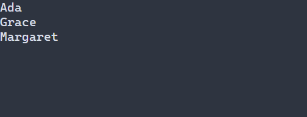

# Show a virtual list

[Русская версия](ru/virtual-list.md)

Use a virtual list for a large typed model when only visible rows should be formatted. `VirtualListOptions` defaults to a one-cell row and two overscan rows. Arrows and Home/End navigate; left press selects and the wheel scrolls. A typed reference observes the scene-owned view. For a loaded configuration, register a typed factory; the model and formatter remain C++ captures. See [resource registration](../include/portals/ui_scene_resource.hpp).



## Styling reference {#virtual-list-styling-reference}

Declarative lists use `VirtualList`; the managed virtual-view API defaults to `List` unless a target was supplied. A directly bound widget uses its registered target. Rows use normal or `:selected`, not focus or disabled variants. `VirtualListOptions::normal` and `selected` provide defaults beneath the cascade.

Use `foreground`, `background` (`#RRGGBB`) and `bold`, `italic`, `underline` (`true` or `false`). A rule without a state applies to all variants. See the [cascade and size constraints](styling-guide.md); `min-width` is state-independent. Prepared match highlighting uses `VirtualListOptions::highlight`, not a PSS part: its present colors override row colors and its boolean attributes are ORed with the row attributes (by default bold and underline).

```pss
VirtualList:selected { background: #305070; bold: true; }
```

Use [VirtualList<T>](../include/portals/virtual_list.hpp). The program below displays three names with standard keyboard and mouse navigation. Press F10 to close.

The program uses Names, an immutable `ModelSnapshot<std::string>` adapter with three records, and displayText, which creates GraphemeText. The adapter, helper, headers and complete program appear below and in [guide_vlist.cpp](examples/guide_vlist.cpp).

<details>
<summary>Complete program</summary>

\include guide_vlist.cpp

</details>

The [standalone guide project](examples.md) builds target `guide_vlist`; run the resulting executable in a terminal. It links `portals::core`.


The scene owns input bindings, range consumers and preparation. The formatter returns owning text and only reads the supplied row. Ready in-memory data needs no provider callback. Pending data requires prepared in ui::VirtualListConfig<T> to dispatch the returned request; the library starts no workers. TBD: the requested ui::vlist alias is unavailable; no delivery date is assigned.

Terms: [recipe](glossary.md#glossary-recipe), [frame](glossary.md#glossary-frame), [ownership](glossary.md#glossary-ownership).

<details>
<summary>API reference and constraints</summary>

`VirtualList<T>` is one `SizedWidget`, regardless of the logical row count.
It consumes the typed immutable [model](model.md), uses the existing
[router](focus.md), and paints widget-local commands through the regular
[layout and frame contract](layout.md). It does not create a widget for each row.

**Owning data and preparing a frame**

Create a separate `ModelConsumer<T>` for every view. Pass it by move to the
list together with an owning, copyable formatter.

`T` need not be default-constructible or copyable. The list only borrows each
`const ModelRow<T>&` during formatting. Providers guarantee immutable reachable
storage, stable nonzero `RowId` pairs, and consistency within a data revision.
The formatter must return owning `GraphemeText` under `options.width_policy`;
it must not retain the row reference, perform I/O, launch work, or mutate the
tree/model. Captures are owned by the list and destroyed on UI.

Between frames, the application applies Scheduler publications, obtains **one
[model pin](glossary.md#glossary-model-pin)**, an immutable capture of data and availability, and passes that same `ModelFrame<T>` to every view of the model.
`prepareVirtualList(tree, list, pin, viewport)` takes the **final local size
of that view**, in integer cells. Determine it from application/layout
constraints; repeat preparation after resize before painting. This preparation
phase precedes the `tree.frame` that performs layout, paint and rendering.
A mismatch between arranged and prepared sizes returns `INVALID_GEOMETRY`;
unprepared or changed scroll/options state returns `WOULD_BLOCK` from paint.
Never render a partial command collection after any paint failure.

The view retains its pin and `ModelRange<T>`, and owns every formatted string.
A preparation builds the entire next presentation before publishing it. An
allocation/delegate failure preserves the previous frame, row identities and
text together. Successful replacement releases old owners only after the new
state is consistent. Paint neither pins nor reads a model and never formats.
Borrowed `TextCommand` text remains alive through rendering inside the enclosing
`tree.frame`; do not retain commands after that frame. The output owner can
submit the resulting owning framebuffer to `FrameWriter` afterward.

A provider completion may contain a bounded prefetched page around the requested
interval. During later preparation the view can read the new exact window from
its retained completion snapshot when both data revision and row count match the
current pin. It retains one such owner, formats only current visible rows, and
respects the model's read budget. A cache miss remains pending and schedules the
new exact request; provider failures are not replaced by older ready data. A
revision change or hidden view releases the old prepared owner. Public base reads
and independent consumer results retain their existing exact semantics.

**Range and request rules**

For a positive fixed row height `H`, the list realizes `ceil(viewport.height/H)`
rows, including the last partial row. Zero width/height and an empty model
realize zero rows. The first row is integral and clamped to the last logical row;
the empty model uses zero. Up to `overscan_rows` extra rows on each side enter the
requested range, but only visible rows are formatted. There is no million-row
allocation, total-height multiplication, row-ID scan or hidden worker.

Preparation first checks the consumer result in the supplied frame. A matching
ready/error result belongs to that consumer. Otherwise it performs a bounded
in-memory `frame.read` and, while pending, checks its own completed page owners.
These reads cannot initiate I/O. The whole requested interval
must be ready: this version does not spatially merge a partially ready overscan.
Pending rows show `...`, error rows show `!`, clipped as whole graphemes.
`rangeState()` exposes the readiness independently of those placeholders.
The provider's detailed error remains available through the model's range API.

A new pending range produces `optional<ModelRequest<T>>` **once**, as a dispatch
receipt. The application starts its own work using that token; repeated preparation
of the same pending request does not return another receipt. A worker calls
`token.complete(snapshot)` and checks its result. Queue backpressure (`WOULD_BLOCK`)
permits retrying the same completion token. If the application cannot start work,
it cancels and releases its receipt; preparation can then issue a fresh one.
A provider error is stable until a new publication or explicit
`retryVirtualList(tree, list)` followed by preparation. No automatic retry loop
is installed. Check `Model::lastError()` when applying Scheduler publications:
queue acceptance alone does not prove application to the model.

Scrolling supersedes the previous request; the existing model consumer checks
request generation and data revision when completions arrive. Cancelling the
token does not join a worker or free its work reservation while other owners
remain. If the model's in-flight budget is full, preparation returns `WOULD_BLOCK`;
release completed/cancelled application tokens and retry. The configured model
range limit also applies to viewport plus overscan; oversized ranges fail with
`INVALID_ARGUMENT`, without silently reducing the requested viewport.

**Selection, input and visibility**

Selection is `optional<RowId>`, not a row position. Insertion, reordering,
publication and scrolling do not replace it. Removed IDs remain selected until
the application clears/changes them. `setVirtualListSelection` accepts an
offscreen nonzero ID without loading or searching the model.

Keep the `ActionBinding` returned by `bindVirtualList` alive. Up/Down move
within the logical model; Home/End reach its boundaries. With no selection in
the visible range, Up/Down start at the first visible row. Finding an already
selected row examines only visible delegates. A navigation intent is a separate
position plus data revision; a later explicit selection cancels it, and a data
revision change discards it. Only ready rows from the applicable preparation
resolve that intent to a stable ID. Pending input can continue scrolling.

Left press uses the router's actual surface geometry and ancestor clip. It
maps the hit cell to a logical row using fixed row height; stale dirty content
is not clickable. Wheel up/down moves the first row by one without changing
selection. Fractional input, identity anchoring and ensure-visible use the shared
[scroll component](scroll.md). Providers opt into stable anchoring by implementing
bounded `ModelSnapshot::locateRow`; unsupported providers retain ordinal scrolling.
The view never scans the full model. Device acceleration remains an input-adapter concern.

Preparation inspects ancestor visibility. Hidden lists cancel work, release their
prepared delegates/frame, clear navigation intent, and keep stable selection.
Call preparation after a visibility change even if the view will not paint.
Tree removal destroys the consumer and cancels its work independently. Disabled
views still paint, but the router prevents their input.

**Errors, invalidation and limits**

All view mutation uses the tree's UI owner and occurs outside a frame. Wrong
thread, stale/foreign node, closed tree, and frame mutation errors propagate.
Nonpositive row height, negative preparation dimensions, invalid IDs/policies,
and range overflow return `INVALID_ARGUMENT`. Allocation failures return
`NO_MEMORY`; other formatter exceptions return `CALLBACK_FAILED`. A foreign
model pin returns `STALE_NODE` for the consumer even if publication revisions
coincidentally match. A failed sink may already have accepted earlier row
commands; the caller discards that scene.

Preparation invalidates paint when it changes the presentation. Repeating an
unchanged preparation neither reformats rows nor schedules a frame. Selection,
scroll and explicit retry invalidate paint; options invalidate layout and paint.
Application-driven model publication already invalidates its model context.
Row text and placeholders use the complete configured width policy, and the
renderer preserves whole wide graphemes even in a one-cell viewport.

</details>
