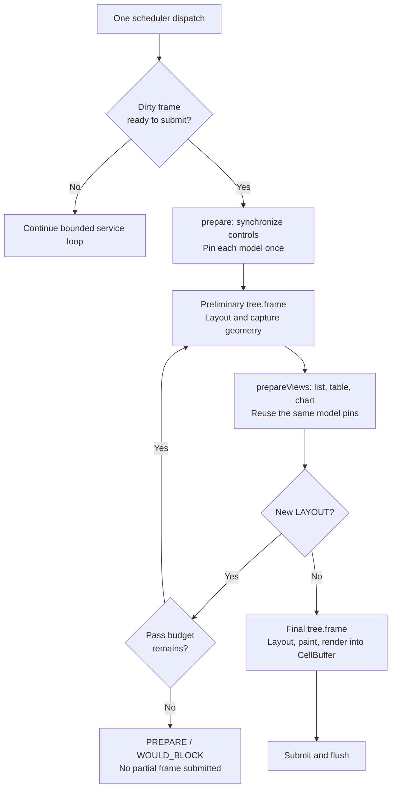

# Prepare virtual views from layout {#virtual-preparation}

[Русская версия](ru/virtual-preparation.md)

Virtual tables, lists and charts can use their arranged sizes without duplicating
layout arithmetic in application code. Choose either the managed factories in
`portals/managed.hpp` or the explicit hooks in `portals/virtual_preparation.hpp`.
The existing explicit `CellSize` preparation overloads remain available.

This is an experimental extension of the [application runner](application.md).
Both paths use the same tree, scheduler, model and renderer. Managed factories
own registration and model pins; provider scheduling and retries remain application
policy. The dashboard uses the managed path while retaining its bounded provider.

## Managed models and views

Create one model with `scene.model<T>(initialSnapshot, modelOptions)`, then pass
its `ManagedModel<T>` handle to `scene.virtualList<T>`, `scene.virtualTable<T>`
or `scene.chart<T>`. Each factory opens a separate range consumer, mounts the
widget, and registers layout-driven preparation and its standard `List`, `Table`
or `Chart` style identity. Lists and tables also receive their existing input
bindings; charts add no input binding. The returned node, such as
`Node<VirtualTable<T>>`, is an observer, just as with `emplace`. No binding token,
model pin or per-view size is retained
by ordinary consumer code. Explicit initial focus and theme selection remain
application choices.

`ManagedModel<T>` is a weak, UI-affine handle. Its `publisher()` operation must
run on the creating UI thread and returns the existing worker-safe
`Publisher<ModelSnapshot<T>>`. Copy that endpoint on UI before using it from a
worker; do not call the weak handle from the worker. The scene owns the model
until `close()`, and a view factory rejects a model from another scene with
`INVALID_ARGUMENT`. `ManagedOptions::maxModels` is a positive model-owner budget,
default 64; exceeding it reports `NODE_LIMIT` in the `STATE` phase.

For each dirty, submittable frame, `ManagedScene::prepare` synchronizes ordinary
controls, pins each owned model once, and flushes pending styles. All registered
views and all layout retries share those pins. `prepareViews` visits views in
registration order. For a chart it first evaluates the optional
`ManagedChartOrigin` callback; an empty origin callback means row zero. After
successful view preparation, it invokes that view's optional
`ManagedViewHandler<T>`, including on layout retries and when there is no new
request. A handler therefore must tolerate repeated invocation and should
invalidate only when its retained presentation changes. There is no new polling
loop or scheduler.

The handler receives a borrowed `const ModelFrame<T>&` and a borrowed
`const std::optional<ModelRequest<T>>&`. They are valid for that invocation.
Copy a present request into provider-owned storage before returning if work
continues later; keep its existing typed completion and cancellation protocol.
Do not retain references to either argument, dispatch the scheduler, repin
models, or mutate the managed registry in this callback. Checked low-level
presentation updates are allowed. Provider publication and completion can still
return `WOULD_BLOCK`: retain the unaccepted value or completion and retry through
the provider's existing service path. The managed layer does not retry it for you.

A handler may be omitted when the snapshot always supplies the requested data,
as in the complete example below. If preparation instead yields a pending request
without a handler, the scene cancels that request and reports
`PREPARE / INVALID_ARGUMENT`; it cannot silently leave provider work unowned.
Callback errors preserve their original `TreeError` and view identity through
`ManagedScene::run`. Allocation exceptions become `NO_MEMORY`, and other thrown
exceptions become `CALLBACK_FAILED`.

Hiding a view or an ancestor still prepares zero geometry to cancel range work
and release prepared rows. Disabling suppresses input but keeps preparation and
rendering. Removing a view retires its range consumer; late completions cannot
revive it. Use `scene.remove` outside preparation to retire managed registrations
as well. An admitted input callback may remove its own node and finishes with
its captures alive. If low-level code removes a node during preparation, retired
entries are pruned at the next ordinary preparation or at close; a later sibling
whose identity is already stale is skipped. An admitted handler's returned error
is still reported even if it removed its node.

Destroy the scene before its `Application`, on UI and outside callbacks or tree
frames. `close()` removes its subtree, retires callbacks and destroys owned
models; weak model handles then return `CLOSED` on UI, and copied publishers
cannot publish to the closed endpoint. A failed factory removes only its new
child and closes its range consumer; earlier successful children and the model
remain scene-owned. Constructor/provider side effects are not rolled back.
The existing [managed control rules](managed-controls.md) also apply.

## Explicit hooks: one frame, two preparation phases

For a custom `ApplicationScene`, opt into `usesPreparedLayout()` and implement
the existing two hooks. `prepare(application, terminalSize)` runs once for a
dirty, submittable frame.
Synchronize ordinary controls here and retain **one pin per model** in the scene.
Then `prepareViews(application, layout)` prepares every sibling from that pin
and the supplied owning `LayoutSnapshot`:

The first pending range request can invalidate layout while the second view
still needs its dimensions. `LayoutSnapshot` owns identities and cell sizes, so
both views see the same geometry even after that invalidation. It owns no
widgets, model rows or borrowed render commands. `viewport(node)` checks the
complete captured identity, including session and generation. It returns zero
size for a node beneath a hidden ancestor. Disabled nodes remain visible.

Capture is a record of one layout, not a subscription to later tree changes.
Use the supplied snapshot during that preparation pass. A subsequent mutation
can make its geometry obsolete; it does not silently update. Removal still
fails the view's existing checked tree access. Never reuse a snapshot across
frames as if it described the current tree.

`ApplicationOptions::maxPreparationPasses` is a positive pass budget, default 3.
Exhaustion ends preparation with `ApplicationPhase::PREPARE` and
`TreeError::WOULD_BLOCK`; no partial frame is submitted. Hooks must converge:
do not unconditionally invalidate layout on each call. Pure measurement and
arrangement can run more than once; painting only happens in the final frame.
An idle scene does not call either hook or redraw periodically.

For a full tree with N nodes, snapshot capture takes O(N log N) time and O(N)
storage; it sorts by slot once and then looks up each full identity in O(log N).
Copies share immutable storage. This cost is additional to the existing layout
algorithm: the opt-in path performs at least one preliminary layout and one
final layout. The pass budget bounds repetition, not the cost of an arbitrary
user widget's measurement callback.

## Providers and lifetime with explicit hooks

Each preparation overload returns the existing optional `ModelRequest<T>`.
Send new receipts to the application's provider and retain/cancel them under
the existing [model contract](model.md). Do not dispatch the scheduler, repin
the model or replace the scene's pin inside `prepareViews`, including retries.
Enqueueing a completion is allowed; delivery belongs to a later scheduler
dispatch. Same-revision range completions still need a fresh pin next frame.

Hidden list/table preparation cancels range work and releases prepared rows.
The snapshot chart overload passes zero size for hidden nodes, cancelling its
request through the existing chart path. A completion from an obsolete request
does not revive the hidden view. Keep preparing registered hidden views if
their outstanding work needs cancellation. A removed view is no longer a
valid preparation target.

Views retain owning pin copies through rendering. The application must outlive
its scene; model, provider and callback cleanup remain scene responsibilities.
The overloads preserve `TreeError` rather than converting failures to a generic
exception. A thrown hook is still reported by the runner's existing exception
boundary. The default scene path has no preliminary layout pass.

## Examples

The [dashboard](../examples/dashboard/dashboard.hpp) combines managed virtual
views with a bounded data provider. For declarative view construction and named
configuration, see [declarative composition](declarative-ui.md).

The [installed-package lifecycle test](../tests/package_consumer/virtual_lifecycle.cpp)
exercises pending requests, an odd-width resize, ancestor hiding, cancelled late
completions and independent sibling completions with the same data revision.
[Shared support](../tests/package_consumer/virtual_support.hpp) supplies immutable
rows and a finite terminal. See [package testing](package.md) for build instructions.

## Provider responsibilities

Managed factories own model ranges and register view preparation. Column arrays
and formatter lambdas infer their row type from the managed model.
Applications supply custom layout, formatters, chart accessors, provider dispatch
and retry policy. Explicit hooks and size overloads support custom preparation.
Network loading policies must preserve bounded requests and immutable snapshots.
