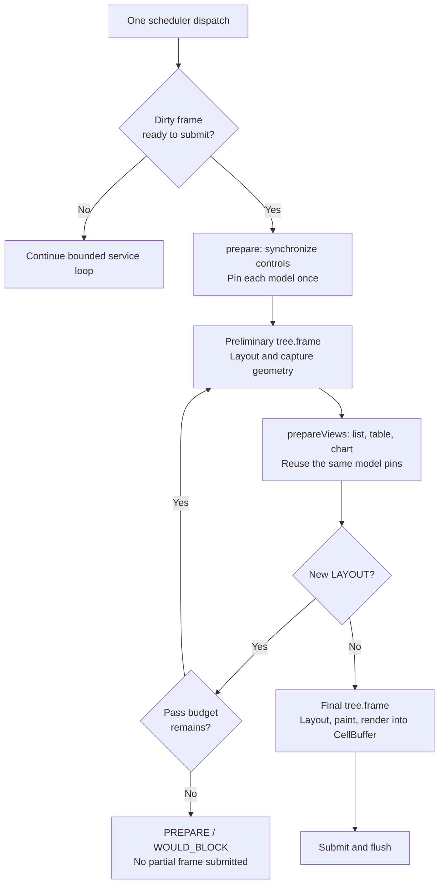

# Prepare virtual views from layout {#virtual-preparation}

Virtual tables, lists and charts can use their arranged sizes without duplicating
layout arithmetic in application code. Include `portals/virtual_preparation.hpp`
and opt a scene into `ApplicationScene::usesPreparedLayout()`. The existing
explicit `CellSize` preparation overloads remain available.

This is an experimental extension of the [application runner](application.md).
It uses the same tree, scheduler, model and renderer. It does not automatically
register views with `ManagedScene`, dispatch provider work, or replace the
dashboard's explicit preparation path.

## One frame, two preparation hooks

`prepare(application, terminalSize)` runs once for a dirty, submittable frame.
Synchronize ordinary controls here and retain **one pin per model** in the scene.
Then `prepareViews(application, layout)` prepares every sibling from that pin
and the supplied owning `LayoutSnapshot`:

The first pending range request can invalidate layout while the second view
still needs its dimensions. `LayoutSnapshot` owns identities and cell sizes, so
both views see the same geometry even after that invalidation. It owns no
widgets, model rows or borrowed render commands. `viewport(node)` checks the
complete captured identity, including session and generation. It returns zero
size for a node beneath a hidden ancestor. Disabled nodes remain visible.

Capture is a record of one layout, not a subscription to later tree changes.
Use the supplied snapshot during that preparation pass. A subsequent mutation
can make its geometry obsolete; it does not silently update. Removal still
fails the view's existing checked tree access. Never reuse a snapshot across
frames as if it described the current tree.

`ApplicationOptions::maxPreparationPasses` is a positive pass budget, default 3.
Exhaustion ends preparation with `ApplicationPhase::PREPARE` and
`TreeError::WOULD_BLOCK`; no partial frame is submitted. Hooks must converge:
do not unconditionally invalidate layout on each call. Pure measurement and
arrangement can run more than once; painting only happens in the final frame.
An idle scene does not call either hook or redraw periodically.

For a full tree with N nodes, snapshot capture takes O(N log N) time and O(N)
storage; it sorts by slot once and then looks up each full identity in O(log N).
Copies share immutable storage. This cost is additional to the existing layout
algorithm: the opt-in path performs at least one preliminary layout and one
final layout. The pass budget bounds repetition, not the cost of an arbitrary
user widget's measurement callback.

## Providers and lifetime

Each preparation overload returns the existing optional `ModelRequest<T>`.
Send new receipts to the application's provider and retain/cancel them under
the existing [model contract](model.md). Do not dispatch the scheduler, repin
the model or replace the scene's pin inside `prepareViews`, including retries.
Enqueueing a completion is allowed; delivery belongs to a later scheduler
dispatch. Same-revision range completions still need a fresh pin next frame.

Hidden list/table preparation cancels range work and releases prepared rows.
The snapshot chart overload passes zero size for hidden nodes, cancelling its
request through the existing chart path. A completion from an obsolete request
does not revive the hidden view. Keep preparing registered hidden views if
their outstanding work needs cancellation. A removed view is no longer a
valid preparation target.

Views retain owning pin copies through rendering. The application must outlive
its scene; model, provider and callback cleanup remain scene responsibilities.
The overloads preserve `TreeError` rather than converting failures to a generic
exception. A thrown hook is still reported by the runner's existing exception
boundary. The default scene path has no preliminary layout pass.

## Complete installed-package examples

The before/after programs use identical nested layout, immutable OHLC data and
finite replay input. The only intended difference is who obtains the local
view sizes. Both link to the relocated installed package through
`find_package(Portals CONFIG REQUIRED)`.

The source listings and exact replay equivalence check are maintained with the
package consumer, so the examples are compiled rather than illustrative API
pseudocode. See [installed package testing](package.md) for the fixture workflow.

| Concern | Before | After |
| --- | --- | --- |
| Nested sizes | Repeat padding, gaps, split rounding and title height in `prepare` | Pass the runner's snapshot to each view |
| Model pin | Local pin in `prepare` | One retained pin shared by `prepareViews` retries |
| Provider | Explicit request receipts | The same explicit request receipts |
| Geometry cost | One final layout | Preliminary capture plus final layout; bounded retries |
| Customization | Explicit `CellSize` | Captured local sizes, with explicit overloads still available |

The improvement is removing duplicated geometry rules, not a claim that the
entire example has fewer lines. The after scene deliberately keeps pin ownership
and provider requests explicit. Counters and captured sizes in this fixture are
test observations; applications do not need them.

### Before: explicit extents

[Complete before program](../tests/package_consumer/virtual_before.cpp).

\include{lineno} virtual_before.cpp

### After: layout snapshot

[Complete scene](../tests/package_consumer/virtual_scene.hpp) and
[complete after program](../tests/package_consumer/virtual_after.cpp).

\include{lineno} virtual_scene.hpp

\include{lineno} virtual_after.cpp

### Shared provider and finite terminal

[Shared support](../tests/package_consumer/virtual_support.hpp) supplies the same
immutable rows and finite terminal to both programs. It opens no native windows.

\include{lineno} virtual_support.hpp

The separate [lifecycle test](../tests/package_consumer/virtual_lifecycle.cpp)
exercises real pending requests, an odd-width resize, ancestor hiding, cancelled
late completions and independent same-data-revision sibling completions.

## Limits of this step

This adds layout-driven preparation, not a complete virtual-view DSL. The
application still owns view handles, pins and provider dispatch. Typed column
builders, query facades, page-cache policy and automatic managed registration
are separate work. It does not solve continuous scrolling across uncached
network ranges. Those provider policies must preserve the current bounded
requests and immutable snapshot contracts.
