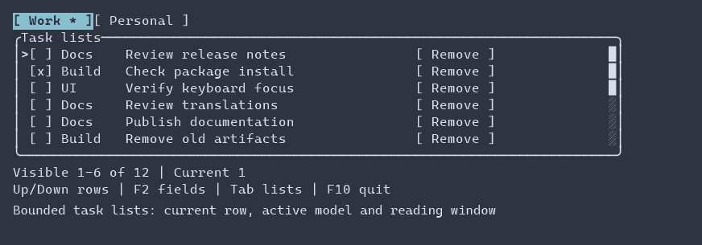
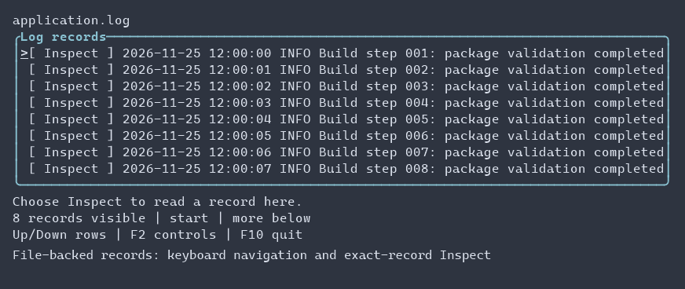

# Compose controls in virtual rows {#virtual-rows}

[Русская версия](ru/virtual-rows.md)

Use `ui::virtualRows` when each model record needs interactive controls: a task
with a checkbox, an editable name and a Remove button, for example. The view
creates ordinary control subtrees for the visible records. The model retains
the data when a row leaves the viewport.

For a list whose rows are formatted text, use [VirtualList](virtual-list.md).
For columns with headers, use [VirtualTable](virtual-table.md).

## Task lists {#virtual-rows-example}

The complete program has two task models. Work and Personal switch the model
used by the same view. Each row contains a CheckBox, Label, LineEdit and Button.
The asterisk marks the active model, independently of keyboard focus on a button.
The bounded panel shows the visible range, exact task count and current row.
F10 closes the application.



[Complete source](examples/guide_virtual_rows.cpp).

<details>
<summary>Complete program</summary>

\include guide_virtual_rows.cpp

</details>

The [standalone guide project](examples.md) builds `guide_virtual_rows` and links
`portals::core`. Include `<portals/ui_virtual_rows.hpp>` to opt into this API.

## Move between lists, rows and fields {#virtual-rows-keyboard}

The view has two keyboard modes. In row navigation, the whole view is one stop
in the outer Tab order. You can return to the list selectors without visiting
every checkbox, field and button in the model.

| Key | Row navigation | Inside the current row's controls |
|---|---|---|
| Tab / Shift+Tab | Move to the next / previous outer control | Move between this row's controls |
| Up / Down | Move the current row and reveal it | The focused control keeps its own input behavior |
| Enter / F2 | Enter the current row's controls | The focused control keeps its own input behavior |
| Escape | Keep row navigation | Return to row navigation after checked editing admission |

At the first or last row, another arrow does not send focus to the list selectors.
The current row follows stable record identity; scrolling the reading window and
changing the current record remain separate operations. Mouse input can enter
the ordinary controls. A rejected edit transition keeps its draft and validation
state; Escape does not introduce a blanket commit or cancel policy.

Enter or F2 opens the current row; Escape returns to row navigation. The next
recording also shows field focus, editing and removal.


## Observe the current position {#virtual-rows-position}

Keep a `ui::Ref<VirtualRows<T>>`; its `position()` method exposes a read-only
model. Place labels bound to that model after the view in the scene description.
The complete program uses ordinary labels for the position and keyboard mode.
Updates follow accepted view changes; the application does not need a polling
timer or a second mutable position variable.

`VirtualRowsPosition` separates the current record from the reading window:

| Member | Meaning |
|---|---|
| `resource`, `current` | Source-qualified current record identity, or no current record. |
| `currentIndex`, `firstIndex` | Optional exact zero-based ordinals; unavailable for unknown-total cursor sources. |
| `visible` | Ready records visible in the window, excluding retained offscreen editors. |
| `count` | Optional exact source count; absence does not mean zero. |
| `hasBefore`, `hasAfter` | Optional knowledge that more records exist in each direction. |
| `windowStatus` | Optional native delivery state. |
| `editing` | Whether focus is inside the current row's controls. |

The task program displays one-based numbers for people. The file-backed program
shows visible records and known traversal directions, without an invented count
or percentage. `Navigation::current()` and `ui::bySource` provide accepted active
source captions; merely focusing a selector does not switch its model.

## Records, fields and callbacks {#virtual-rows-data}

The row factory returns a fresh ordinary description. `row.field(&Task::done)`
binds the checkbox to that exact record; it does not follow the current selection.
Reordering the model cannot redirect a saved field or action to a different row.
When an assignment retires, its saved handles report `CLOSED`.

`row.value()` borrows an immutable value only while the factory runs. Copy the
fields needed to build labels. A later callback can call `row.snapshot()` to
obtain a checked owning data lease. Retaining that lease keeps the original
data page alive and uses the source's page budget; it does not retain controls.
The record and any borrowed members remain readable while the lease lives.

The field adapters use the same [editing contract](model-workflows.md) as other
model-bound controls. The default edit mode is `IMMEDIATE`. Validation, conflicts
and endpoint failures remain checked outcomes. A read-only provider requires
an explicit writable `EditEndpoint` before a row field can change its data.

Use `ui::label(row.field(&Task::category))` for a live accepted field value.
It updates without replacing the active editor. A label constructed from
`row.value().category` is a factory snapshot; it refreshes when that row recipe
is rebuilt. While an assignment is retained for focus or local editor history,
its snapshot-only labels retain their original text. Prefer field bindings for independently changing
captions.

With `EXPLICIT` editing, one unfinished row can remain retained outside the
viewport. Its draft, Undo history, cursor, selection and validation state stay
together. Starting another unfinished row fails before changing its data. With
`ON_COMPLETION`, scrolling an unfinished row out of view is rejected; finish or
cancel it explicitly first. Scrolling does not silently commit or cancel edits.

Accepted Undo history remains local to the mounted editor. Committing does not
clear that history while the editor remains mounted. After a completed row is
destroyed and remounted, it starts with a new editor history. The view does not
retain completed editor histories for every record ever visited. These policies
do not change an independently owned `EditSession`.

Models, states and derived values declared inside a row factory belong to that
assignment and are released when it retires. A shared model declared outside
the factory retains its scene ownership even when its first consumer is a row.
A newly declared cold model cannot be read before it is mounted; checked access
reports `CLOSED` until publication.

## Size and composition {#virtual-rows-size}

The example limits its whole panel with `maxWidth(76)` and lets the name field
shrink in a narrower terminal. This does not measure every record in the model.
Choose viewport width limits for your composition; the host does not scan a
potentially unbounded source to discover its longest row.

`height(8)` sets the viewport height in terminal cells, including its frame.
`VirtualRowsOptions::rowHeight` sets the common height of a record's child
composition; its default is one cell. Use a larger value for a `ui::vbox` of
fields. A child requiring more height than its slot reports `INVALID_GEOMETRY`.

`maxRows` bounds the number of visible assignments; its default is 256. This is
a view resource limit, independent of the number of records in the model.
An oversized viewport is rejected rather than silently hiding required rows.
Automatic measurement of varying record heights is a separate planned feature.

### Host options

Pass a `VirtualRowsOptions` value as the third argument to `ui::virtualRows`.

| Member | Default | Meaning |
|---|---|---|
| `rowHeight` | `1` | Positive height of each record composition, in terminal cells. |
| `maxRows` | `256` | Positive limit on assignments required by the visible viewport. |
| `overscanRows` | `2` | Additional native records requested for bounded row-step overlap. |
| `maxPendingRows` | `4096` | Positive cap on admitted native relative row movement awaiting delivery. |
| `editing` | `EditOptions{}` | Common edit mode and retained field/byte limits. |
| `checkpoints` | `ModelCheckpointOptions{}` | Existing bounded source-position history settings. |
| `scrollbar` | `true` | Use the existing styled vertical scrollbar for an exact finite extent. |
| `currentIndicator` | `true` | Reserve a left cell for the current-row marker. |

During a replacement, staged and retiring child trees can coexist. `maxRows`
does not mean that the process contains at most that many controls: a row may
contain several controls, and one unfinished edit may retain an extra row.
The source separately accounts for prepared pages and explicitly retained data
leases. Over-limit movement is rejected with a checked error.

## Style the controls and frame {#virtual-rows-styling-reference}

The host's style type is `VirtualRows`. Its children retain their ordinary style
types: [CheckBox](check-box.md), [Label](label.md), [LineEdit](line-edit.md) and
[Button](button.md). Their guides list supported properties and states.
A row composition may add classes and IDs
using the ordinary description API. Apply themes to the scene in the usual way.

Use `.framed("rounded", "Task lists")` for a titled boundary. Frame glyphs,
title decoration and colors use the common [styling guide](styling-guide.md).
The current-row marker is separate from focus on an individual child. The
vertical scrollbar uses the existing [scrollbar styles](scroll-controls.md) in a
compact right gutter inside the frame. This is not ScrollArea's `ON_FRAME`
placement. Unknown-total sources do not acquire a fabricated scrollbar scale.
Each child retains its own input and presentation behavior when entered.

## Sources without a known count {#virtual-rows-window-source}

`ui::model<T>(provider)` accepts a `shared_ptr<WindowProvider<T>>` and returns a
distinct window-source descriptor. Pass that descriptor to `ui::virtualRows`
with the same row factory. It does not invent a total count or require the
source to implement random access.

The source's capabilities determine whether backward traversal, row seeking
and tail navigation are available. `rowCount()` is empty for these sources.
Provider loading runs on the existing application worker; factories and control
updates run on the UI thread using already prepared immutable pages.

The file-backed program uses the existing `FileLogModel` as a
`WindowProvider<LogLine>`. Each visible log record has its own Inspect button.
Inspect obtains a checked data lease and copies its text into a separate label.



[Complete file-backed source](examples/guide_virtual_log_rows.cpp).

<details>
<summary>Complete file-backed program</summary>

\include guide_virtual_log_rows.cpp

</details>

Build `guide_virtual_log_rows`, linked to `portals::lyra`, and pass a UTF-8 log:

```text
guide_virtual_log_rows application.log
guide_virtual_log_rows --help
```

The default path is `application.log`. This record-based example uses the
existing `FileLogOptions`: records are bounded to 32 KiB by default, and the
source does not build a complete row index. Use [DocumentView](document-view.md)
for a document viewer with text/hex modes and long-line handling.

| Operation | Finite model | Native window source |
|---|---|---|
| Count | Exact model extent | `rowCount()` is empty |
| Prepare data | Existing model range protocol | Existing background worker and bounded pages |
| Move by row or page | Within the model's capabilities | Retained overlap, then provider traversal capabilities |
| Write a field | Writable model backend or explicit endpoint | Explicit writable endpoint |
| Return to a remembered position | Existing model position resolver | Stable row seeking through `seekRow` |

## Switch the existing view {#virtual-rows-model-switch}

Keep `ui::Ref<VirtualRows<T>> rows` and attach it using `.reference(rows)` on the
description. Call `rows.model(other)` in a UI handler. The checked spelling is
`rows.setModel(other)`; the short spelling reports a failure through the scene.
The same spelling supports replacement within the view's source family: finite
models replace finite models, and window providers replace window providers.
An existing view cannot switch between a finite descriptor and a window-source
descriptor; such a request returns a checked refusal and keeps its source.
Keep and reuse descriptors when returning to the same logical source.

The default `REMEMBER` policy restores the source's saved reading position.
For a forward-only provider that cannot resolve a saved row, restoration returns
a checked unsupported/unavailable outcome and preserves the installed source.
This does not prohibit the first visit to a source with no saved position.
Choose `.model(other, {.restore = ModelRestorePolicy::RESET})` to start at its
initial position explicitly. Restoration requires row seeking valid for that
logical source; a cursor cannot be reused after its delivery session ends.

## Failures and limits {#virtual-rows-limits}

Failed staging retains the last committed row set. Allocation, factory,
geometry, thread, lifetime and source errors are reported through the checked
interfaces. The host's `lastError()` and native `sourceError()` expose different
error domains; `windowStatus()` exposes delivery state.

Virtualization bounds the controls and prepared pages retained by the view.
It does not change how an application-owned model stores records, or make an
O(N) source mutation constant time. Keep heavy parsing, I/O and expensive source
updates off the UI thread. Separately retained data leases consume source
credits and can cause backpressure.
