# Widget gallery {#widget-gallery}

[Русская версия](ru/widget-gallery.md) · [User guides](guides.md)

Explore the controls below and follow a card to its guide. Some images show a composition of several controls; the linked guide explains the featured control or layout.

## Input and selection

\htmlonly

  <article class="widget-gallery-card"><h3><a href="md_docs_2line-edit.html">Single-line input — LineEdit</a></h3><a href="md_docs_2line-edit.html" tabindex="-1">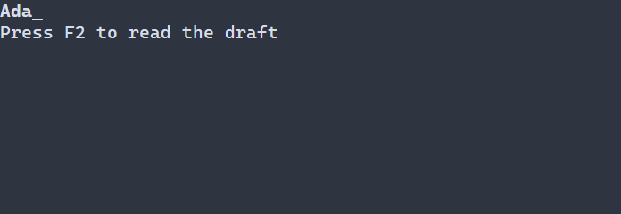</a>
Edit a single line of text.
</article>
  <article class="widget-gallery-card"><h3><a href="button-guide.html">Button</a></h3><a href="button-guide.html" tabindex="-1">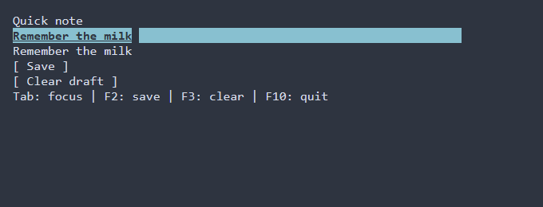</a>
Save and Clear draft buttons in the quick-note form.
</article>
  <article class="widget-gallery-card"><h3><a href="choices.html">ComboBox and DropDown</a></h3><a href="choices.html" tabindex="-1">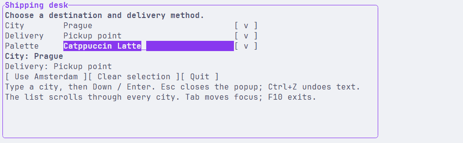</a>
Choose a row from a model.
</article>
  <article class="widget-gallery-card"><h3><a href="radio-group.html">RadioGroup</a></h3><a href="radio-group.html" tabindex="-1">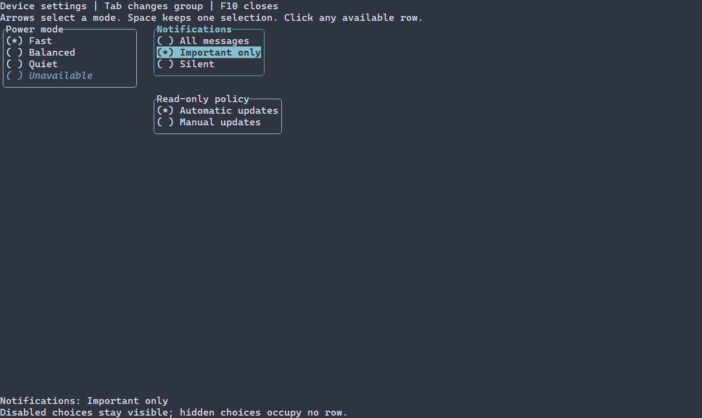</a>
Select one option.
</article>
  <article class="widget-gallery-card"><h3><a href="sliders.html">Sliders</a></h3><a href="sliders.html" tabindex="-1">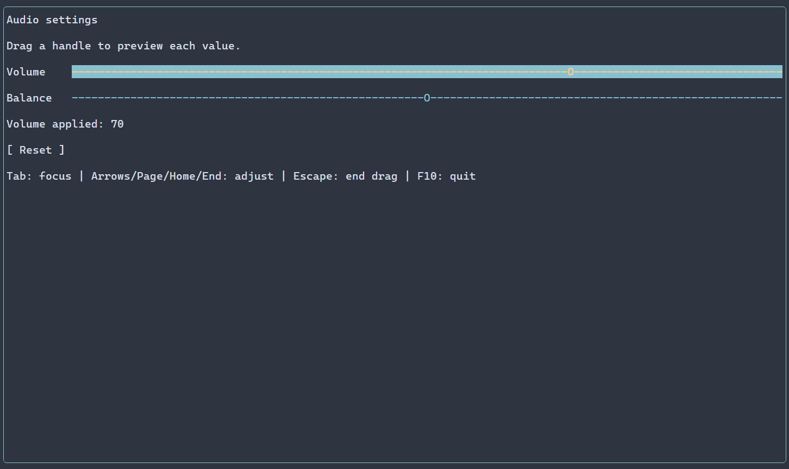</a>
Adjust a bounded numeric value.
</article>
  <article class="widget-gallery-card"><h3><a href="spin-boxes.html">Numeric editors</a></h3><a href="spin-boxes.html" tabindex="-1">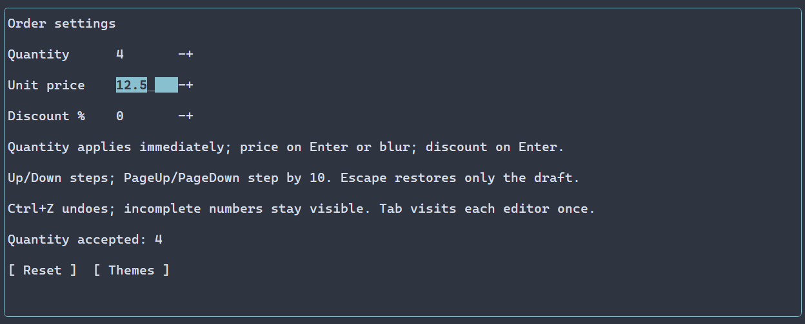</a>
Enter a bounded numeric value.
</article>
  <article class="widget-gallery-card"><h3><a href="switch-guide.html">Switch</a></h3><a href="switch-guide.html" tabindex="-1">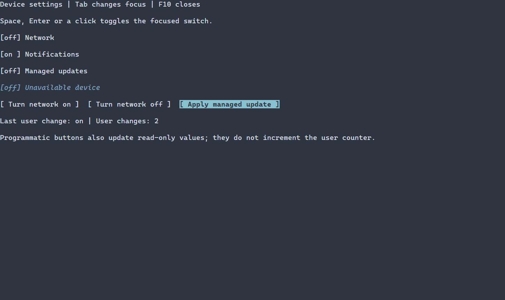</a>
Change a Boolean value.
</article>

\endhtmlonly

## Layout and scrolling

\htmlonly

  <article class="widget-gallery-card"><h3><a href="md_docs_2layout.html">Responsive layout</a></h3><a href="md_docs_2layout.html" tabindex="-1">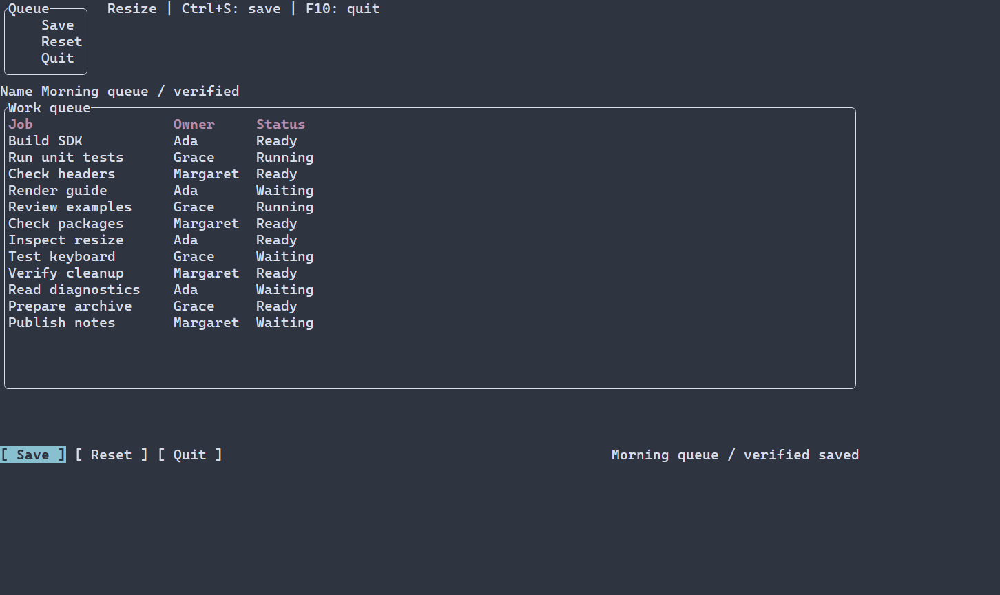</a>
Arrange controls as the available space changes.
</article>
  <article class="widget-gallery-card"><h3><a href="md_docs_2layout.html">Layout spacers</a></h3><a href="md_docs_2layout.html" tabindex="-1">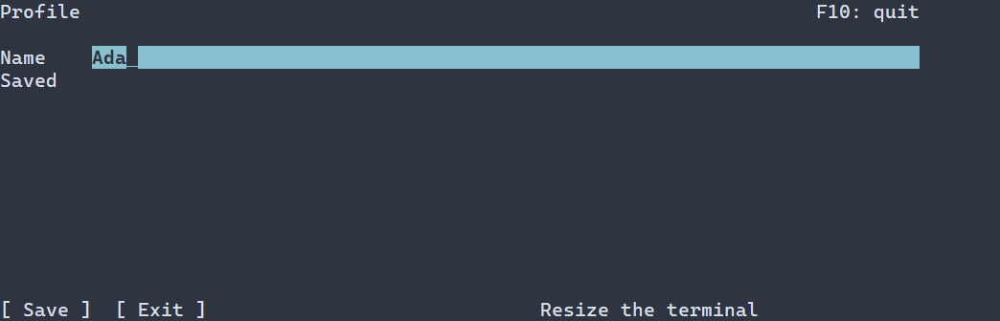</a>
Distribute space between controls.
</article>
  <article class="widget-gallery-card"><h3><a href="border-guide.html">Frames and titles</a></h3><a href="border-guide.html" tabindex="-1">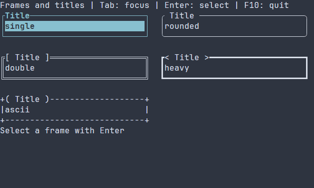</a>
Explore frames and title decorations.
</article>
  <article class="widget-gallery-card"><h3><a href="scroll-controls.html">Scrollbars</a></h3><a href="scroll-controls.html" tabindex="-1">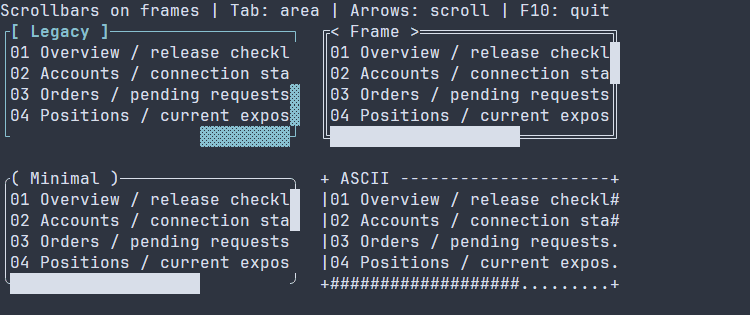</a><a href="scroll-controls.html" tabindex="-1">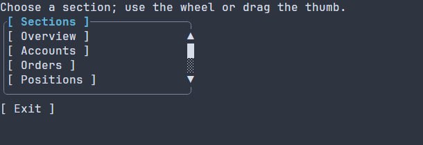</a>
Scroll content with independently configurable track, thumb and arrows.
</article>

\endhtmlonly

## Menus and feedback

\htmlonly

  <article class="widget-gallery-card"><h3><a href="menus.html">Menus and commands</a></h3><a href="menus.html" tabindex="-1">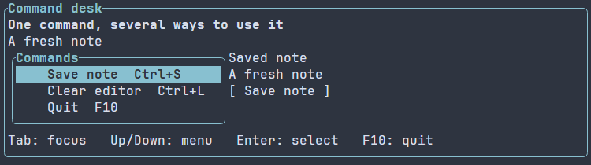</a>
Share actions between menus, buttons and keys.
</article>
  <article class="widget-gallery-card"><h3><a href="menus.html">Popup menus</a></h3><a href="menus.html" tabindex="-1">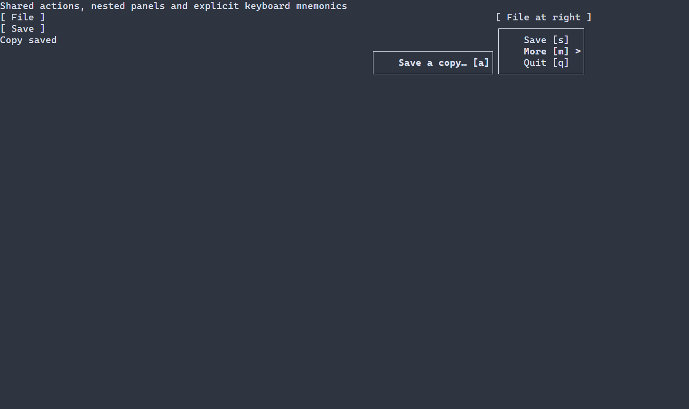</a>
Choose commands from a popup menu.
</article>
  <article class="widget-gallery-card"><h3><a href="status-bar-guide.html">Status bar</a></h3><a href="status-bar-guide.html" tabindex="-1">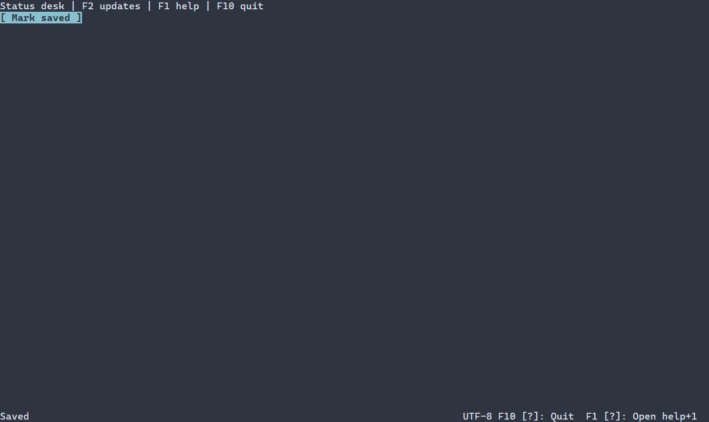</a>
Show status information in sections.
</article>

\endhtmlonly

Scrollbar customization: [complete properties, glyphs and styling priorities](scroll-controls.md#scrollbar-styling-reference).

## More controls and patterns

| Need | Guide |
|---|---|
| Validate a labeled editor | [Form fields](form-fields.md) |
| Search a document | [FindBar](find-bar.md) |
| Show loading, empty and error states | [Data presentation](data-presentation.md) |
| Show a loading indicator | [Loading indicators](loading-indicators.md) |
| Display a large list or table | [Virtual lists](virtual-list.md) · [Virtual tables](virtual-table.md) |
| Display a text log or chart | [LogView](log-view.md) · [Charts](chart.md) |
| Show dialogs or notifications | [Dialogs](dialogs.md) · [Notifications](notifications.md) |

The linked guides include recordings where available and instructions for running the examples.

## More controls: native examples

\htmlonly

  <article class="widget-gallery-card"><h3><a href="check-box-guide.html">CheckBox</a></h3><a href="check-box-guide.html" tabindex="-1">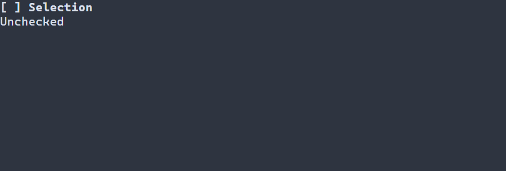</a></article>
  <article class="widget-gallery-card"><h3><a href="label-guide.html">Label</a></h3>
The Unchecked label displays the checkbox state.
</article>
  <article class="widget-gallery-card"><h3><a href="three-state-guide.html">ThreeState</a></h3><a href="three-state-guide.html" tabindex="-1">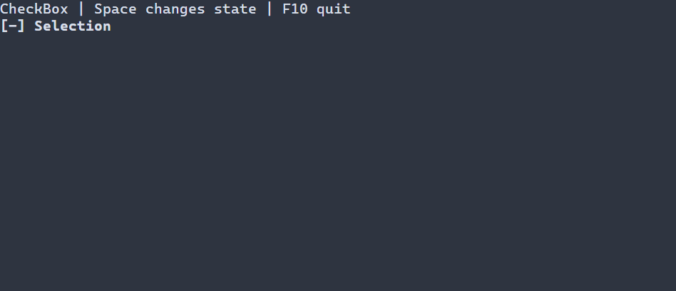</a></article>
  <article class="widget-gallery-card"><h3><a href="password-guide.html">Password</a></h3><a href="password-guide.html" tabindex="-1">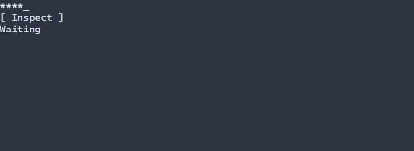</a></article>
  <article class="widget-gallery-card"><h3><a href="form-fields.html">FormField</a></h3><a href="form-fields.html" tabindex="-1">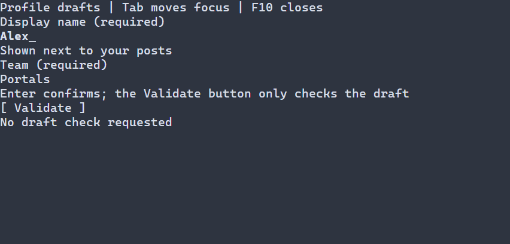</a></article>
  <article class="widget-gallery-card"><h3><a href="find-bar.html">FindBar</a></h3><a href="find-bar.html" tabindex="-1">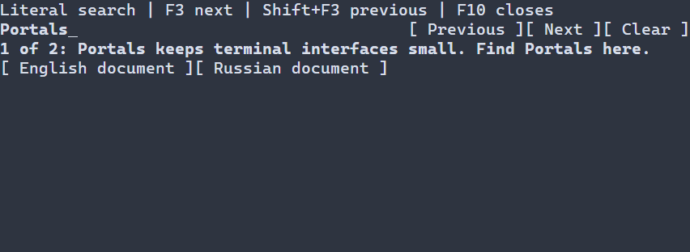</a></article>
  <article class="widget-gallery-card"><h3><a href="md_docs_2virtual-list.html">VirtualList</a></h3><a href="md_docs_2virtual-list.html" tabindex="-1">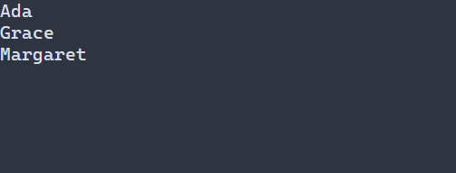</a></article>
  <article class="widget-gallery-card"><h3><a href="md_docs_2virtual-table.html">VirtualTable</a></h3><a href="md_docs_2virtual-table.html" tabindex="-1">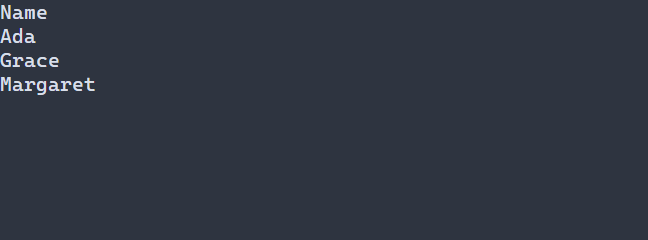</a></article>
  <article class="widget-gallery-card"><h3><a href="md_docs_2chart.html">Chart</a></h3><a href="md_docs_2chart.html" tabindex="-1">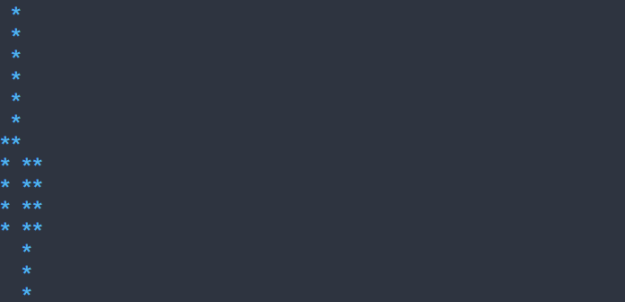</a></article>
  <article class="widget-gallery-card"><h3><a href="log-view.html">LogView</a></h3><a href="log-view.html" tabindex="-1">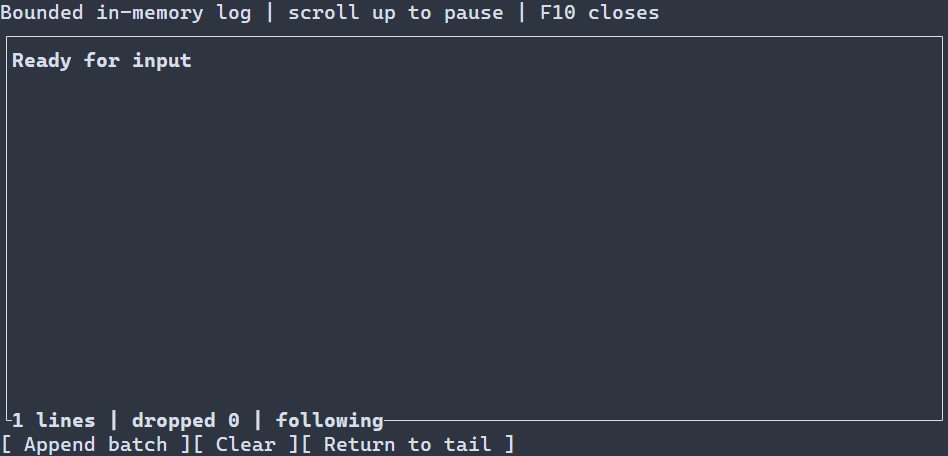</a></article>
  <article class="widget-gallery-card"><h3><a href="gauge-guide.html">Gauge</a></h3><a href="gauge-guide.html" tabindex="-1">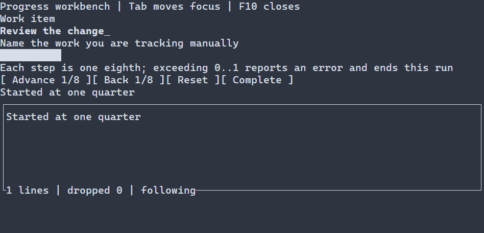</a></article>
  <article class="widget-gallery-card"><h3><a href="md_docs_2grid.html">Grid</a></h3><a href="md_docs_2grid.html" tabindex="-1">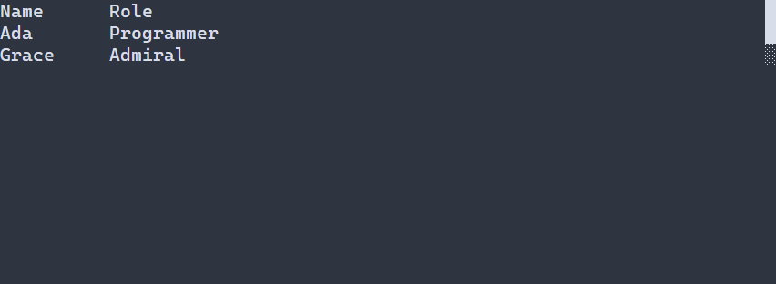</a></article>
  <article class="widget-gallery-card"><h3><a href="dialogs.html">Dialog</a></h3><a href="dialogs.html" tabindex="-1">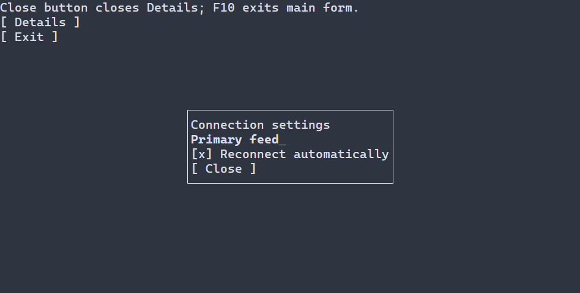</a></article>
  <article class="widget-gallery-card"><h3><a href="notifications.html">Toast</a></h3><a href="notifications.html" tabindex="-1">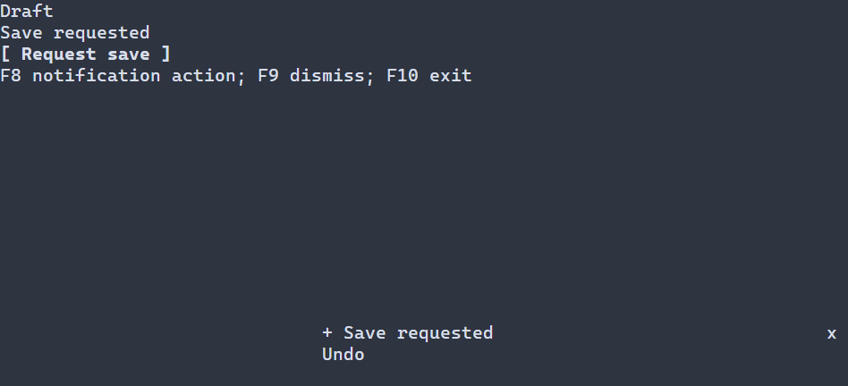</a></article>
  <article class="widget-gallery-card"><h3><a href="loading-indicators.html">Spinner</a></h3><a href="loading-indicators.html" tabindex="-1">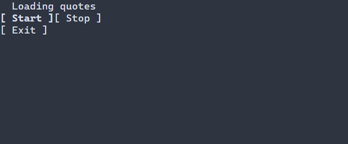</a></article>
  <article class="widget-gallery-card"><h3><a href="key-help.html">KeyHints and HelpView</a></h3><a href="key-help.html" tabindex="-1">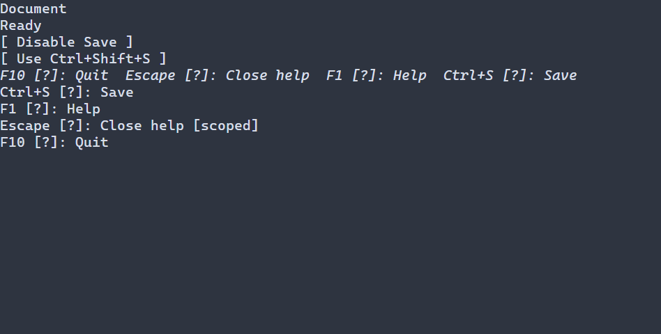</a></article>
  <article class="widget-gallery-card"><h3><a href="theme-selector.html">ThemeSelector</a></h3><a href="theme-selector.html" tabindex="-1">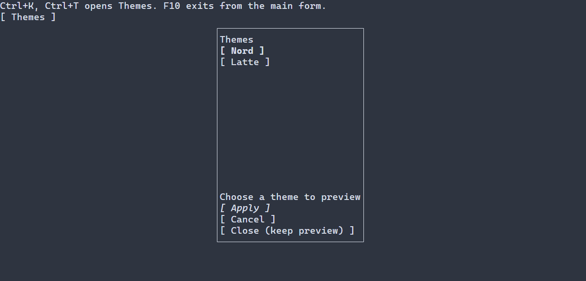</a></article>
  <article class="widget-gallery-card"><h3><a href="data-presentation.html">DataStateView</a></h3><a href="data-presentation.html" tabindex="-1">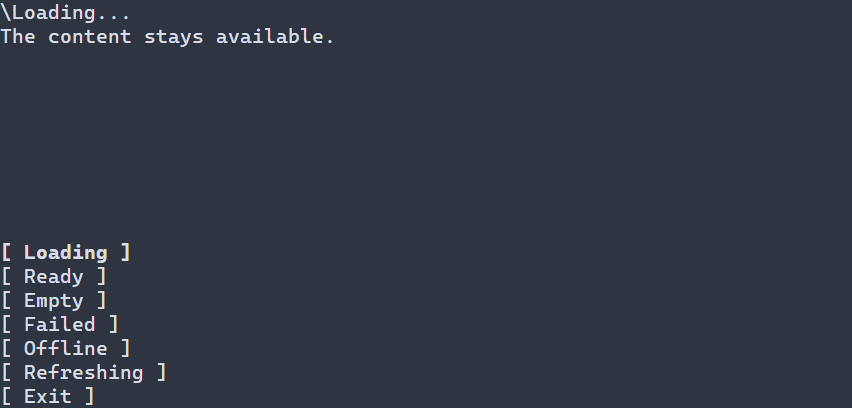</a></article>

\endhtmlonly

## Control styling index {#control-styling-index}

Each group documents its supported parts, values and limits. The common PSS table does not imply automatic style inheritance into children.

| Control | Styling reference |
|---|---|
| Button | [Customize](button.md#button-styling-reference) |
| Label | [Customize](label.md#label-styling-reference) |
| CheckBox | [Customize](check-box.md#check-box-styling-reference) |
| ThreeState | [Customize](three-state.md#three-state-styling-reference) |
| Password | [Customize](password.md#password-styling-reference) |
| StatusBar | [Customize](status-bar.md#status-bar-styling-reference) |
| LineEdit | [Customize](line-edit.md#line-edit-styling-reference) |
| Switch | [Customize](switch.md#switch-styling-reference) |
| RadioGroup | [Customize](radio-group.md#radio-group-styling-reference) |
| Slider | [Customize](sliders.md#sliders-styling-reference) |
| SpinBox | [Customize](spin-boxes.md#spin-boxes-styling-reference) |
| ComboBox / DropDown | [Customize](choices.md#choices-styling-reference) |
| FormField | [Customize](form-fields.md#form-fields-styling-reference) |
| FindBar | [Customize](find-bar.md#find-bar-styling-reference) |
| VirtualList / List | [Customize](virtual-list.md#virtual-list-styling-reference) |
| VirtualTable / Table | [Customize](virtual-table.md#virtual-table-styling-reference) |
| LogView | [Customize](log-view.md#log-view-styling-reference) |
| Chart | [Customize](chart.md#chart-styling-reference) |
| Border | [Customize](border.md#border-styling-reference) |
| Gauge | [Customize](gauge.md#gauge-styling-reference) |
| Row / Column / Spacer / Spacing | [Customize](layout.md#layout-styling-reference) |
| Grid / Overlay | [Customize](grid.md#grid-styling-reference) |
| ScrollArea / ScrollBar | [Customize](scroll-controls.md#scrollbar-styling-reference) |
| DataStateView | [Customize](data-presentation.md#data-presentation-styling-reference) |
| Menu / PopupMenu | [Customize](menus.md#menus-styling-reference) |
| Dialog / MessageBox / OverlayHost | [Customize](dialogs.md#dialogs-styling-reference) |
| Toast | [Customize](notifications.md#notifications-styling-reference) |
| Spinner | [Customize](loading-indicators.md#loading-indicators-styling-reference) |
| KeyHints / HelpView | [Customize](key-help.md#key-help-styling-reference) |
| ThemeSelector | [Customize](theme-selector.md#theme-selector-styling-reference) |
